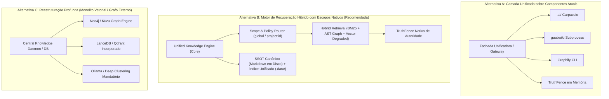
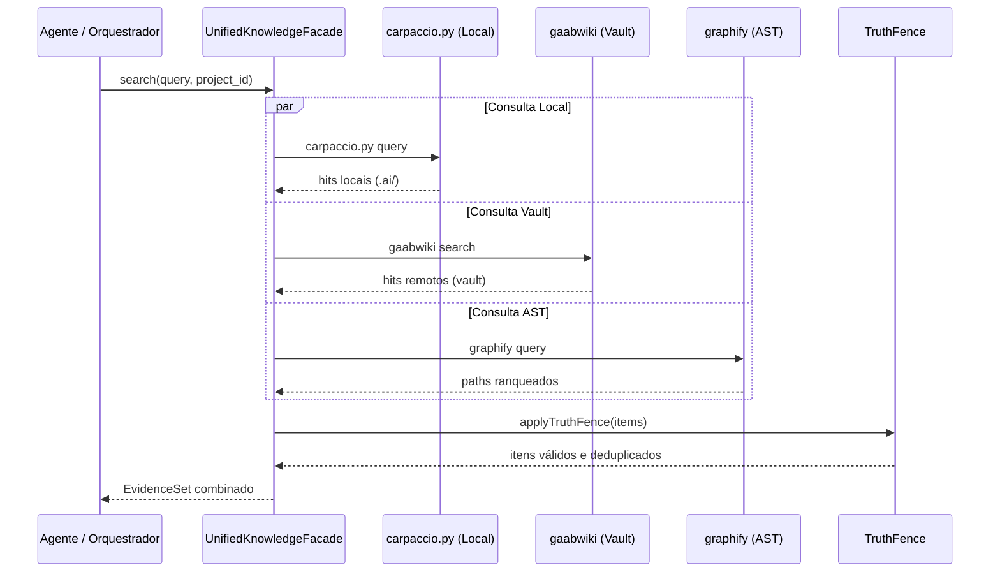
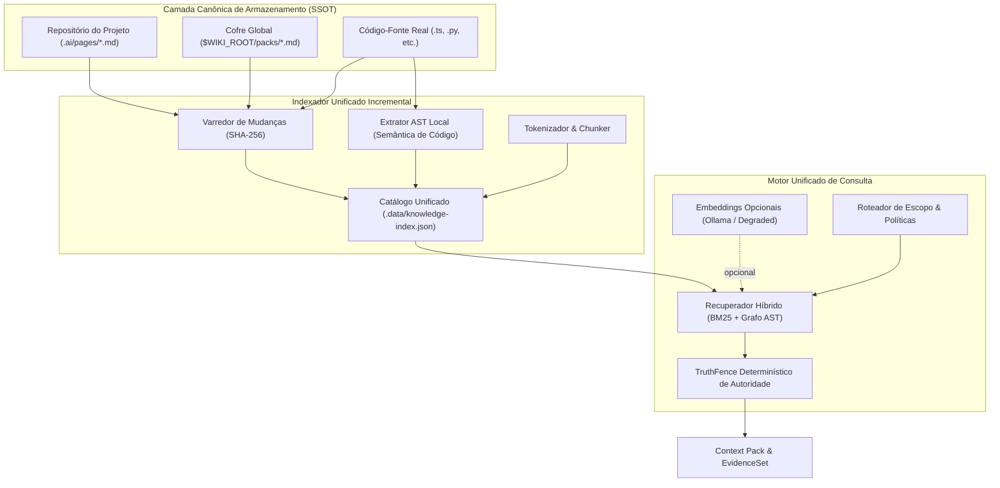
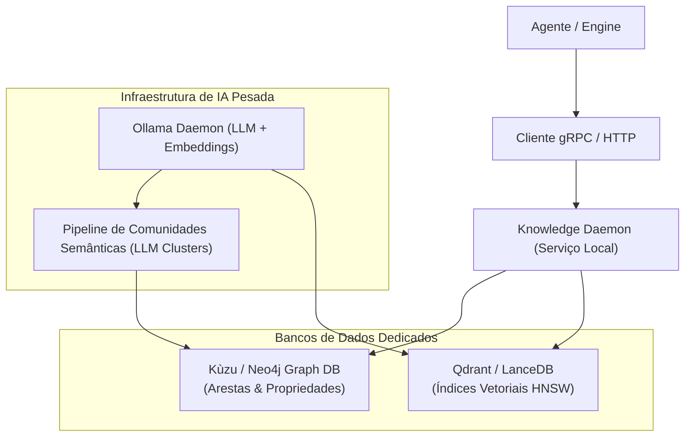

# Comparação de Alternativas Arquiteturais

> **Status:** Análise Comparativa Estruturada (Fase B)  
> **Data:** 2026-10-24  
> **Escopo:** Avaliação aprofundada de três modelos arquiteturais viáveis para o Sistema Unificado de Conhecimento do EvolveLoop, sob 15 dimensões de engenharia e operação.

---

## 1. Visão Geral das Alternativas

Para responder à fragmentação diagnosticada no ecossistema (Fase A) e alcançar o objetivo de permitir que os agentes descubram o contexto correto antes de ler indiscriminadamente arquivos, foram formuladas três alternativas arquiteturais distintas:

- **Alternativa A (Fachada de Integração):** Mantém todos os componentes exatamente onde estão (`.ai/`, `gaabwiki`, `graphify`, `KnowledgeStore`, scripts de sync) e constrói uma camada de abstração TypeScript/CLI para orquestrar as chamadas.
- **Alternativa B (Motor Compartilhado com Escopos Isolados):** Consolida os motores de indexação e busca em um único motor leve, preservando os arquivos Markdown e o código como fontes canônicas (SSOT), unificando os catálogos de hashes e introduzindo suporte nativo de primeira classe a escopos (`global` e `project:<id>`), com retrieval híbrido sob demanda.
- **Alternativa C (Reestruturação Profunda):** Substitui os formatos de arquivos planos por um banco de dados integrado de grafos e vetores (como Neo4j/Kùzu integrado a um vector store dedicado e clusterização semântica obrigatória via LLM local/Ollama).

---

## 2. Detalhamento das Alternativas

### Alternativa A: Camada Unificada sobre Componentes Atuais (Wrapper / Fachada)

#### Arquitetura Conceitual
Esta alternativa adota o padrão *Facade*. Não altera o formato das notas `.ai/`, não modifica a fixture `gaabwiki`, mantém o script `carpaccio.py` e preserva o `GraphifyAdapter`. Em vez disso, introduz um orquestrador de consultas (`UnifiedKnowledgeFacade`) que:
1. Recebe a requisição do agente.
2. Dispara sequencialmente ou em paralelo o `carpaccio.py query`, `gaabwiki search` e `graphify query`.
3. Coleta os três resultados, converte-os em um formato comum e aplica o `applyTruthFence()`.
4. Exige a manutenção de scripts como `sync-carpaccio-to-vault.sh` para manter os dados sincronizados.

#### Prós e Contras
- **Vantagens:** Risco de regressão quase nulo no curto prazo; nenhum arquivo precisa ser migrado; reaproveita 100% do código existente.
- **Desvantagens:** Mantém a latência elevada (múltiplos subprocessos `python`); preserva a redundância de manifestos (`manifest.yaml` e `manifest.json`); não resolve a sincronização manual frágil entre `.ai/` e `$WIKI_ROOT`; mantém o consumo elevado de memória com arquivos voláteis como `graph.json` (7.4 MB).

---

### Alternativa B: Motor de Recuperação Híbrido com Escopos Nativos (Recomendada)

#### Arquitetura Conceitual
Esta alternativa unifica a responsabilidade de indexação, integridade criptográfica e recuperação em um único **Motor Unificado de Conhecimento** (`UnifiedKnowledgeEngine`), operado localmente em linha com os princípios de simplicidade do EvolveLoop:
1. **Fonte Canônica Única:** Todo conhecimento de domínio permanece em arquivos Markdown simples com frontmatter (`.ai/pages/*.md` no repositório do projeto para escopo local; `$WIKI_ROOT/packs/*.md` e `projects/` para escopo global).
2. **Índice Unificado e Incremental:** Um único catálogo binário/JSON leve (`.data/knowledge-index.json`) armazena os chunks, os tokens BM25, as arestas estruturais e os hashes SHA-256 dos arquivos de código fonte. Substitui a duplicação entre Carpaccio e gaabwiki.
3. **Escopos Nativos de Primeira Classe:** Toda entidade indexada possui a tag de escopo obrigatória: `project:<id>` ou `global`. Consultas de projeto por padrão filtram `scope == project:<id>`, impedindo contaminação sem depender de pós-processamento de canários.
4. **Recuperação Híbrida Seletiva:** A busca utiliza BM25 veloz como base determinística; se a consulta exigir relações estruturais de código, consulta o subgrafo AST (absorvendo o papel útil do Graphify sem depender de pacotes instáveis em `/tmp`); se o Ollama estiver ativo, utiliza embeddings para reranqueamento; se indisponível, cai transparentemente para BM25 puro com `degraded: true` (ADR-0005).

#### Prós e Contras
- **Vantagens:** Elimina duplicações de ferramentas; reduz drasticamente o tempo de consulta (<100ms) ao evitar múltiplos subprocessos; resolve a governança entre projetos via particionamento nativo de escopo; mantém o código-fonte e o Markdown como SSOT auditável; estabiliza a análise AST eliminando dependência volátil em `/tmp`.
- **Desvantagens:** Requer consolidar o parser de Markdown e o chunker (atualmente divididos entre `carpaccio.py` e `indexing.py`); exige uma rotina simples de migração reversível de índices existentes.

---

### Alternativa C: Reestruturação Profunda (Monolito Vetorial / Grafo Externo)

#### Arquitetura Conceitual
Esta alternativa descarta a dependência de arquivos Markdown planos e manifestos em disco como base primária de consulta. Introduz uma arquitetura de banco de dados corporativo integrada:
1. Instalação e execução em segundo plano de um banco de dados em grafo transacional (ex.: Kùzu DB embarcado ou Neo4j via contêiner Docker/daemon).
2. Armazenamento obrigatório de vetores em banco especializado (LanceDB/Qdrant).
3. Pipeline de ingestão baseado no modo avançado do Graphify ("Part B" com Gemini/LLM clustering) para agrupar automaticamente nós de código em "comunidades semânticas" e salvar em grafo de propriedades.
4. O orquestrador se comunica via Cypher ou API gRPC/HTTP local com o serviço central de conhecimento.

#### Prós e Contras
- **Vantagens:** Capacidade analítica avançada para consultas de grafo altamente complexas (caminhos de múltiplos saltos com propriedades ricas); busca semântica sofisticada por agrupamentos de tópicos.
- **Desvantagens:** **Incompatível com os princípios fundamentais do EvolveLoop** (viola o princípio local-first leve, a regra de não exigir daemons pesados ou serviços de nuvem e a garantia de portabilidade em CI); consome centenas de megabytes de RAM e CPU constante para manter daemons; torna o conhecimento opaco (não é possível inspecionar ou debugar via `git diff` como em Markdown); quebra a reversibilidade e adiciona múltiplos pontos únicos de falha.

---

## 3. Matriz Comparativa Detalhada (15 Dimensões)

A tabela a seguir confronta as três alternativas segundo critérios rigorosos de engenharia de software e viabilidade operacional:

| Dimensão de Avaliação | Alternativa A (Fachada Atual) | Alternativa B (Motor Compartilhado com Escopos) | Alternativa C (Reestruturação Profunda) |
|---|---|---|---|
| **1. Compatibilidade com Arquitetura Atual** | **Excelente (10/10)** — Não altera formatos nem chamadas existentes. | **Alta (8.5/10)** — Mantém todos os contratos do `KnowledgeBackend`, `EvidenceBus` e `TruthFence`. | **Baixa (2/10)** — Quebra a interface de arquivos e exige novos contratos de dados e daemons. |
| **2. Reutilização de Código Existente** | **Máxima (9.5/10)** — Reutiliza `carpaccio.py`, `gaabwiki`, `graphify-adapter` e stores TS sem mudanças. | **Alta (7.5/10)** — Unifica os algoritmos de tokenização e hashing do `gaabwiki` e `carpaccio.py`; reaproveita `TruthFence` e `ContextBudget`. | **Mínima (2/10)** — Descarta quase todos os módulos em favor de bibliotecas de terceiros. |
| **3. Complexidade de Implementação** | **Baixa** — Apenas criação da classe integradora e scripts de orquestração. | **Média** — Reescrita/consolidação do indexador leve e criação de rotina de resolução de escopos. | **Muito Alta** — Implantação de clientes de grafo, esquema Cypher, reconciliação de transações e daemons. |
| **4. Complexidade Operacional** | **Alta** — Usuário precisa gerenciar múltiplos diretórios, sincronizações manuais e venvs voláteis em `/tmp`. | **Muito Baixa** — Zero dependência de daemons; execução local rápida em um comando; índice autocontido. | **Crítica** — Exige gerenciar portas de rede, serviços em background, integridade de DBs binários e consumo de recursos. |
| **5. Consumo de CPU, RAM e Armazenamento** | **Médio/Alto** — `graph.json` de 7.4 MB em disco; subprocessos frequentes consumindo picos de CPU. | **Mínimo** — Índice binário/JSON unificado e compacto (<1 MB para projetos médios); carregamento seletivo em RAM. | **Alto a Crítico** — Daemons residentes consumindo centenas de MBs de RAM e alta carga de CPU para indexação. |
| **6. Custo e Latência** | **Latência Ruim (~2000ms)** decorrente de 3 subprocessos paralelos; custo financeiro zero. | **Latência Excelente (<100ms)** em busca lexical/grafo direto; custo financeiro zero. | **Latência Variável (200ms a 1500ms)** dependendo do embedding; alto custo computacional local. |
| **7. Potencial de Redução de Tokens** | **Médio** — Permite achar caminhos, mas falta precisão cirúrgica de chunks consolidados. | **Máximo** — Recuperação hierárquica por escopo devolve apenas trechos e nós exatos necessários. | **Médio** — Retornos de clusters semânticos podem ser excessivamente verbosos se mal calibrados. |
| **8. Qualidade e Precisão da Recuperação** | **Média** — Corre o risco de retornar notas duplicadas de `.ai/` e do vault que sofreram drift. | **Muito Alta** — Resolução de escopo + BM25 discriminado + AST de código + TruthFence determinístico. | **Alta** (se embeddings forem perfeitos), porém propensa a alucinações em grafos inferidos por LLMs. |
| **9. Isolamento entre Projetos** | **Frágil** — Depende exclusivamente de filtros de canários (`foreign_canary`) em pós-processamento. | **Absoluto** — Escopo é cidadão de primeira classe na partição do índice (`scope: "project:xyz"` vs `"global"`). | **Variável** — Exige multi-tenancy formal em grafo e partições de namespace no banco de vetores. |
| **10. Atualização e Consistência** | **Fraca** — Sincronização entre local e global exige scripts manuais; sem cascade delete. | **Forte** — Invalidação orientada a eventos ou pre-commit; re-hash atômico dos arquivos modificados. | **Complexa** — Invalidação de nós e arestas de grafo em tempo real é notoriamente difícil de garantir. |
| **11. Proveniência e Auditabilidade** | **Média** — Fontes divididas entre dois manifestos com formatos e convenções diferentes. | **Máxima** — Documentos Markdown em Git (SSOT) + referências rastreáveis `file:line` + SHA-256. | **Opaca** — Dados armazenados em estruturas binárias de banco de dados, difíceis de auditar via Git. |
| **12. Testabilidade** | **Média** — Depende de invocar ferramentas CLI externas reais ou manter mocks complexos de subprocesso. | **Excelente** — Motor modular, funções puras de busca e parsing testáveis unitariamente em milissegundos. | **Difícil** — Exige instâncias em contêiner ou mocks de infraestrutura para executar testes em CI. |
| **13. Riscos de Migração** | **Quase Zero** — Aditivo; não remove arquivos. | **Baixo e Gradual** — Executa em paralelo aos componentes antigos antes de desligá-los (ADR). | **Crítico** — Risco real de paralisação de agentes e corrupção de bases de conhecimento. |
| **14. Dependências Externas** | **Média** — Node.js, Python 3, pacote `graphifyy`, binários em `/tmp`. | **Mínima** — Node.js nativo ou Python 3 stdlib básico; sem dependência de binários voláteis em `/tmp`. | **Máxima** — Motores de banco de dados nativos, compiladores C++, Ollama com modelos específicos baixados. |
| **15. Reversibilidade** | **Imediata** — Basta remover a fachada. | **Alta** — Como o SSOT permanece em Markdown no Git, o rollback para o modelo atual é trivial. | **Muito Baixa** — Dados estruturados em DBs proprietários exigem exportadores e scripts de resgate. |

---

## 4. Análise de Trade-Offs e Justificativa de Decisão

### Por que rejeitar a Alternativa A?
A Alternativa A é tentadora por exigir esforço imediato menor, mas atua como um "remendo cosmético". Ela consolida a dívida técnica da fragmentação: preserva dois scripts em Python que realizam praticamente a mesma coisa (`carpaccio.py` e `indexing.py`), mantém a latência de subprocessos no hot-path de decisões do agente, perpetua a falha de isolamento nativo e continua vulnerável à limpeza acidental de arquivos em `/tmp` pelo sistema operacional.

### Por que rejeitar a Alternativa C?
A Alternativa C introduz uma complexidade desmedida (*over-engineering*). O EvolveLoop é um framework focado em automação ágil, previsível e determinística de código. Impor uma dependência de banco de dados em grafo e um vector store externo transacional viola as premissas de portabilidade estabelecidas no `AGENT.md` ("do not assume author machine paths"), compromete a execução rápida em ambientes de integração contínua (CI) e transforma um sistema que hoje roda com zero infraestrutura em um ecossistema pesado e propenso a quebras operacionais.

### Por que a Alternativa B é a Escolha Recomendada?
A **Alternativa B** é a única que atende simultaneamente aos requisitos de:
1. **Pragmatismo Local-First:** O conhecimento permanece em arquivos Markdown auditáveis e versionáveis via Git. Qualquer desenvolvedor pode inspecionar, editar e corrigir notas sem precisar de ferramentas especializadas de banco de dados.
2. **Governança Estrita de Escopos:** O isolamento entre projetos não depende de instruções textuais nem de filtros reativos de canários; o próprio índice é particionado por `project:<id>` e `global`.
3. **Eficiência e Latência:** Ao consolidar a busca em uma rotina leve e direta, elimina o overhead de múltiplos subprocessos, permitindo que o grounding seja executado em dezenas de milissegundos.
4. **Resiliência e Degradação Graciosa:** Preserva a diretriz do ADR-0005: a base lexical determinística garante funcionamento perfeito mesmo sem rede, sem Ollama e sem GPUs, enquanto o grafo sintático (AST) e os embeddings atuam como aceleradores opcionais de relevância.

---

## 5. Conclusão da Fase B

A **Alternativa B (Motor Compartilhado com Escopos Isolados)** é a alternativa formalmente recomendada para a concepção da proposta arquitetural na Fase C. Ela equilibra a máxima reutilização de código e princípios validados do EvolveLoop com a resolução definitiva dos pontos de falha e fragmentação identificados na auditoria.
