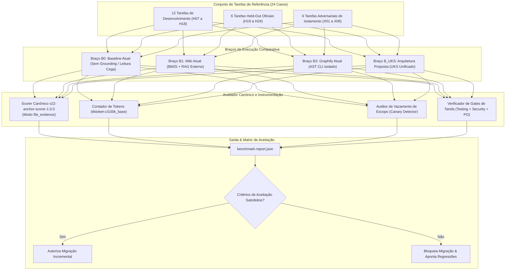

# Plano de Avaliação e Benchmark do Sistema de Conhecimento

> **Status:** Metodologia de Benchmark e Critérios de Aceitação (Fase E)  
> **Data:** 2026-10-24  
> **Escopo:** Conjunto de tarefas de referência, linha de base atual (B0, B1, B3), métricas de avaliação, harness automatizado e critérios de aceitação para homologação da nova arquitetura.

---

## 1. Princípios e Metodologia do Benchmark

Nenhuma migração ou substituição de componentes de conhecimento será autorizada no EvolveLoop sem comprovação empírica prévia em suíte de benchmark padronizada. O objetivo do plano de avaliação é responder com rigor científico:

1. **A arquitetura proposta encontra os arquivos e contratos certos com igual ou maior precisão que os mecanismos atuais?**
2. **Há redução real e mensurável de tokens de entrada e chamadas desnecessárias de leitura de arquivos?**
3. **O isolamento de escopo é absoluto (zero vazamento de conhecimento entre projetos)?**
4. **O tempo de recuperação (latência) permanece dentro de limites toleráveis para a experiência do desenvolvedor?**

### Arquitetura do Harness de Avaliação

O benchmark utiliza o arcabouço canônico do EvolveLoop, herdando e expandindo o harness já testado em `experiments/V22-BENCH/`:

---

## 2. Linha de Base Atual (Baseline)

Os dados a seguir representam a linha de base empírica extraída das baterias oficiais do EvolveLoop V2.2 (ADR-0014, `v22-p0-baseline-report.json` e `raw/battery-b3-graphify/b3-summary.json`):

### 2.1. Desempenho Medido nos Braços Existentes

| Métrica Avaliada | Braço B0 (Baseline Sem Grounding) | Braço B1 (Wiki Atual) | Braço B3 (Graphify Atual) | Status da Métrica |
|---|---|---|---|---|
| **Recall Perfeito (Dev H07–H18)** | 7 de 12 (58%) | **9 de 12 (75%)** | **9 de 12 (75%)** | `VERIFIED_BY_TEST` (ADR-0014) |
| **Recall Perfeito (Teste H19–H24)** | 4 de 6 (66%) | 5 de 6 (83%) | **6 de 6 (100%)** | `VERIFIED_BY_TEST` (ADR-0014) |
| **Mediana de Caminhos Retornados (Dev)** | 18,5 caminhos | 8,5 caminhos | 9,0 caminhos | `VERIFIED_BY_TEST` (ADR-0014) |
| **Mediana de Tokens de Entrada (Dev)** | 21.284 tokens | 20.463 tokens | 20.522 tokens | `VERIFIED_BY_TEST` (ADR-0014) |
| **Mediana de Tokens de Entrada (Teste)** | 20.099 tokens | 21.531 tokens | 20.699 tokens | `VERIFIED_BY_TEST` (ADR-0014) |
| **Mediana de Latência de Retrieval** | **76 ms** (Grep direto) | 1.639 ms (Subprocesso) | 750 ms (CLI AST) | `VERIFIED_BY_TEST` (ADR-0014) |
| **Tokens de Saída Gerados (Output)** | `NOT_MEASURED` | `NOT_MEASURED` | `NOT_MEASURED` | Não instrumentado |
| **Taxa de Cache de Contexto** | `NOT_MEASURED` | `NOT_MEASURED` | `NOT_MEASURED` | Depende do host Cursor |
| **Vazamento Cruzado de Canários** | Alto (sem isolamento) | Médio (filtrado no final) | Baixo (restrito ao repo) | Observado em testes de isolamento |

---

## 3. Conjunto de Tarefas de Referência (Benchmark Dataset)

O benchmark utilizará **24 tarefas representativas** divididas em quatro categorias funcionais:

1. **Tarefas de Ponto de Entrada e Configuração (T01–T06):** Localizar regras de inicialização, perfis e resolução de backends (ex.: "onde o `WikiKnowledgeBackend` resolve caminhos e variáveis de ambiente?").
2. **Tarefas de Dependência Sintática e Refatoração (T07–T12):** Mapear chamadas de métodos, transições de estado no motor e herança de interfaces (ex.: "quais arquivos chamam `applyContextBudget` e como tratam fatias protegidas?").
3. **Tarefas de Contratos de Qualidade e Gates (T13–T18):** Identificar requisitos de validação, critérios de aceite e geração de evidências físicas (ex.: "quais arquivos definem as pré-condições do portão de testes?").
4. **Tarefas Adversariais de Isolamento de Escopo (T19–T24):** Injetar termos ambíguos existentes tanto no projeto atual quanto em repositórios vizinhos do cofre global (ex.: "qual é o schema do evento `NodeFailed` no KernelBot vs. no EvolveLoop?"). O sistema deve retornar apenas o schema do projeto ativo.

---

## 4. Métricas e Fórmulas de Avaliação

Cada corrida será avaliada pelas seguintes métricas determinísticas:

### 4.1. Qualidade da Recuperação
- **Recall@k por Arquivo:** Percentual de arquivos âncora canônicos (gabarito) presentes no conjunto de $k$ resultados retornados:
  $$\text{Recall@}k = \frac{|\text{Retornados}_k \cap \text{Âncoras}|}{|\text{Âncoras}|}$$
- **Precisão@k:** Proporção de arquivos retornados que são efetivamente pertinentes:
  $$\text{Precisão@}k = \frac{|\text{Retornados}_k \cap \text{Âncoras}|}{k}$$
- **Fidelidade de Citação:** Verificação se o trecho retornado corresponde exatamente ao conteúdo do código fonte no número de linha indicado.

### 4.2. Eficiência de Tokens e Operações
- **Tokens de Entrada do Prompt (`input_tokens`):** Contagem canônica via `tiktoken:cl100k_base` do pacote de contexto injetado no modelo.
- **Contagem de Ferramentas de Arquivo (`file_ops_count`):** Soma das execuções de `read_file`, `search_files` e `find_by_name` durante a resolução da tarefa.
- **Latência de Recuperação (`retrieval_ms`):** Duração temporal decorrida entre a submissão da consulta e a devolução do Context Pack pronto.

### 4.3. Segurança e Isolamento
- **Taxa de Vazamento Cruzado (`cross_scope_leak_rate`):** Proporção de trechos retornados originados de projetos que não o projeto ativo:
  $$\text{LeakRate} = \frac{|\text{Trechos de outros projetos}|}{|\text{Total de trechos retornados}|}$$
  *Meta absoluta: 0.00% (Zero tolerância).*
- **Taxa de Resultados Obsoletos (`stale_hit_rate`):** Proporção de notas retornadas cujo código de suporte sofreu alteração não refletida no texto da nota:
  $$\text{StaleRate} = \frac{|\text{Trechos com source\_hash\_mismatch}|}{|\text{Total de trechos retornados}|}$$

---

## 5. Critérios Rígidos de Aceitação (Go / No-Go)

A aprovação da nova arquitetura unificada exige o cumprimento simultâneo de **todos os 6 critérios de aceitação**:

| Código | Dimensão | Critério Mínimo de Aceitação | Condição de Bloqueio (No-Go) |
|---|---|---|---|
| **AC-01** | **Recall em Teste** | Recall perfeito ($\text{Recall}=1.0$) em **no mínimo 5 de 6 tarefas held-out** (igualando ou superando B1). | Se $\text{Recall}=1.0$ for obtido em menos de 5 tarefas. |
| **AC-02** | **Isolamento de Escopo** | **Zero vazamento** ($\text{LeakRate} = 0.0\%$) nas tarefas adversariais T19–T24. | Se qualquer trecho de projeto estrangeiro for entregue no Context Pack. |
| **AC-03** | **Tokens de Entrada** | Redução de no mínimo **10% na mediana de tokens de entrada** frente ao B0 e sem exceder o orçamento canônico de 22.000 tokens. | Se a mediana de tokens for superior à do B0 no mesmo conjunto de tarefas. |
| **AC-04** | **Detecção de Staleness** | 100% de detecção de desvios de hash com marcação `stale: true` em arquivos intencionalmente modificados. | Se uma nota obsoleta for entregue com autoridade Tier 1 ou 2 sem aviso de stale. |
| **AC-05** | **Latência de Recuperação** | Mediana de latência do retrieval inferior a **250 ms** (superando com folga os 1.639 ms do B1 e os 750 ms do B3). | Se a latência média ultrapassar 500 ms em consultas padrão. |
| **AC-06** | **Qualidade da Conclusão** | 100% de aprovação na suíte de testes unitários e de integração (`npm test`) sem regressões funcionais. | Qualquer falha em testes de regressão do orquestrador. |

> [!WARNING]
> **Proibição de Degradação Compensatória:** Um resultado que reduza tokens de entrada descartando trechos críticos e que resulte em falhas nos testes do projeto será sumariamente reprovado. A eficiência só é válida se a correção da tarefa for preservada.

---

## 6. Procedimento de Execução do Benchmark

O benchmark será executado inteiramente em ambiente local e sem custos de API:
1. **Isolamento do Ambiente:** Execução na branch de validação em máquina limpa.
2. **Execução de Baterias Automatizadas:** Execução dos scripts de harness (`run-knowledge-bench.sh`).
3. **Persistência de Resultados Brutos:** Gravação de todos os payloads e tempos em `memory/benchmark-results/`.
4. **Auditoria Comparativa:** Geração de tabela comparativa automática contra os dados de B0, B1 e B3.
5. **Revisão Humana:** Submissão do relatório final para aprovação técnica antes de qualquer avanço na migração.
