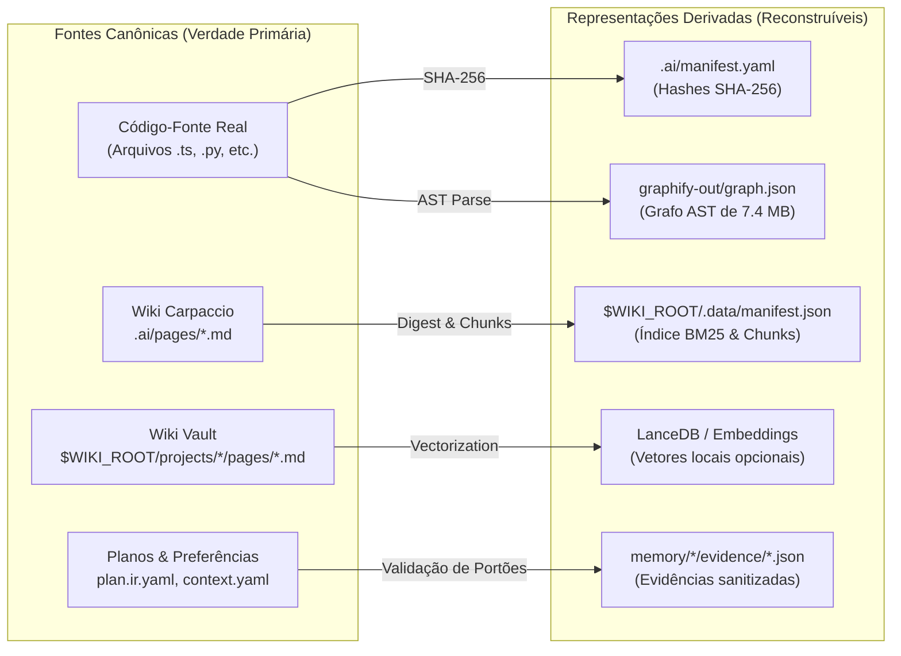

# Diagnóstico Arquitetural do Ecossistema Atual de Conhecimento

> **Status:** Diagnóstico Factual e de Engenharia Reversa  
> **Data:** 2026-10-24  
> **Escopo:** Mapeamento integral dos 16 componentes, fontes de dados, fluxos de ingestão/recuperação/invalidação, interfaces de agentes, acoplamentos e limitações observadas no checkout atual do EvolveLoop.

---

## 1. Introdução e Contexto

O ecossistema EvolveLoop evoluiu através de sucessivas iterações arquiteturais (MegaBrain, EvolveLoop V2, V2.2, V2.3 e preparações para V3). Cada ciclo introduziu mecanismos especializados para resolver dores operacionais concretas: persistência de decisões locais, busca por documentação externa, aceleração de navegação em AST de código, orçamentação de contexto para LLMs e prevenção de regressões por meio de hard-gates.

Essa evolução incremental resultou em um ambiente funcional e altamente resiliente (comprovado pela suíte de testes de integração e benchmarks V2.2), porém **estruturalmente fragmentado**. O conhecimento está distribuído em múltiplos formatos (Markdown com frontmatter, manifestos YAML, catálogos JSON, stores em memória TypeScript, processos Python externos e vetores opcionais), com fronteiras nem sempre coesas entre o conhecimento do repositório local e o cofre compartilhado.

Este diagnóstico reconstrói a arquitetura real implementada, fundamentando cada afirmação em arquivos, símbolos, testes e comportamentos observados.

---

## 2. Inventário e Taxonomia dos Componentes de Conhecimento

A inspeção do checkout identificou **16 mecanismos e subsistemas** que participam diretamente ou indiretamente do ciclo de armazenamento, recuperação, derivação ou governança de conhecimento e memória:

```mermaid
flowchart TD
    subgraph OrquestradorTS["Núcleo Orquestrador (TypeScript / Node.js)"]
        KB["M01: KnowledgeBackend / WikiKnowledgeBackend"]
        TF["M02: ProjectKnowledgeRuntime & TruthFence"]
        KS["M03: KnowledgeStore (FilesystemKnowledgeStore)"]
        MS["M04: MemoryStore (FilesystemMemoryStore)"]
        EB["M05: EvidenceBus & Persistência de Gates"]
        CB["M06: WorkingContext & ContextBudget"]
        GA["M07: GraphifyAdapter (AST Code Graph)"]
        PA["M12: PatternAggregator (Aprendizado de Falhas)"]
        ES["M13: EvolveLoopStore / SignalStore"]
        GS["M14: GraphStore (DAG de Tarefas - Execução)"]
    end

    subgraph ScriptsPython["Motores e Scripts de Conhecimento (Python)"]
        Carpaccio["M08: Wiki Carpaccio (.ai/ & carpaccio.py)"]
        Vault["M09: Wiki Vault & gaabwiki (BM25 / LanceDB)"]
        MemPy["M11: wiki-mem (mem.py & hooks Cursor)"]
    end

    subgraph SkillsCursor["Camada de Agente & Governança (Skills Cursor)"]
        SkillWiki["M10: Skill wiki (Context Engineer)"]
        SkillCarpaccio["Skill wiki-carpaccio"]
        SkillGraphify["Skill graphify (Hard-Gate CLI)"]
    end

    subgraph ExternosWorkspace["Infraestrutura de Suporte & Workspace"]
        MCPMem["M15: MCP Memory Server (server-memory)"]
        RootMem["M16: Diretório Raiz memory/"]
        OllamaLocal["Ollama (LLM/Embeddings Local - Opcional)"]
    end

    KB -->|subprocesso spawn| Vault
    Vault -.->|opcional embeddings| OllamaLocal
    KB --> TF
    TF -->|sanitiza hits| KB
    SkillWiki -->|ground.sh| Vault
    SkillWiki -->|grava evidência| EB
    Carpaccio -->|sync script| Vault
    GA -->|executa binário venv| SkillGraphify
    CB -->|consome evidências| EB
```



### Detalhamento dos Componentes

| ID | Componente | Arquivos Principais | Responsabilidade Real | Consumidores |
|---|---|---|---|---|
| **M01** | `KnowledgeBackend` / `WikiKnowledgeBackend` | `orchestrator/src/knowledge/backend/wiki-backend.ts`<br/>`types.ts`, `resolve.ts` | Interface TypeScript para consulta a RAG externo. Dispara subprocesso Python `gaabwiki search <query>`, higieniza segredos via `redactSecrets`, classifica erros em códigos estruturados (`WIKI_TIMEOUT`, `RAG_REPO_MISSING`). | `DeterministicProvider` (`knowledge.search`, `knowledge.inspect`) |
| **M02** | `ProjectKnowledgeRuntime` & `TruthFence` | `orchestrator/src/knowledge/truth-source/runtime.ts`<br/>`fence.ts`, `isolation.ts`, `provenance.ts` | Guardião determinístico de autoridade de conhecimento. Aplica hierarquia estrita (`code (0) > ai (1) > vault (2) > inferred (3)`), descarta itens sem `source_ref`, expurga páginas `.ai/` com `status: obsoleto` e bloqueia canários de projetos estrangeiros. | Envolve todas as buscas do provedor determinístico de conhecimento |
| **M03** | `KnowledgeStore` & `FilesystemKnowledgeStore` | `orchestrator/src/knowledge/knowledge-store.ts`<br/>`filesystem-knowledge-store.ts` | Store local de entidades tipadas (`pattern`, `pitfall`, `decision`, `lesson`, `contract`). Permite busca por substring e tags. Persiste notas Markdown individuais com YAML frontmatter e gera `index.yaml`. | `ExecutionEngine`, `Scheduler` (Ativo em código, diretório `knowledge/` vazio no repositório) |
| **M04** | `MemoryStore` & `FilesystemMemoryStore` | `orchestrator/src/memory/memory-store.ts`<br/>`filesystem-memory-store.ts` | Store de memória contextual por feature (`featureId`). Mantém separação entre preferências (`preferences.yaml`) e decisões técnicas (`decisions.yaml`). Protegido contra path traversal. | `ExecutionEngine` (`run.contextual_learnings`) |
| **M05** | `EvidenceBus` & Persistência de Gates | `orchestrator/src/evidence/evidence-bus.ts`<br/>`builders.ts`, `publish-sanitize.ts` | Barramento que persiste e higieniza evidências físicas de validação em `memory/<feature_id>/evidence/` (ex: `grounding.json`, `gate.testing.json`). Gates bloqueiam avanço sem arquivos físicos no disco. | Skill `orquestrar`, `/evolve`, `ExecutionEngine` |
| **M06** | `WorkingContext` & `ContextBudget` | `orchestrator/src/context/budget.ts`<br/>`retrieval-ranking.ts`, `tokenizer.ts` | Montador efêmero de fatias de contexto para prompts LLM. Aplica limites de tokens (tokenizer `tiktoken:cl100k_base`), deduplica caminhos e protege fatias críticas (`acceptance_criteria`, `security_restriction`, `evidence`) contra truncamento destrutivo. | `spawn-pickup-context.ts`, CLI `apply-context-budget` |
| **M07** | `GraphifyAdapter` & Skill `graphify` | `orchestrator/src/v22/graphify-adapter.ts`<br/>`.cursor/skills/graphify/SKILL.md` | Grafo estático de dependências de código baseado em AST gerado via CLI PyPI `graphifyy`. Constrói `graphify-out/graph.json` (7.4 MB) e roda consultas ranqueadas por paths sem LLM. | Hard-gate em `orquestrar`, flag experimental `EVOLVELOOP_GRAPHIFY` |
| **M08** | Wiki Carpaccio (`.ai/` & `carpaccio.py`) | `.cursor/skills/wiki-carpaccio/scripts/carpaccio.py`<br/>`.ai/manifest.yaml`, `.ai/pages/*.md` | Documentação local por repositório com rastreamento criptográfico de integridade. Mapeia páginas Markdown aos arquivos de código via SHA-256. `carpaccio.py lint` detecta desvios de código e rebaixa páginas para `status: obsoleto`. | Agentes no ciclo `/evolve`, scripts de sync |
| **M09** | Wiki Vault & `gaabwiki` | `fixtures/evolveloop-wiki-vault/gaabwiki/`<br/>`cli.py`, `indexing.py`, `manifest.py` | Motor de busca léxica (BM25) e semântica sobre cofre Markdown (`projects/`, `packs/`). Chunking estruturado, cálculo de SHA-256 e detecção de staleness em tempo de consulta (`stale_reason: source_hash_mismatch`). | `WikiKnowledgeBackend`, skill `wiki` (`ground.sh`) |
| **M10** | Skill `wiki` (Context Engineer) | `.cursor/skills/wiki/SKILL.md`<br/>`scripts/ground.sh`, `format_hits.py` | Portão procedural de grounding pré-implementação. Proíbe edição de código sem consulta ao cofre e geração obrigatória de Context Pack estruturado (Fontes, Contratos, GAPs, Método, Handoff). | Hard-gate `/evolve`, comando `/wiki` |
| **M11** | Skill `wiki-mem` & Hooks de Sessão | `.cursor/skills/wiki-mem/SKILL.md`<br/>`.cursor/hooks/wiki-mem/mem.py` | Memória episódica de chats Cursor via hooks (`session-start`, `after-edit`, `session-end`). Grava histórico em `$WIKI_ROOT/.ai/sessions/` e enfileira edições em `promote-queue.md`. | Comando `/mem`, papel de Librarian (Desativado por padrão no perfil default) |
| **M12** | `PatternAggregator` | `orchestrator/src/learning/pattern-aggregator.ts` | Sistema de aprendizado operacional que agrupa falhas de execução (`capability:provider_id:reason`) e calcula penalidade numérica (0.0 a 0.3) aplicada pelo escalonador a provedores instáveis. | `ExecutionEngine`, `Scheduler` |
| **M13** | `EvolveLoopStore` & `SignalStore` | `orchestrator/src/evolveloop/store.ts`<br/>`orchestrator/src/evolveloop/persistence/` | Persistência de sinais de necessidade do framework (`NeedSignal`) e auto-evolução em `evolutionDir/snapshot.json`. Desacoplado da semântica de projeto. | Controladores longitudinais do engine |
| **M14** | `GraphStore` (DAG de Execução) | `orchestrator/src/graph/graph-store.ts` | Gerencia exclusivamente o DAG de tarefas do IR (`CapabilityIR`). **Não é um knowledge graph** de entidades nem armazena semântica de domínio. | `ExecutionEngine`, `Scheduler` |
| **M15** | MCP Memory (`server-memory`) | `mcp/mcp.json` | Servidor MCP externo para grafo de nós e relações em JSON monolítico no host. **Descartado formalmente pelo core** por misturar dados de múltiplos repositórios sem isolamento. | Host Cursor (se habilitado pelo usuário), ignorado pelo EvolveLoop |
| **M16** | Diretório Raiz `memory/` | `/home/gaab/Downloads/EvolveLoop/memory/` | Espaço físico de trabalho local (`.gitignore`). Armazena planos de execução (`plan.ir.yaml`), evidências de gates (`memory/<feature_id>/evidence/`) e logs de benchmarks. | Execução de comandos, benchmarks, testes de integração |

---

## 3. Fontes de Dados Canônicas vs. Representações Derivadas

Uma das causas raízes da fragmentação do conhecimento reside na indefinição de limites estritos entre o que constitui **Fonte Canônica Única de Verdade (SSOT)** e o que é **Índice Derivado Descartável**:



### Análise das Fontes:
1. **Código-Fonte (Tier 0 de Autoridade):** É a verdade material absoluta. Qualquer documentação que contradiga o código é, por definição do `TruthFence`, considerada inconsistente ou obsoleta (`codeOverridesWiki`).
2. **Wiki Carpaccio `.ai/` (Tier 1 de Autoridade):** Documentação mantida diretamente no repositório de trabalho. Cada página declara explicitamente quais arquivos de código documenta (`source_paths`). Sua validade está criptograficamente atrelada ao SHA-256 desses arquivos.
3. **Wiki Vault Canônica `$WIKI_ROOT` (Tier 2 de Autoridade):** Repositório de notas Markdown externo ao código. Abriga conhecimento cross-project (`packs/`) e silos de projetos (`projects/`). Atua como cofre de longo prazo.
4. **Índices Derivados (Descartáveis):**
   - `.ai/manifest.yaml`: Pode ser completamente reconstruído a partir da leitura dos arquivos em `source_paths`.
   - `.data/manifest.json`: Pode ser completamente reconstruído executando `gaabwiki rebuild`.
   - `graphify-out/graph.json`: Pode ser inteiramente reconstruído a partir do parse AST local do repositório (`graphify update . --no-cluster`).
   - Tabelas LanceDB / vetores Ollama: Derivados dos chunks do cofre; se corrompidos ou apagados, o sistema opera em modo degradado BM25 (ADR-0005).

---

## 4. Fluxos de Dados e Controle

### 4.1. Fluxo de Ingestão e Indexação
- **No Carpaccio:** O autor redige notas Markdown. O script `carpaccio.py update --all` inspeciona os arquivos declarados em `source_paths`, gera seus hashes SHA-256 e atualiza `.ai/manifest.yaml`.
- **No Vault:** O script `sync-carpaccio-to-vault.sh` copia manualmente as notas de `.ai/pages/` para o diretório do cofre. Em seguida, o comando `gaabwiki rebuild --incremental` particiona os arquivos em blocos estruturados, calcula o digest do chunk (`rel_path#digest`), consulta o monorepo para registrar o hash do código fonte associado e persiste o catálogo em `.data/manifest.json`.
- **No Graphify:** Executa-se `graphify update . --no-cluster`. A AST do código-fonte é extraída, gerando nós e arestas de dependência em `graphify-out/graph.json`. O modo `--no-cluster` impede que o Graphify faça chamadas a LLMs externos para enriquecimento semântico.

### 4.2. Fluxo de Consulta e Recuperação
1. **Agente via Cursor (`ground.sh`):** O agente dispara `bash ground.sh search "<query>"`. O script chama o módulo Python `gaabwiki`. O motor realiza correspondência lexical BM25 e calcula a sobreposição de termos.
2. **Checagem de Frescor em Runtime:** Para cada resultado retornado, o `gaabwiki` lê o arquivo de código original no monorepo e calcula seu hash ao vivo. Se houver divergência em relação ao hash indexado, retorna `stale: true` e `stale_reason: "source_hash_mismatch"`.
3. **Orquestrador via Engine (`knowledge.search`):** O provedor determinístico invoca o `WikiKnowledgeBackend`, que executa o CLI `python -m gaabwiki search <query>`. A saída JSON é capturada, higienizada (`redactSecrets`) e submetida à função `applyTruthFence()`.
4. **Aplicação do TruthFence:** Descarta itens sem rastreabilidade de código, filtra referências de projetos estrangeiros e elimina notas com `status: obsoleto`. O resultado final é entregue como um `EvidenceSet`.

### 4.3. Fluxo de Atualização e Invalidação
- **Divergência de Código:** Quando um desenvolvedor modifica um arquivo `.ts` ou `.py`, o arquivo de documentação `.ai/pages/*.md` correspondente **não é modificado no commit**.
- **Detecção:** A invalidação ocorre de forma diferida quando `carpaccio.py lint` é executado: o script detecta o desvio de SHA-256 e edita o frontmatter da página, alterando `status: atual` para `status: obsoleto`.
- **Exclusão de Arquivo:** Se um arquivo for deletado do código, `carpaccio.py lint` detecta `not fp.is_file()` e marca a página como obsoleta. No vault, `source_hash()` retorna `None`.

### 4.4. Fluxo de Exclusão (Inexistência de Cascade Delete)
- Se uma página `.md` for fisicamente apagada de `.ai/pages/`, o arquivo `.ai/manifest.yaml` mantém a entrada antiga até um novo `update`.
- O cofre da Wiki **não remove chunks órfãos** em execuções incrementais normais. A única forma documentada de expurgar conteúdo órfão no cofre é a destruição da pasta alvo com recópia integral via `sync-carpaccio-to-vault.sh` e posterior `rebuild` completo.

---

## 5. Relações e Acoplamentos entre Componentes

```mermaid
graph TD
    subgraph AcoplamentosCríticos["Acoplamentos Críticos Identificados"]
        subgraph Subprocesso["Ponte Subprocesso CLI"]
            TSBackend["WikiKnowledgeBackend (TS)"] -->|child_process.spawn| PyCLI["gaabwiki (Python)"]
            PyCLI -->|exige módulo instalado| PyEnv["Ambiente Python do Host / Venv"]
        end

        subgraph VenvTemp["Dependência de Binário em /tmp"]
            SkillOrq["Skill orquestrar (Cursor)"] -->|espera executável em| TmpBin["/tmp/graphify-skill-hardgate-venv/bin/graphify"]
            TmpBin -.->|risco de deleção pelo SO| VenvVolatil["Sistema Operacional /tmp Clean"]
        end

        subgraph SincronizacaoManual["Sincronização Frágil de Documentação"]
            LocalAi[".ai/pages/*.md"] -->|sync-carpaccio-to-vault.sh (Manual)| VaultPages["$WIKI_ROOT/projects/*/pages/"]
            VaultPages -->|gaabwiki rebuild| VaultManifest[".data/manifest.json"]
        end

        subgraph FallbackOllama["Degradação Silenciosa de Embeddings"]
            LanceDB["LanceDB / Vetores"] -->|depende de| Ollama["Ollama Daemon (11434)"]
            Ollama -.->|se offline (ADR-0005)| BM25Degraded["BM25 Only (degraded: true)"]
        end
    end
```

### Análise das Dependências:
1. **Ponte TypeScript ↔ Python via Subprocesso:** O `WikiKnowledgeBackend` não se comunica por sockets IPC ou API de memória, mas invocando o binário do Python via `spawn`. Isso impõe um overhead de inicialização de interpretador (aproximadamente 150ms a 300ms por consulta) e exige que as dependências Python estejam resolvidas no PATH do usuário.
2. **Fragilidade do Graphify em `/tmp`:** O hard-gate da skill `orquestrar` busca o binário em `/tmp/graphify-skill-hardgate-venv/bin/graphify`. Em sistemas operacionais Linux/macOS, o diretório `/tmp` é limpo periodicamente ou a cada reboot, fazendo com que o portão caia frequentemente no estado `blocked`.
3. **Descompasso entre `.ai/` e `$WIKI_ROOT`:** As notas locais em `.ai/pages/` e as notas do cofre em `$WIKI_ROOT` são mantidas como árvores de arquivos separadas. Se o desenvolvedor não executar o script de sincronização, a busca global da Wiki opera sobre uma versão desatualizada da documentação do projeto.
4. **Ollama como Dependência Não Determinística:** Conforme documentado no ADR-0005 e comprovado nos benchmarks V2.2, o serviço de embeddings Ollama não faz parte do contrato mínimo de CI e benchmarks oficiais. Sua presença melhora o ranqueamento semântico, mas sua ausência aciona o fallback obrigatório para BM25 puro com sinalização de modo degradado.

---

## 6. Interfaces Utilizadas pelos Agentes

Os agentes do EvolveLoop interagem com o conhecimento por meio de quatro canais primários:

1. **Hard-Gate de Grounding (`.cursor/skills/orquestrar/references/knowledge-grounding-gate.md`):**
   - Invocado antes de qualquer edição de código no ciclo `/evolve`.
   - Executa `ground.sh scout|search "<termo>"`.
   - Exige a formatação do *Context Pack* padronizado: `Fontes`, `Contratos`, `GAPs`, `Método`, `Handoff`.
   - O avanço é bloqueado sem a gravação de `memory/<feature_id>/evidence/grounding.json`.
2. **Hard-Gate Graphify (`.cursor/skills/orquestrar/references/graphify-skill-gate.md`):**
   - Executa antes do grounding da Wiki para mapear dependências topológicas de código.
   - Executa `graphify query "<termo>" --budget <tokens>`.
   - Se o CLI não estiver presente, registra `graphify_skill_status: blocked` e não interrompe o fluxo geral.
3. **Skill Wiki-Carpaccio (`.cursor/skills/wiki-carpaccio/SKILL.md`):**
   - Subcomandos CLI: `carpaccio.py query` (busca lexical em páginas válidas), `carpaccio.py lint` (validação de integridade) e `carpaccio.py update` (recálculo de SHA-256).
4. **Provedor Determinístico do Orquestrador (`orchestrator/src/providers/deterministic/knowledge.ts`):**
   - Disponibiliza as capabilities `knowledge.search` e `knowledge.inspect` para tarefas automatizadas declaradas no plano intermediário (`CapabilityIR`).

---

## 7. Redundâncias, Pontos de Falha e Inconsistências Comprovadas

A auditoria direta do código e dos diretórios revelou os seguintes problemas estruturais:

### 7.1. Duplicação de Estruturas de Conhecimento
- **`KnowledgeStore` (TS) vs. `.ai/` (Carpaccio) vs. `$WIKI_ROOT` (Vault):** O orquestrador implementa classes completas para gerenciar regras e padrões tipados (`KnowledgeStore`, `FilesystemKnowledgeStore`), mas o diretório esperado pelo código não existe no repositório de trabalho. O conhecimento factual reside em `.ai/` e na Wiki externa, tornando a implementação de `KnowledgeStore` um código zumbi que opera em memória vazio.
- **Duplicidade de Manifestos:** Existem dois manifestos calculando hashes dos mesmos arquivos de código: `.ai/manifest.yaml` (usado pelo Carpaccio) e `.data/manifest.json` (usado pelo `gaabwiki`).

### 7.2. Falta de Transação e Cascade Delete
- Quando um arquivo de código é renomeado ou excluído, não há gatilho atômico. Se o desenvolvedor não rodar manualmente os comandos de lint e rebuild, o sistema continua gerando hits apontando para linhas ou arquivos inexistentes, dependendo exclusivamente do `TruthFence` para descartá-los em tempo de consulta.

### 7.3. Dessincronização entre Local e Global
- O conhecimento de um projeto específico nasce localmente em `.ai/`. Para que ele fique visível a consultas globais ou ao `WikiKnowledgeBackend`, é necessário rodar o script shell de sincronização (`sync-carpaccio-to-vault.sh`). Se esse passo for esquecido, a busca global permanece defasada.

### 7.4. Ausência de Isolamento Nativo por Escopo no CLI da Wiki
- O utilitário `gaabwiki` foi construído com foco em um cofre unificado. Embora particione diretórios em `projects/<projeto>`, uma consulta geral sem parâmetro estrito de projeto pode retornar trechos de outros repositórios, transferindo toda a responsabilidade de isolamento para a lógica de filtro de canários do `TruthFence` no TypeScript.

---

## 8. Avaliação de Observabilidade e Métricas de Consumo

O comportamento de observabilidade e consumo de recursos no checkout atual divide-se claramente entre o que é rigorosamente medido e o que permanece desconhecido:

| Métrica / Dimensão | Estado Atual | Mecanismo de Medição / Instrumentação | Evidência |
|---|---|---|---|
| **Contagem de Tokens de Entrada (Prompt)** | **MEDIDO** | Tokenizer determinístico `tiktoken:cl100k_base` no `ContextBudget` (`orchestrator/src/context/tokenizer.ts`) | `VERIFIED_BY_TEST` (`v22-p0-baseline.test.ts`) |
| **Limite de Orçamento de Contexto** | **MEDIDO** | Teto canônico de 22.000 tokens e 45 paths no harness V2.2 | `VERIFIED_IN_CODE` (`p0-baseline-harness.ts`) |
| **Latência de Recuperação (Retrieval)** | **MEDIDO** | Medição em milissegundos nas baterias B0 (76ms), B1 (1639ms) e B3 (750ms) | `VERIFIED_BY_TEST` (ADR-0014, summary JSON) |
| **Recall por Arquivo (Recall@k)** | **MEDIDO** | Scorer canônico `v22-anchor-scorer-1.0.0` em baterias held-out (H07 a H24) | `VERIFIED_BY_TEST` (ADR-0014) |
| **Tokens de Saída Gerados (Output)** | `NOT_MEASURED` | Não instrumentado no orquestrador (chamadas ao modelo ocorrem no host Cursor) | `DOCUMENTED_ONLY` (Baseline report) |
| **Cache Hit de Provedor (Prompt Cache)** | `NOT_MEASURED` | Inexistente no runtime local; nenhuma telemetria captura hits de cache do provedor | `DOCUMENTED_ONLY` (`06-token-optimization.md`) |
| **Consumo de CPU/RAM de Embeddings** | `NOT_MEASURED` | Instância Ollama não é perfilada pelo orquestrador; opera como processo daemon separado | `DOCUMENTED_ONLY` |
| **Uso da Memória Episódica (`wiki-mem`)** | `NOT_MEASURED` | Desativada por padrão em `profiles/default.yaml` (`memory.enabled: false`) | `VERIFIED_IN_CODE` (`profiles/default.yaml`) |

---

## 9. Classificação Epistêmica das Evidências

Para assegurar total rigor arquitetural, todas as afirmações deste diagnóstico estão categorizadas conforme os níveis de evidência definidos no projeto:

| Afirmação / Fato Arquitetural | Nível de Evidência | Referência no Checkout |
|---|---|---|
| O `KnowledgeBackend` padrão é a Wiki externa via subprocesso Python | `VERIFIED_IN_CODE` | `orchestrator/src/knowledge/backend/wiki-backend.ts#L45-L100` |
| O `TruthFence` aplica precedência `code > ai > vault > inferred` | `VERIFIED_BY_TEST` | `orchestrator/tests/unit/v22-truth-source.test.ts` |
| O fallback de Ollama para BM25 puro funciona e emite `degraded: true` | `VERIFIED_BY_TEST` | `fixtures/evolveloop-wiki-vault/tests/test_index.py` (ADR-0005) |
| O Graphify B3 empata com a Wiki em recall (6/6 teste, 9/12 dev) com ~750ms | `VERIFIED_BY_TEST` | ADR-0014, `experiments/V22-BENCH/raw/battery-b3-graphify/` |
| A geração de `graphify-out/graph.json` produz um arquivo JSON de 7.4 MB | `OBSERVED_AT_RUNTIME` | `ls -la graphify-out/graph.json` (7.477.454 bytes) |
| O portão do `/evolve` bloqueia avanço sem arquivos em `memory/<feat>/evidence/` | `VERIFIED_IN_CODE` | `.cursor/skills/orquestrar/references/evidence-bus.md` |
| O `KnowledgeStore` em TypeScript está vazio no disco de trabalho | `OBSERVED_AT_RUNTIME` | Inexistência do diretório `knowledge/` no monorepo |
| O servidor `@modelcontextprotocol/server-memory` foi descartado pelo core | `DOCUMENTED_ONLY` | `docs/research/evolveloop-v2.2/03-repositories-and-tools.md#L259` |
| Economia de tokens gerados pelo estilo telegráfico (Caveman) é de ~8,5% | `DOCUMENTED_ONLY` | Citação do paper JetBrains em `docs/research/evolveloop-v2.2/06-token-optimization.md` |
| O Graphify detecta invalidação semântica de decisões quando o código muda | `UNKNOWN` | O algoritmo de invalidação de arestas do pacote PyPI não foi auditado linha a linha |
| O impacto real de tokens de saída gerados no host Cursor durante um ciclo | `NOT_MEASURED` | Host Cursor não expõe métricas de streaming de saída para o orquestrador |

---

## 10. Conclusão do Diagnóstico

A arquitetura atual possui **fundamentos sólidos e comprovados**:
- Uma política rígida e testada de autoridade da verdade (`TruthFence`).
- Um sistema de validação de integridade de código determinístico via hashes SHA-256 (Carpaccio e gaabwiki).
- Um mecanismo de orçamento e controle de contexto para LLMs seguro contra truncamento destrutivo (`ContextBudget`).
- Hard-gates procedimentais que impedem que agentes iniciem modificações sem contextualização (`knowledge-grounding-gate`).

No entanto, o sistema sofre com **desacoplamentos operacionais**:
- Três silos conceituais separados para a mesma finalidade documental (`.ai/`, `KnowledgeStore` vazio e `$WIKI_ROOT`).
- Processamento fragmentado entre Node.js e subprocessos Python com dependências voláteis em `/tmp`.
- Falta de um motor de recuperação único que realize busca federada com escopos nativos de isolamento (`global` vs `project:<id>`).

Essa radiografia estabelece a base para avaliar as alternativas arquiteturais na Fase B.
