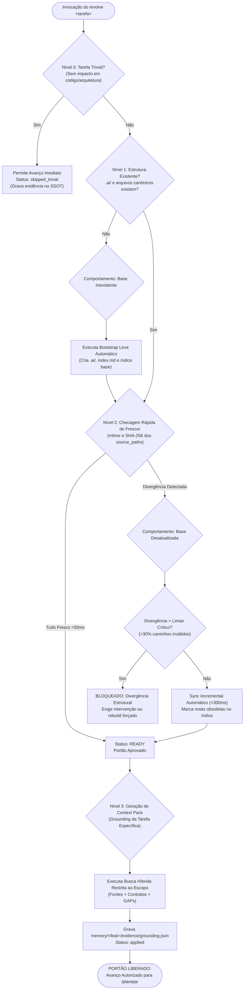

# Proposta de Contrato do Hard-Gate de Conhecimento para o `/evolve`

> **Status:** Proposta de Contrato e Critérios de Prontidão (Fase C.6)  
> **Data:** 2026-10-24  
> **Escopo:** Definição das pré-condições, verificações de integridade, matriz de decisão, critérios de bloqueio/liberação e diagnósticos do portão de conhecimento na entrada do comando `/evolve`.

---

## 1. Contexto e Motivação do Gate

No ecossistema EvolveLoop, a invocação do comando público `/evolve` rege o ciclo de desenvolvimento autônomo e semi-autônomo de software. A arquitetura atual já possui o conceito normativo de hard-gates (`knowledge-grounding-gate.md`, `evidence-bus.md`), cujo objetivo é impedir que agentes implementadores editem código sem fundamentação e sem evidências físicas gravadas em disco.

No entanto, a auditoria (Fase A) identificou fragilidades operacionais no gate atual:
- A verificação de grounding no agente frequentemente se confunde com "já li o README" ou invoca scripts de terceiros que dependem de venvs voláteis em `/tmp` (Graphify).
- Se a base estiver desatualizada, o gate permite avançar gerando alucinações baseadas em documentação defasada.
- Não há uma rotina determinística e de baixo custo para checar se a base de conhecimento de um projeto específico está **pronta para uso** (*readiness check*) antes de autorizar a fase de planejamento (`/planejar`).

Esta proposta define um contrato verificável, rápido e proporcional ao risco, denominado **Knowledge Readiness Gate (KRG)**, sem exigir a reconstrução completa a cada chamada.

---

## 2. Visão do Fluxo de Avaliação do Gate

O portão é executado no início da orquestração, operando em quatro níveis sucessivos de verificação com curto-circuito (*fail-fast*):



---

## 3. Pré-Condições do Gate

Antes de avaliar o conhecimento, o verificador checa as seguintes condições preliminares de ambiente:
1. **Identificação Válida do Projeto Ativo:** O repositório atual possui identificador resolvível (`project_id`).
2. **Permissão de Leitura e Escrita:** O processo possui permissão de leitura no repositório de trabalho e de escrita no diretório local `.data/` e `memory/`.
3. **Isolamento de Escopo Garantido:** O escopo de execução está fixado em `project:<project_id>`. O acesso irrestrito a outros repositórios no cofre global é barrado.

---

## 4. Critérios de Prontidão (Readiness Criteria)

Para que o projeto seja declarado **PRONTO** (`status: ready`), as seguintes verificações devem ser satisfeitas:

| Código | Critério | Verificação Realizada | Tolerância |
|---|---|---|---|
| **RC-01** | **Existência Canônica** | Pasta `.ai/` presente com pelo menos `.ai/index.md` e `.ai/log.md`. | Nenhuma (bootstrap automático se ausente). |
| **RC-02** | **Integridade do Índice** | Arquivo `.data/project-index.json` parseável e com `schema_version` compatível. | Zero corrupção (self-healing se inválido). |
| **RC-03** | **Alinhamento de Frescor** | Menos de 30% dos `source_paths` declarados nas notas com divergência de SHA-256. | Atualização incremental automática para notas afetadas. |
| **RC-04** | **Grounding da Tarefa** | Context Pack gerado com sucesso contendo pelo menos uma fonte rastreável ou um GAP declarado explicitamente. | Proibido inventar fontes sem citação `arquivo:linha`. |
| **RC-05** | **Evidência Física em Disco** | O arquivo físico `memory/<feature_id>/evidence/grounding.json` deve existir e conter hash válido de validação. | **Hard-stop**: O engine bloqueia a Fase 2 se o arquivo não estiver presente fisicamente. |

---

## 5. Matriz de Decisão do Gate

| Estado do Conhecimento | Severidade da Tarefa | Ação do Gate | Decisão | Mensagem Emitida |
|---|---|---|---|---|
| **Base Inexistente (.ai/ ausente)** | Qualquer tarefa técnica | Executa bootstrap leve automático | **LIBERADO (Auto-Init)** | `INFO: Initialized basic .ai/ structure for project.` |
| **Base Íntegra e Atualizada** | Qualquer tarefa | Realiza busca e gera Context Pack | **LIBERADO (Ready)** | `SUCCESS: Knowledge grounding verified (100% fresh).` |
| **Divergência Leve (<30% stale)** | `standard` ou `low` | Atualiza hashes incrementais e rebaixa notas obsoletas | **LIBERADO (Degraded/Stale)** | `WARN: 2 pages marked stale. Grounding applied with fresh code overrides.` |
| **Divergência Estrutural (>30% stale)** | `sensitive` ou refactor | Interrompe o avanço | **BLOQUEADO (Structural Drift)** | `BLOCK: Over 30% of architecture documentation is structurally out of sync with code. Run rebuild.` |
| **Corrupção de Índice (.data/)** | Qualquer tarefa | Move arquivo quebrado e refaz indexação local | **LIBERADO (Self-Healed)** | `INFO: Knowledge index self-healed in 180ms.` |
| **Índice / Repositório Inacessível (I/O)** | Qualquer tarefa | Falha imediatamente (fail-closed) | **BLOQUEADO (I/O Failure)** | `ERROR: Cannot read project repository. Check filesystem permissions.` |
| **Tarefa Trivial (Formatação de texto)** | `trivial` | Registra exceção no SSOT | **LIBERADO (Skipped)** | `INFO: Knowledge grounding skipped for trivial task.` |

---

## 6. Comportamentos Específicos do Gate

### 6.1. Quando a Wiki Não Existe
O sistema **não deve falhar imediatamente nem exigir intervenção manual** se o projeto for novo:
- O verificador aciona a rotina de *bootstrap não-destrutivo*.
- Cria a pasta `.ai/pages/` e os arquivos modelo mínimos (`index.md` e `log.md`).
- Realiza uma extração estática de símbolos de código via parser AST nativo.
- O portão emite um alerta informativo ao desenvolvedor e permite que o ciclo de planejamento inicie, gerando a documentação inicial da tarefa.

### 6.2. Quando a Wiki Está Desatualizada
O princípio do `TruthFence` entra em ação imediatamente:
- Se um arquivo de código foi alterado após a última indexação, a nota documental que o referencia é **rebaixada de autoridade** (`status: obsoleto`).
- O portão não interrompe cegamente o trabalho para pequenas alterações do dia a dia; ele atualiza o índice incremental em centenas de milissegundos e instrui o agente:
  > *"ATENÇÃO: A nota `.ai/pages/engine.md` está desatualizada em relação ao arquivo `engine.ts`. Priorize a inspeção direta do código-fonte real."*
- Se a divergência for estrutural e atingir módulos críticos em tarefas classificadas como de alto risco (`risk_tier: sensitive`), o portão bloqueia a execução até que o desenvolvedor autorize a reconciliação.

### 6.3. Quando a Indexação Falha
- Se a falha for pontual em um arquivo de código (ex.: erro de sintaxe TypeScript em arquivo temporário), o gate isola o erro, ignora aquele arquivo no AST e indexa o restante do repositório.
- Se a falha for sistêmica de I/O ou falta de espaço em disco, o portão opera em **fail-closed** (rejeição segura), impedindo que o agente execute alterações em um ambiente instável.

---

## 7. Formato da Evidência Emitida (`grounding.json`)

Para cumprir a exigência do `EvidenceBus`, o portão grava compulsoriamente o arquivo `memory/<feature_id>/evidence/grounding.json` com a seguinte estrutura normalizada:

```json
{
  "gate": "knowledge_grounding",
  "version": "2.0.0",
  "feature_id": "feat-402-unified-knowledge",
  "project_id": "evolveloop",
  "evaluated_at": "2026-10-24T16:15:00.123Z",
  "status": "applied",
  "risk_tier": "standard",
  "metrics": {
    "total_pages_evaluated": 12,
    "stale_pages_detected": 1,
    "code_files_verified": 48,
    "grounding_latency_ms": 78
  },
  "context_pack": {
    "sources": [
      {
        "path": "orchestrator/src/engine/execution-engine.ts",
        "lines": "120-145",
        "tier": "code",
        "hash": "a1b2c3d4..."
      },
      {
        "path": ".ai/pages/engine-execution.md",
        "tier": "ai",
        "status": "atual"
      }
    ],
    "contracts": [
      "Hard-gates devem exigir arquivos físicos em disco sob memory/<feat>/evidence/",
      "Avanço bloqueado se status != applied"
    ],
    "gaps": [
      "Documentação de recuperação de falhas do Ollama ausente em .ai/"
    ]
  },
  "gate_decision": {
    "allowed_to_proceed": true,
    "bypass_reason": null
  }
}
```

---

## 8. Diagnóstico de Falhas e Mensagens para o Usuário

Quando o gate bloquear o avanço, a saída emitida no terminal ou chat da IDE deve ser acionável e explicativa, contendo:
1. **O motivo exato do bloqueio** (ex.: divergência de hashes, permissão de disco, arquivo corrompido).
2. **Os arquivos envolvidos** com indicação de linha ou status.
3. **O comando exato para resolução**.

### Exemplo de Mensagem de Bloqueio:
```text
═══════════════════════════════════════════════════════════════════════════════
 [EVOLVELOOP HARD-GATE: KNOWLEDGE READINESS CHECK FAILED]
───────────────────────────────────────────────────────────────────────────────
 Tarefa bloqueada: Implementação de refatoração no motor de execução.
 Motivo: Desvio arquitetural severo detectado (4 de 6 notas estão obsoletas).

 Arquivos desalinhados:
  - .ai/pages/engine-execution.md (source: orchestrator/src/engine/execution-engine.ts)
  - .ai/pages/checkpoint-hmac.md   (source: orchestrator/src/jobs/checkpoint.ts)

 Ação recomendada:
  Execute a sincronização e reconstrução do índice antes de prosseguir:
  $ evolve knowledge rebuild --project evolveloop

 Para tarefas experimentais que dispensam documentação de projeto:
  Invoque com a flag explícita: /evolve --skip-knowledge-gate (requer aprovação)
═══════════════════════════════════════════════════════════════════════════════
```

---

## 9. Conclusão do Gate

O Knowledge Readiness Gate proposto transforma o grounding de uma "convenção de texto frágil" em um **portão de engenharia determinístico, rápido e à prova de falhas**. Ele protege a qualidade do código produzido pelos agentes sem introduzir sobrecarga operacional ou lentidão em tarefas triviais.
