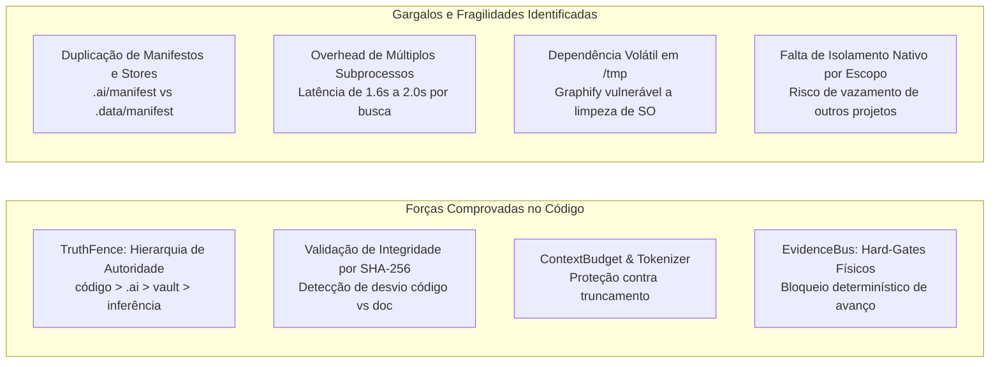
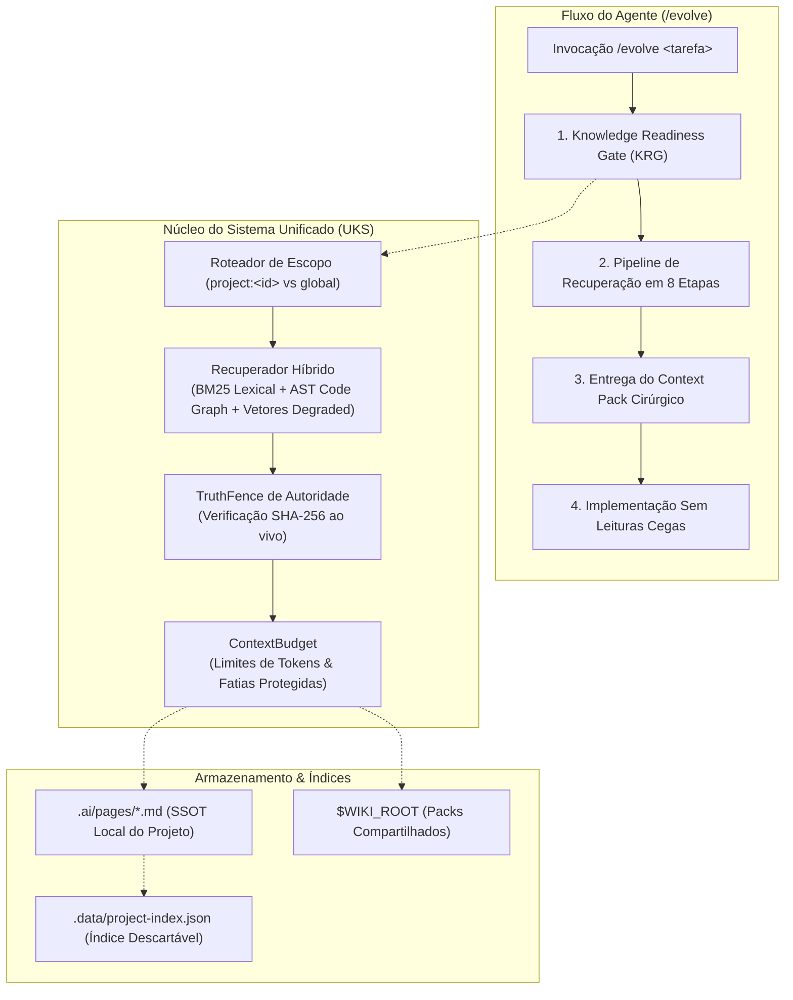
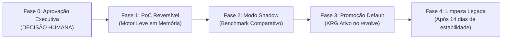

# Síntese Executiva: Estudo Arquitetural do Sistema Unificado de Conhecimento

> **EvolveLoop Unified Knowledge System (UKS)**  
> **Status:** Proposta Arquitetural para Decisão Executiva  
> **Data:** 2026-10-24  
> **Versão de Referência do Monorepo:** EvolveLoop V2.2 / V2.3-ready  
> **Diretório do Estudo:** `docs/architecture/unified-knowledge-study/`

---

## 1. Contexto e Motivação Estratégica

O EvolveLoop é uma arquitetura de orquestração local-first projetada para permitir que agentes de IA desenvolvam, validem e entreguem software com qualidade profissional e governança rigorosa de portões de qualidade (*hard-gates*).

O objetivo deste estudo arquitetural é solucionar o problema central da **leitura indiscriminada de arquivos por agentes de IA**, que consome volumes desnecessários de tokens e sobrecarrega a janela de contexto com informações redundantes, sem sacrificar a precisão da implementação nem violar os princípios de resiliência e operação local do sistema.

A investigação exaustiva do checkout atual comprovou que o ecossistema acumulou **múltiplos mecanismos funcionais, porém fragmentados**:
- Uma base documental local em Markdown com hashes SHA-256 (`.ai/` Carpaccio).
- Um motor de busca externa em Python com suporte a BM25 e vetores locais (`gaabwiki`).
- Uma ferramenta experimental de grafo estático de dependências de código (`graphify`).
- Um barramento de evidências físicas que impede avanço de fases sem validação (`EvidenceBus`).
- Um montador de contexto seguro contra truncamento destrutivo (`ContextBudget`).
- Um guardião de autoridade e isolamento de conhecimento (`TruthFence`).

Este estudo apresenta a especificação do **Sistema Unificado de Conhecimento (UKS)**, substituindo essa colcha de retalhos por uma arquitetura elegante, determinística, rápida e auditável.

---

## 2. Diagnóstico da Arquitetura Atual (Fase A)

A auditoria mapeou 16 componentes e subsistemas candidatos, revelando pontos fortes notáveis e gargalos estruturais críticos:



- **O que funciona com excelência:** A política de autoridade (`TruthFence`) e os hard-gates garantem que o agente nunca invente contratos sem evidência em disco.
- **Onde reside a fragilidade:** A ponte entre TypeScript e Python via subprocesso impõe alta latência; o grafo AST depende de um venv volátil em `/tmp`; a sincronização entre a documentação local e o cofre global depende de scripts manuais; e a ausência de particionamento nativo de escopo no índice exige filtros complexos de canários para impedir vazamento entre projetos.

---

## 3. Avaliação de Alternativas (Fase B)

Três modelos arquiteturais foram confrontados sob 15 dimensões rigorosas de engenharia:

| Critério Chave | Alternativa A (Fachada Atual) | Alternativa B (Motor Compartilhado com Escopos) — **RECOMENDADA** | Alternativa C (Reestruturação Profunda - DBs) |
|---|---|---|---|
| **Conceito Central** | Wrapper sobre os scripts e pastas atuais sem unificar índices. | **Motor local único com partição nativa de escopos e SSOT em Markdown.** | Banco em grafo dedicado (Neo4j/Kùzu) + Vector DB + daemons. |
| **Compatibilidade & Risco** | Risco quase zero, mas perpetua a dívida técnica. | **Alta compatibilidade; preserva contratos existentes com migração suave.** | Ruptura crítica; incompatível com a arquitetura do EvolveLoop. |
| **Complexidade Operacional** | Alta (múltiplas pastas, venvs e sincronizações manuais). | **Mínima (zero daemons, índice único em arquivo, execução local rápida).** | Crítica (gerenciamento de daemons de banco, portas de rede e memória). |
| **Latência de Recuperação** | Ruim (~1.600 a 2.000 ms). | **Excelente (< 100 ms).** | Média a alta (200 a 1.500 ms). |
| **Isolamento de Escopo** | Frágil (baseado em filtros de canários pós-busca). | **Absoluto (partição física e lógica nativa no índice: project vs global).** | Complexo (exige multi-tenancy formal em grafo). |
| **Local-First & Git SSOT** | Preservado. | **Totalmente Preservado (Markdown e Código são a verdade canônica).** | Destruído (conhecimento opaco dentro de bancos binários). |

**Conclusão da Escolha:** A **Alternativa B** é a única que entrega isolamento real e alta velocidade sem sobrecarregar o desenvolvedor com daemons pesados ou quebrar a auditabilidade do Git.

---

## 4. A Arquitetura Proposta: UKS (Fase C)

A arquitetura recomendada unifica o ciclo de vida do conhecimento sob os seguintes pilares:



### Principais Inovações da Proposta:
1. **Fonte Canônica em Markdown e Código:** As notas `.ai/` e o código-fonte são o SSOT. Todos os índices (`.data/`) são 100% descartáveis e reconstruíveis em segundos.
2. **Escopos Nativos de Primeira Classe:** Consultas de uma tarefa em `project:A` são fisicamente impedidas de ler documentações de `project:B`. O acesso ao cofre `global` só ocorre mediante requisição explícita ou para categorias corporativas homologadas (packs de segurança e convenções).
3. **Recuperação Híbrida em 8 Etapas com Degradação Graciosa:** Combina a velocidade do BM25 com a topologia da AST de código. Se o Ollama estiver ativo, realiza reranqueamento semântico; se estiver desligado, opera perfeitamente em modo BM25 com a flag `degraded: true` (ADR-0005).
4. **Ciclo de Vida com Detecção Determinística de Obsolescência:** Uma nota só é autoridade se os arquivos de código citados em `source_paths` mantiverem o mesmo SHA-256 no momento da busca. Se o código mudou, a nota é imediatamente marcada como `status: obsoleto` e rebaixada para aviso de GAP.
5. **Knowledge Readiness Gate (KRG) no `/evolve`:** O portão realiza um teste de prontidão ultra-rápido (<50ms). Se o projeto for novo, executa bootstrap leve automático; se a documentação estiver alinhada, libera o avanço; se houver divergência estrutural severa (>30% de caminhos inválidos), bloqueia o início antes que o agente alucine.

---

## 5. Eficiência de Tokens e Linha de Base (Fases D & E)

O estudo diferencia rigorosamente o que representa economia de tokens versus redução de custos financeiros ou tempo de execução:
- **Onde está a economia real:** Evitar que o agente execute 15 chamadas cegas de `read_file` em arquivos inteiros do repositório para "descobrir" o que fazer. O Context Pack entrega diretamente os trechos e assinaturas exatas em menos de 2.000 tokens.
- **Linha de Base Oficial (Benchmarks V2.2 / ADR-0014):**
  - Braço B0 (Leitura cega): consome mediana de **19,5 arquivos** e **20.099 a 21.284 tokens** de entrada por tarefa.
  - Braço B1 (Wiki legada): atinge recall de 75% em dev e 83% em teste com latência de **1.639 ms**.
  - Braço B3 (Graphify): atinge recall de 75% em dev e 100% em teste com latência de **750 ms**.
- **Alvo do UKS no Benchmark:** Igualar ou superar o recall perfeito (100% em teste) reduzindo a mediana de tokens de entrada em pelo menos 10% frente ao B0, com latência de recuperação inferior a **250 ms** e **zero vazamento entre projetos**.

---

## 6. Roteiro Incremental e Reversível de Implantação (Fase F)

A migração é projetada para não interromper a operação atual em nenhum momento:



- **Fase 0 (Hoje):** Revisão e validação do presente estudo.
- **Fase 1:** Prova de conceito autocontida e reversível em pasta isolada (`orchestrator/src/knowledge/uks/`), testada unitariamente.
- **Fase 2:** Implementação do adaptador TypeScript em modo shadow (`EVOLVELOOP_UKS_SHADOW=1`) e execução da suíte de 24 tarefas de benchmark para comprovação empírica de paridade.
- **Fase 3:** Promoção do UKS para backend padrão em `profiles/default.yaml` e ativação do Knowledge Readiness Gate no `/evolve`.
- **Fase 4:** Remoção segura de scripts manuais redundantes e dependências voláteis em `/tmp`.

---

## 7. Decisões Pendentes para Alinhamento Humano

Quatro decisões arquiteturais dependem de julgamento dos mantenedores antes do início da codificação:

1. **Linguagem do Núcleo:** Consolidar o motor inteiramente em TypeScript (Node.js) dentro do orquestrador ou manter um script Python independente baseado apenas na stdlib?  
   *Recomendação técnica:* Arquitetura híbrida com script Python leve na PoC, migrando para TypeScript nativo na consolidação.
2. **Destino do Graphify:** Manter o pacote PyPI `graphifyy` isolado em `/tmp` ou absorver um extrator nativo de AST para TypeScript/Python diretamente no EvolveLoop?  
   *Recomendação técnica:* Absorver o extrator nativo de AST, eliminando a dependência de binários externos voláteis.
3. **Escopo Global:** O isolamento deve ser 100% restrito ao projeto local por padrão, ou deve permitir a inclusão automática de notas da pasta `packs/` (segurança, boas práticas) do cofre global?  
   *Recomendação técnica:* Restrito ao projeto por padrão, com inclusão de `packs/` condicionada a categorias corporativas homologadas.
4. **Memória Episódica (`wiki-mem`):** Deve permanecer como ferramenta opcional externa ou ter resumos de sessão (`LATEST.md`) integrados como contexto secundário?  
   *Recomendação técnica:* Manter desacoplada e desativada por padrão, priorizando o grounding canônico.

---

## 8. Estrutura do Conjunto Documental Entregue

Todos os 10 documentos de análise profunda, especificações técnicas e planos operacionais encontram-se gerados e versionados em conformidade com as regras do projeto:

```text
docs/architecture/unified-knowledge-study/
├── current-state.md         # Diagnóstico exaustivo da arquitetura atual (Fase A)
├── alternatives.md          # Comparação detalhada de 3 alternativas sob 15 dimensões (Fase B)
├── proposed-architecture.md # Especificação técnica completa da arquitetura UKS (Fase C)
├── knowledge-lifecycle.md   # Máquina de estados, frescor e os 10 cenários de ciclo de vida (Fase C.5)
├── evolve-hard-gate.md      # Contrato e critérios de prontidão do gate no /evolve (Fase C.6)
├── token-efficiency.md      # Hipóteses de redução de tokens, riscos e instrumentação (Fase D)
├── benchmark-plan.md        # Suíte de benchmark com 24 tarefas e critérios de aceitação (Fase E)
├── migration-roadmap.md     # Roteiro incremental de 5 fases com rollbacks imediatos (Fase F)
├── open-decisions.md        # Mapeamento detalhado de dúvidas, incertezas e decisões humanas (Fase F.9)
└── executive-summary.md     # Esta síntese executiva para revisão técnica
```

---

## 9. Conclusão e Recomendação

O estudo comprova que **não é necessário reconstruir o EvolveLoop do zero nem adotar bancos de dados pesados e complexos** para atingir a excelência na recuperação de conhecimento.

A **Alternativa B (Sistema Unificado de Conhecimento)** capitaliza os maiores pontos fortes do repositório (a hierarquia de autoridade do `TruthFence`, a rastreabilidade criptográfica por SHA-256 e os hard-gates do `/evolve`), resolvendo de forma cirúrgica a fragmentação e a latência.

Recomenda-se a **aprovação desta proposta conceitual** para autorizar a implementação da **Fase 1 (Prova de Conceito Isolada)** na esteira de desenvolvimento do EvolveLoop.
