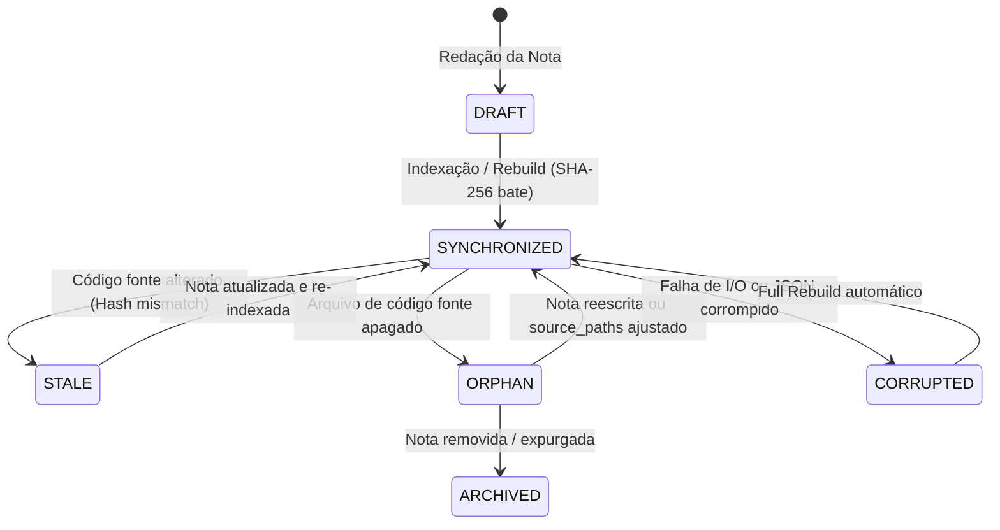
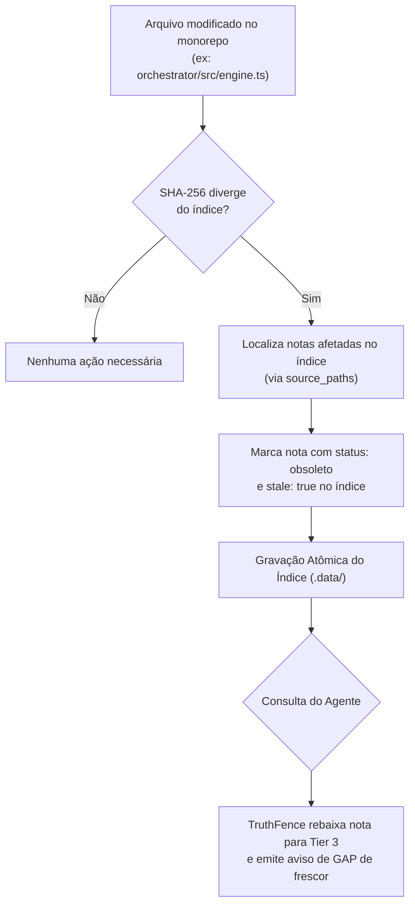

# Ciclo de Vida do Conhecimento: Criação, Atualização, Invalidação e Reconstrução

> **Status:** Especificação Operacional do Ciclo de Vida (Fase C.5)  
> **Data:** 2026-10-24  
> **Escopo:** Estados, transições, algoritmos de detecção de obsolescência, recuperação de falhas e procedimentos de migração do Sistema Unificado de Conhecimento do EvolveLoop.

---

## 1. Princípio Fundamental de Frescor e Integridade

> [!CRITICAL]
> **A Wiki não pode ser considerada atualizada apenas porque existe em disco.**  
> No EvolveLoop, a mera presença de arquivos Markdown em `.ai/` ou no vault não confere autoridade ao seu conteúdo. A autoridade de uma nota é uma função determinística do alinhamento criptográfico entre os arquivos de código citados em sua declaração (`source_paths`) e os hashes desses arquivos no repositório no momento da execução.

Toda nota documental e todo chunk indexado transitam por uma **máquina de estados finitos** rigorosa:

---

## 2. Comportamento Operacional nos 10 Cenários do Ciclo de Vida

### 2.1. Primeira Criação (Cold Start — Projeto sem Wiki)
- **Condição:** Repositório novo ou existente sendo integrado ao EvolveLoop pela primeira vez (diretório `.ai/` inexistente).
- **Comportamento Automatizado:**
  1. O comando `/evolve` detecta a ausência de `.ai/` e do manifesto.
  2. Dispara a rotina de inicialização leve (`bootstrap`):
     - Cria a estrutura de pastas: `.ai/pages/`, `.ai/sessions/` e `.data/`.
     - Gera o esqueleto canônico: `.ai/index.md` (visão geral do projeto) e `.ai/log.md` (registro de sessões).
  3. Executa a primeira varredura sintática de código via parser AST local, gerando o subgrafo de dependências e mapeando os principais pontos de entrada (`entrypoints`).
  4. Gera o índice inicial `.data/project-index.json`.
  5. Marca o portão de conhecimento como `bootstrap_complete`, permitindo que o agente gere as primeiras notas conceituais durante a Fase 0.5 (`/prd`) e Fase 1 (`/planejar`).

### 2.2. Projeto Já Indexado (Steady State)
- **Condição:** Repositório já possui `.ai/` e `.data/project-index.json`.
- **Comportamento Automatizado:**
  1. Ao iniciar qualquer comando ou ciclo de orquestração, o sistema realiza uma **checagem ultra-rápida de integridade** (<50ms):
     - Compara o carimbo de data/hora (`mtime`) dos arquivos de código fonte com o carimbo gravado no cabeçalho do índice.
  2. Se nenhum arquivo do repositório tiver `mtime > last_indexed_at`, o índice é carregado imediatamente da memória/disco sem reprocessamento.
  3. Se houver divergência de carimbo, o sistema engatilha a verificação incremental de hashes (Cenário 2.3).

### 2.3. Alterações Incrementais no Código (Dia a Dia de Desenvolvimento)
- **Condição:** Um ou mais arquivos de código (`.ts`, `.py`, etc.) foram modificados por um desenvolvedor ou agente.
- **Comportamento Automatizado:**
  1. O motor identifica apenas os arquivos cujo `mtime` foi modificado em relação ao índice.
  2. Calcula o novo hash SHA-256 somente para esses arquivos modificados.
  3. **Invalidação Cirúrgica de Chunks:**
     - O motor busca no índice todas as notas que listam o arquivo modificado dentro de `source_paths`.
     - Essas notas recebem imediatamente o status `stale: true` no índice em memória, com o atributo `stale_reason: "source_hash_mismatch"`.
  4. O arquivo de índice `.data/project-index.json` é atualizado atomicamente (escrita em arquivo temporário com `fs.rename`).
  5. Na próxima consulta do agente, o `TruthFence` identifica a marcação de staleness e rebaixa os trechos dessas notas para Tier 3 (Inferência/Aviso), impedindo que o agente tome decisões de código baseadas em documentação desatualizada.

### 2.4. Mudanças Estruturais e Grandes Refatorações
- **Condição:** Reestruturação de pastas, renomeação de múltiplos módulos ou migração de arquivos entre diretórios (ex.: renomear `src/models/` para `src/core/entities/`).
- **Comportamento Automatizado:**
  1. A checagem incremental detecta dezenas de `source_paths` ausentes simultaneamente.
  2. Se o percentual de arquivos desalinhados ultrapassar o limiar de segurança (configurável, default: 30% dos caminhos citados), o motor interrompe o modo incremental e sinaliza:  
     `ALERT: Structural divergence detected (>30% source_paths invalid).`
  3. O motor executa uma **reconciliação estrutural heurística**:
     - Utiliza o extrator de AST para detectar se classes e funções conhecidas foram apenas movidas para outros arquivos (correspondência de símbolos).
     - Sugere automaticamente no relatório de diagnóstico a atualização dos `source_paths` para os novos caminhos.
  4. Exige confirmação ou reexecução do rebuild pelo agente ou desenvolvedor antes de autorizar o portão do `/evolve`.

### 2.5. Arquivos Novos ou Removidos
- **Caso A — Arquivo de Código Adicionado:**
  - O motor detecta o novo arquivo durante a varredura sintática de código.
  - O novo arquivo é incorporado ao subgrafo AST (arestas e chamadas).
  - Se o arquivo não for coberto por nenhuma nota em `.ai/pages/`, ele passa a figurar na lista de **GAPs de Cobertura Documental**, recomendando a criação de uma nota para novos módulos críticos.
- **Caso B — Arquivo de Código Removido:**
  - O cálculo de hash retorna que o arquivo não existe mais no disco (`not fp.is_file()`).
  - Todas as notas associadas a ele têm seus chunks alterados para `status: orphan`.
  - O `TruthFence` bloqueia sumariamente esses chunks de serem entregues como evidência confiável.

### 2.6. Falha de Indexação (Erros de Sintaxe ou Interrupções)
- **Condição:** O desenvolvedor deixou um arquivo com erro grosseiro de sintaxe que quebra o parser AST, ou o processo foi interrompido por sinal de encerramento (`SIGINT`/`SIGTERM`) durante a gravação.
- **Comportamento Automatizado:**
  1. **Tolerância a Falhas de AST:** Se um arquivo específico falhar no parser sintático, ele é registrado com erro individual (`ast_parse_failed`), mas o processo de indexação **não aborta**. Os demais arquivos válidos continuam sendo indexados normalmente.
  2. **Gravação Transacional e Atômica:** O manifesto e o índice nunca são gravados diretamente sobre o arquivo de produção. O motor grava em `.data/project-index.json.tmp` e, apenas após a conclusão bem-sucedida de todas as etapas e validação de schema, realiza a renomeação atômica (`atomic rename`).
  3. Se o processo morrer antes do rename, o arquivo original anterior permanece 100% íntegro.

### 2.7. Reconstrução Completa (Full Rebuild)
- **Condição:** Execução explícita do comando de reconstrução (`rebuild --force`), alteração da versão do esquema de indexação ou recuperação de falha severa.
- **Comportamento Automatizado:**
  1. O motor ignora qualquer cache anterior em `.data/`.
  2. Realiza a leitura fria de todos os arquivos de código do repositório e de todas as notas Markdown em `.ai/pages/`.
  3. Recalcula todos os hashes SHA-256 e reconstrói o grafo AST de dependências do zero.
  4. Limpa e reconstrói as tabelas de tokens BM25.
  5. Se o modo vetorial estiver habilitado e com modelo local ativo, regenera os embeddings de chunks pendentes.
  6. Gera um novo índice limpo e remove quaisquer resíduos temporários.

### 2.8. Recuperação de Estado Inconsistente (Self-Healing)
- **Condição:** O arquivo de índice `.data/project-index.json` sofreu corrupção de disco, foi editado manualmente ou possui JSON malformado.
- **Comportamento Automatizado:**
  1. O leitor do orquestrador executa o parsing dentro de um bloco protegido (`try/catch`).
  2. Se ocorrer erro de validação de schema (`JSON.parse` fail ou schema mismatch):
     - Emite log de aviso: `WARN: Knowledge index corrupted or unreadable. Initiating automatic self-healing rebuild.`
     - Move o arquivo corrompido para `.data/project-index.corrupted.<timestamp>.bak`.
     - Dispara automaticamente o Full Rebuild em segundo plano.
  3. Durante a reconstrução, as consultas caem no modo de emergência: operam via varredura direta de texto (`rg`/grep) sobre `.ai/pages/` e código, garantindo que o agente não fique travado.

### 2.9. Projeto Temporariamente Indisponível (Falhas de Montagem ou I/O)
- **Condição:** O diretório de projeto está em um volume compartilhado ou partição de rede temporariamente sem permissão de leitura ou desconectada.
- **Comportamento Automatizado:**
  1. O motor detecta erro de I/O de sistema de arquivos (`EACCES`, `ENOENT`, `ETIMEDOUT`).
  2. Registra o status de saúde: `status: unavailable`, `error_code: REPO_UNAVAILABLE`.
  3. O `KnowledgeBackend` propaga o estado degradado para o orquestrador.
  4. O hard-gate do `/evolve` bloqueia o início de tarefas com uma mensagem explícita e clara para o usuário:  
     `ERROR: Project repository unreadable at path /path/to/repo. Check filesystem permissions.`
  5. Impede que o sistema confunda "projeto inacessível" com "projeto sem conhecimento" (`empty_corpus`).

### 2.10. Migração de Versão da Wiki (Schema Evolution)
- **Condição:** Atualização de versão do framework EvolveLoop que introduz novos campos no modelo de documentos (ex.: migração do Schema v1 para Schema v2).
- **Comportamento Automatizado:**
  1. O índice e as notas declaram explicitamente o campo `schema_version`.
  2. Ao carregar uma base com versão anterior (ex.: v1 em um ambiente v2):
     - O carregador executa a rotina de **migração incremental não destrutiva** em memória.
     - Aplica valores padrão para os novos campos introduzidos.
     - Persiste a nova versão no catálogo `.data/project-index.json` marcando `schema_version: 2`.
  3. O texto e o corpo das notas Markdown originais **nunca são alterados automaticamente**, garantindo que nenhum histórico de Git seja reescrito sem autorização humana.

---

## 3. Matriz de Invalidação e Ações do Sistema

| Evento no Ambiente | Impacto no Conhecimento | Ação Automática do Motor | Efeito no TruthFence |
|---|---|---|---|
| **Edição de arquivo de código** | Apenas notas associadas ficam obsoletas | Recalcula hash do arquivo e marca `stale: true` no índice | Rebaixa notas afetadas para Tier 3 (Aviso/GAP) |
| **Criação de nova nota `.md`** | Novo conhecimento disponível | Indexa a nota, associa chunks e calcula hashes dos códigos | Promove nota para Tier 1 (Autoridade de Projeto) |
| **Edição do texto de nota `.md`** | Conteúdo da nota alterado | Re-tokeniza chunks e reconcilia `source_paths` | Mantém Tier 1 atualizado |
| **Exclusão de arquivo de código** | Notas associadas ficam órfãs | Marca notas com `status: orphan` | Bloqueia exibição como evidência confiável |
| **Exclusão física de nota `.md`** | Conhecimento foi removido | Remove chunks órfãos do índice atomicamente | Chunks deixam de aparecer nas buscas |
| **Queda do daemon Ollama** | Busca vetorial indisponível | Comuta para BM25 + AST puro | Emite `degraded: true (ollama_unavailable)` |
| **Corrupção de `.data/`** | Índice binário inválido | Dispara reconstrução automática (Self-Healing) | Opera temporariamente via grep direto |

---

## 4. Conclusão do Ciclo de Vida

Com essa especificação, o EvolveLoop ganha uma gestão determinística do estado do conhecimento. As notas deixam de ser tratadas como "arquivos estáticos esquecidos no Git" e passam a ter um **ciclo de vida vivo, rastreável e autolimpante**, eliminando alucinações provocadas por documentações desatualizadas.
