# Roteiro de Migração e Adoção Gradual

> **Status:** Plano Incremental de Implantação e Transição Segura (Fase F)  
> **Data:** 2026-10-24  
> **Escopo:** Fases incrementais, portas de decisão, provas de conceito reversíveis, critérios de rollback e pontos de aprovação humana para a implantação do Sistema Unificado de Conhecimento.

---

## 1. Princípios e Estratégia Geral de Migração

Para garantir que a operação do EvolveLoop permaneça 100% funcional e contínua durante todo o processo, a migração é estruturada sob a política de **Transição Não Destrutiva (*Parallel Run / Strangler Fig*)**:

- **Nenhum arquivo ou script existente será apagado prematuramente.** Os componentes atuais (`carpaccio.py`, `gaabwiki`, `graphify-adapter`, `KnowledgeBackend`) continuam operando normalmente enquanto a nova arquitetura é construída e validada.
- **Integração Gradual atrás de Feature Flags:** Cada novo mecanismo é introduzido atrás de flags de controle (ex.: `EVOLVELOOP_UNIFIED_KNOWLEDGE=1`), mantendo o comportamento default inalterado até a homologação final.
- **Rollback Imediato em Qualquer Fase:** Se qualquer regressão for identificada, o desligamento da flag ou a reversão de commits isolados restaura instantaneamente o comportamento anterior.
- **Portões Rígidos de Aprovação Humana:** Nenhuma transição entre fases maiores avança sem a apresentação de evidências em relatórios de teste e assinatura formal do mantenedor.

```mermaid
flowchart TD
    subgraph Fase0["Fase 0: Alinhamento & Design Review"]
        Step0["Aprovação deste Estudo Arquitetural<br/>(DECISÃO HUMANA MANDATÓRIA)"]
    end

    subgraph Fase1["Fase 1: Prova de Conceito (PoC) Isolada"]
        PoCEngine["Motor Unificado de Extração e BM25 em Memória"]
        PoCTests["Testes Unitários de Indexação e Escopo"]
        Gate1{"Gate de Avaliação da PoC<br/>(Critérios de Aceitação)"}
    end

    subgraph Fase2["Fase 2: Adaptador & Provedor em Paralelo"]
        AdapterUKS["UnifiedKnowledgeBackend (TS)"]
        ShadowRun["Execução em Modo Shadow (Dual-Run)<br/>Compara resultados do B1 e UKS"]
        BenchRun["Execução da Bateria de Benchmark (Fase E)"]
        Gate2{"Gate de Paridade do Benchmark<br/>(DECISÃO HUMANA MANDATÓRIA)"}
    end

    subgraph Fase3["Fase 3: Promoção do Backend Default"]
        DefaultSwitch["Chaveamento de knowledge.backend para uks<br/>em profiles/default.yaml"]
        HardGateKRG["Ativação do Knowledge Readiness Gate no /evolve"]
        Gate3{"Gate de Estabilidade Operacional"}
    end

    subgraph Fase4["Fase 4: Descomissionamento & Limpeza"]
        PruneOld["Remoção de scripts redundantes<br/>(sync manual, venv /tmp do graphify)"]
        FinalDoc["Atualização final de ADRs e documentação"]
    end

    Step0 --> PoCEngine
    PoCEngine --> PoCTests
    PoCTests --> Gate1
    Gate1 -->|Aprovado| AdapterUKS
    AdapterUKS --> ShadowRun
    ShadowRun --> BenchRun
    BenchRun --> Gate2
    Gate2 -->|Aprovado| DefaultSwitch
    DefaultSwitch --> HardGateKRG
    HardGateKRG --> Gate3
    Gate3 -->|Aprovado| PruneOld
    PruneOld --> FinalDoc
```

---

## 2. Detalhamento das Fases Incrementais

### Fase 0: Alinhamento Arquitetural e Aprovação Humana (Fase Atual)
- **Objetivo:** Submeter este estudo completo aos mantenedores do projeto para criticar premissas, avaliar trade-offs e decidir sobre os caminhos propostos.
- **Componentes Envolvidos:** Conjunto documental em `docs/architecture/unified-knowledge-study/`.
- **Pré-Requisitos:** Finalização da auditoria factual (Fase A) e dos 10 documentos de entrega.
- **Decisão Humana Obrigatória:** Autorização formal para iniciar o desenvolvimento da Fase 1.

---

### Fase 1: Prova de Conceito (PoC) Pequena, Leve e Reversível
- **Objetivo:** Construir uma implementação mínima e autocontida do indexador e buscador unificado em Python/TypeScript, validando em memória a tokenização BM25, o extrator sintático AST local e a partição nativa de escopos (`project:<id>` vs `global`).
- **Componentes Envolvidos:**
  - Novo módulo experimental: `orchestrator/src/knowledge/uks/` (ou script Python equivalente `scripts/uks/core.py`).
  - Suíte de testes unitários dedicada: `orchestrator/tests/unit/uks-core.test.ts`.
- **Dependências:** Apenas bibliotecas já presentes no ambiente (Python stdlib e Node.js core). Zero novas dependências externas.
- **Pré-Requisitos:** Aprovação da Fase 0.
- **Testes:**
  - Teste de chunking e cálculo de hashes SHA-256.
  - Teste de busca lexical BM25 com ranqueamento determinístico.
  - Teste de isolamento de escopo (garantir que notas com `scope: "project:b"` sejam 100% invisíveis em consultas de `project:a`).
- **Critérios de Aceitação:**
  - 100% de testes unitários aprovados em menos de 2 segundos de execução total.
  - Zero alteração no comportamento de produção do orquestrador ou nas skills do Cursor.
- **Riscos:** Nenhum risco ao ambiente de produção (código isolado sem consumidores no fluxo principal).
- **Estratégia de Rollback:** Deletar a pasta `orchestrator/src/knowledge/uks/` e seu arquivo de teste correspondente.
- **Evidências para Avançar:** Relatório de testes unitários aprovado (`npm test orchestrator/tests/unit/uks-core.test.ts`).

---

### Fase 2: Implementação do Adaptador e Execução em Modo Shadow (Dual-Run)
- **Objetivo:** Conectar o novo motor ao orquestrador através de um novo backend (`UnifiedKnowledgeBackend`), permitindo que consultas do provedor determinístico sejam executadas em paralelo (modo shadow) para comparação de resultados sem interferir na decisão do agente.
- **Componentes Envolvidos:**
  - `orchestrator/src/knowledge/backend/unified-backend.ts`.
  - Feature flag `EVOLVELOOP_UKS_SHADOW=1`.
  - Harness de benchmark: `run-knowledge-bench.sh`.
- **Dependências:** Conclusão bem-sucedida da Fase 1.
- **Pré-Requisitos:** Código da Fase 1 mergeado na branch de desenvolvimento.
- **Testes:**
  - Execução das 24 tarefas do benchmark oficial definido no `benchmark-plan.md`.
  - Comparação automatizada de métricas entre B1 (Wiki legada), B3 (Graphify) e UKS.
- **Critérios de Aceitação (Go/No-Go):**
  - Cumprimento integral dos 6 critérios de aceitação do benchmark (Recall@k $\ge$ B1, Zero Vazamento de Escopo, Latência $<$ 250ms, Redução de Tokens $\ge$ 10% vs B0).
  - Nenhuma discrepância semântica que prejudique a qualidade das evidências.
- **Riscos:** Consumo adicional temporário de CPU durante a execução dupla em modo shadow.
- **Estratégia de Rollback:** Desligar a flag `EVOLVELOOP_UKS_SHADOW=0`. O sistema volta a invocar exclusivamente o `WikiKnowledgeBackend` legado.
- **Decisão Humana Obrigatória:** Revisão do relatório comparativo do benchmark antes de autorizar o chaveamento de produção.

---

### Fase 3: Promoção para Backend Padrão e Ativação do Hard-Gate
- **Objetivo:** Tornar o UKS o backend oficial de conhecimento do EvolveLoop, ativando o Knowledge Readiness Gate (KRG) na entrada do `/evolve`.
- **Componentes Envolvidos:**
  - `profiles/default.yaml` (`knowledge.backend: uks`).
  - `.cursor/skills/orquestrar/references/knowledge-grounding-gate.md`.
  - Adaptador de compatibilidade para a CLI do agente (`scripts/ground.sh`).
- **Dependências:** Aprovação formal dos resultados da Fase 2.
- **Pré-Requisitos:** Benchmark aprovado com relatório auditado.
- **Testes:**
  - Execução de 5 ciclos completos do `/evolve` em tarefas reais do monorepo (dogfooding).
  - Validação da persistência de evidências em `memory/<feature_id>/evidence/grounding.json`.
  - Teste de degradação com Ollama desligado (verificação do fallback BM25).
- **Critérios de Aceitação:**
  - Todos os ciclos do `/evolve` completados com sucesso na primeira tentativa.
  - Zero bloqueios indevidos do gate em tarefas de rotina.
  - Tempo total de grounding inferior a 300ms por tarefa.
- **Riscos:** Agentes estranharem pequenas variações na formatação do Context Pack.
- **Estratégia de Rollback:** Alterar `knowledge.backend: wiki` em `profiles/default.yaml`. O orquestrador reverte imediatamente para o `WikiKnowledgeBackend` anterior sem necessidade de reinstalação.
- **Evidências para Avançar:** 5 execuções consecutivas de dogfooding com aprovação em todos os portões de qualidade.

---

### Fase 4: Descomissionamento de Redundâncias e Limpeza de Código
- **Objetivo:** Eliminar o código zumbi, manifestos duplicados e dependências voláteis identificadas na auditoria (Fase A).
- **Componentes Envolvidos:**
  - Exclusão dos scripts de cópia manual: `docs/architecture/v2.2/scripts/sync-carpaccio-to-vault.sh`.
  - Exclusão do venv volátil `/tmp/graphify-skill-hardgate-venv/`.
  - Limpeza dos métodos mortos em `orchestrator/src/knowledge/knowledge-store.ts`.
  - Remoção de referências ao servidor MCP Memory em `mcp/mcp.json`.
  - Emissão de nova ADR formalizando a substituição do ADR-0004 e ADR-0012.
- **Dependências:** Mínimo de 14 dias de operação estável da Fase 3 sem incidentes ou rollbacks.
- **Pré-Requisitos:** Confirmação por todos os mantenedores de que os componentes legados não possuem consumidores remanescentes.
- **Testes:**
  - Execução da suíte completa de testes de regressão do monorepo (`npm test`).
  - Varredura de integridade de links e referências documentais.
- **Critérios de Aceitação:**
  - Suíte de testes 100% verde com redução de tamanho da base de código e dependências.
- **Riscos:** Exclusão acidental de arquivos que ainda fossem referenciados por alguma automação legada externa.
- **Estratégia de Rollback:** Reversão do commit de limpeza via Git (`git revert`).

---

## 3. Matriz de Decisões Humanas Obrigatórias

| Fase | Decisão Necessária | Papel Responsável | Evidência Exigida | Impacto da Aprovação |
|---|---|---|---|---|
| **Fase 0** | **Aprovação do Estudo Arquitetural** | Líder Técnico / Mantenedores | Análise dos 10 documentos da proposta | Autoriza início de codificação da PoC na Fase 1. |
| **Fase 1** | **Validação da PoC** | Engenheiro Responsável | Relatório de testes unitários em memória | Autoriza integração da feature flag na Fase 2. |
| **Fase 2** | **Aprovação do Benchmark Comparativo** | Mantenedores do EvolveLoop | Relatório auditado de paridade do benchmark | Autoriza a promoção para backend default na Fase 3. |
| **Fase 3** | **Homologação do Dogfooding** | Desenvolvedores / Usuários | Logs de 5 execuções do `/evolve` com evidências | Consolida a nova arquitetura em produção. |
| **Fase 4** | **Autorização de Descarte Legado** | Mantenedores do EvolveLoop | 14 dias de estabilidade comprovada | Autoriza deleção definitiva de arquivos legados. |

---

## 4. Conclusão do Roteiro

Este roteiro assegura que a modernização do conhecimento no EvolveLoop aconteça sem "saltos no escuro". O sistema permanece operacional em 100% do tempo, com rollbacks instantâneos disponíveis em cada etapa e com decisões fundamentadas exclusivamente em dados empíricos de qualidade e performance.
