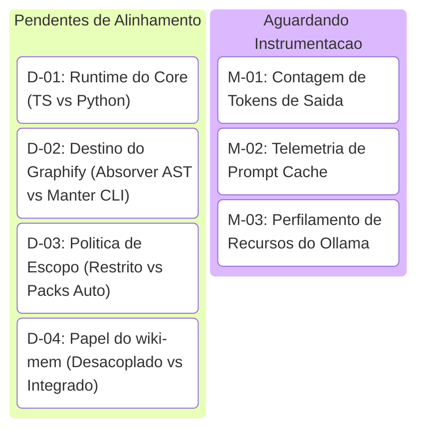

# Decisões Pendentes e Informações Ausentes

> **Status:** Mapeamento de Incertezas, Lacunas e Pontos de Decisão (Fase F.9)  
> **Data:** 2026-10-24  
> **Escopo:** Registro explícito de dúvidas não resolvidas, limitações de observabilidade no ambiente atual e decisões arquiteturais que dependem de alinhamento humano antes da execução.

---

## 1. Visão Geral das Incertezas

Em conformidade com as diretrizes do `AGENT.md` e os princípios de rigor epistêmico do EvolveLoop, este estudo **não transforma hipóteses em fatos**. A investigação do checkout identificou aspectos operacionais e de design que não puderam ser verificados de forma definitiva no código atual ou que envolvem escolhas fundamentais de produto.

Estas incertezas estão organizadas em três categorias:
1. **Decisões Arquiteturais Pendentes de Alinhamento Humano.**
2. **Lacunas de Observabilidade e Métricas Indisponíveis no Ambiente Atual.**
3. **Comportamentos Não Comprovados de Dependências de Terceiros.**

---

## 2. Decisões Arquiteturais que Requerem Aprovação Humana

### Decisão D-01: Linguagem e Runtime do Núcleo do Motor de Conhecimento (UKS Core)
- **O Dilema:** O orquestrador do EvolveLoop é majoritariamente escrito em TypeScript (Node.js), enquanto os motores atuais de wiki (`gaabwiki`, `carpaccio.py`, `mem.py`) foram desenvolvidos em Python.
- **Alternativa D01.A — Núcleo em TypeScript Puro (Node.js):**
  - *Prós:* Elimina completamente o subprocesso `child_process.spawn`, remove a dependência de interpretador Python para o funcionamento básico do orquestrador e permite execução em processo único em milissegundos.
  - *Contras:* Requer reescrever o algoritmo de tokenização e o parser de Markdown em TypeScript (embora bibliotecas nativas de Node.js existam).
- **Alternativa D01.B — Núcleo em Python (CLI/Script Standalone com Stdlib):**
  - *Prós:* Reutiliza diretamente a lógica já testada em `gaabwiki` e `carpaccio.py`; mantém a compatibilidade natural com o ecossistema de dados e embeddings.
  - *Contras:* Mantém a dependência de um interpretador Python 3 no host e o overhead de chamada CLI via subprocesso.
- **Alternativa D01.C — Arquitetura Híbrida (Recomendada Provisoriamente):**
  - Script Python rápido e autocontido (apenas stdlib) acionado por adaptador TypeScript de baixo overhead, com transição futura para Node.js puro se a latência justificar.
- **Pergunta para Decisão Humana:** *Qual é a preferência dos mantenedores em relação à unificação de linguagem do núcleo de conhecimento: consolidar tudo em TypeScript no orquestrador ou manter o motor em Python stdlib?*

---

### Decisão D-02: Destino Definitivo da Ferramenta Graphify
- **O Dilema:** O benchmark V2.2 (ADR-0014) comprovou que a consulta de dependências sintáticas (AST) via Graphify alcança excelente recall (6/6 em teste), porém o pacote PyPI `graphifyy` possui 7.4 MB de grafo volátil, depende de um ambiente virtual isolado em `/tmp` sujeito a limpeza pelo sistema operacional e traz riscos de acoplamento com serviços de nuvem desnecessários.
- **Alternativa D02.A — Manter o Graphify como Ferramenta Externa Experimental (Status Quo):**
  - O portão continua tolerando a ausência do binário (`blocked`) e rodando apenas quando o venv em `/tmp` estiver ativo.
- **Alternativa D02.B — Absorver o Parser de AST Diretamente no Motor do EvolveLoop (Recomendada):**
  - Implementar um extrator leve de AST para TypeScript/JavaScript (via `ts-morph` ou parser nativo) e Python (via `ast` da stdlib). Isso garante as mesmas arestas de dependência (`calls`, `imports`), elimina 100% da dependência de pacotes externos no PyPI e remove a fragilidade do `/tmp`.
- **Alternativa D02.C — Descartar Completamente a Recuperação Baseada em Grafo:**
  - Apoiar-se exclusivamente no BM25 com `source_paths` de notas Carpaccio e no grep de símbolos do monorepo.
- **Pergunta para Decisão Humana:** *Devemos absorver um extrator leve de AST local nativo para eliminar a dependência do Graphify e do venv em `/tmp`, ou devemos manter o Graphify externo como ferramenta opt-in?*

---

### Decisão D-03: Política Estrita de Isolamento de Escopos vs. Consulta Global
- **O Dilema:** Como governar o acesso a conhecimentos corporativos compartilhados (`$WIKI_ROOT/packs/`) durante a execução de uma feature em um repositório específico.
- **Opções em Aberto:**
  1. **Isolamento Rígido por Padrão com Consulta Global Explícita (Recomendada):** O agente só enxerga o projeto local, a menos que solicite expressamente no briefing a consulta aos padrões organizacionais.
  2. **Inclusão Automática Apenas de Packs Homologados:** As notas de `packs/` (segurança, convenções) entram automaticamente na busca, mas notas de outros projetos (`projects/<outro>/`) são bloqueadas fisicamente.
- **Pergunta para Decisão Humana:** *A política de escopo deve ser 100% restrita ao repositório por padrão, ou deve incluir automaticamente os packs de segurança e diretrizes organizacionais do cofre global?*

---

### Decisão D-04: Papel e Integração da Memória Episódica (`wiki-mem`)
- **O Dilema:** A memória episódica de chats (`.ai/sessions/`, `LATEST.md`, `promote-queue.md`) está atualmente desativada no perfil default (`profiles/default.yaml`).
- **Opções em Aberto:**
  1. Manter `wiki-mem` totalmente fora do núcleo do UKS, como uma funcionalidade opcional gerenciada apenas por hooks de IDE para desenvolvedores que desejam histórico de sessão.
  2. Integrar a leitura de `LATEST.md` no `WorkingContext` como uma fatia opcional de baixa prioridade, sem transformar o histórico de chat em fonte canônica de verdade.
- **Pergunta para Decisão Humana:** *A memória episódica deve permanecer desacoplada e desligada por padrão, ou deve ser integrada como uma camada secundária de contexto no UKS?*

---

## 3. Lacunas de Observabilidade e Informações Ausentes

A auditoria registrou formalmente que as seguintes métricas e comportamentos **não puderam ser medidos no checkout atual**:

| Informação Ausente / Lacuna | Motivo da Indisponibilidade | Impacto na Tomada de Decisão | Ação Necessária para Resolução |
|---|---|---|---|
| **Consumo Real de Tokens de Saída (Output)** | O host Cursor não expõe contadores de streaming de tokens para os scripts locais do orquestrador. | Impossibilita comprovar a economia percentual exata de respostas curtas dos agentes. | Desenvolver hook de interceptação de saída ou medir em chamadas de API controladas. |
| **Taxa Efetiva de Hit em Prompt Cache** | As chamadas ao modelo ocorrem via interface da IDE ou provedores sem telemetria aberta de cache para o orquestrador. | Não é possível determinar hoje quantos dólares são economizados pelo prefixo estável. | Instrumentar adapter de telemetria no provedor determinístico. |
| **Custo de CPU/RAM do Ollama Local em Execução Contínua** | O daemon Ollama roda como serviço do sistema operacional independente do processo Node.js. | O impacto em máquinas com hardware modesto não foi perfilado em conjunto com o engine. | Executar profiling com `top`/`psrecord` durante benchmark de inferência local. |
| **Algoritmo Interno de Invalidação de Arestas do Upstream Graphify** | O código-fonte interno do pacote compilado `graphifyy` no PyPI não foi auditado linha a linha. | Não é possível garantir matematicamente se uma aresta de código inferida é limpa quando um arquivo é apagado. | Justifica a recomendação de absorver o parser de AST internamente (Decisão D-02). |

---

## 4. Matriz de Acompanhamento das Questões Abertas

---

## 5. Próximos Passos Imediatos

As questões acima não impedem a análise comparativa nem a estruturação do plano de evolução. Elas definem exatamente **onde o julgamento humano deve intervir**.

Recomenda-se que a equipe técnica realize uma reunião de alinhamento com base neste documento para responder às Decisões D-01 a D-04 antes do início formal da codificação da Prova de Conceito (Fase 1).
