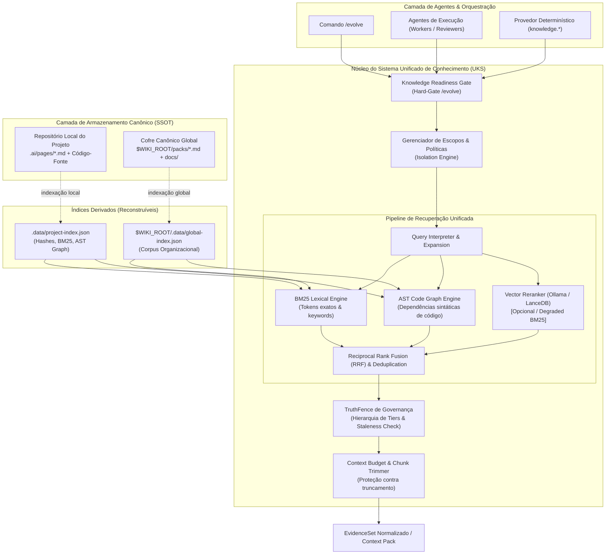
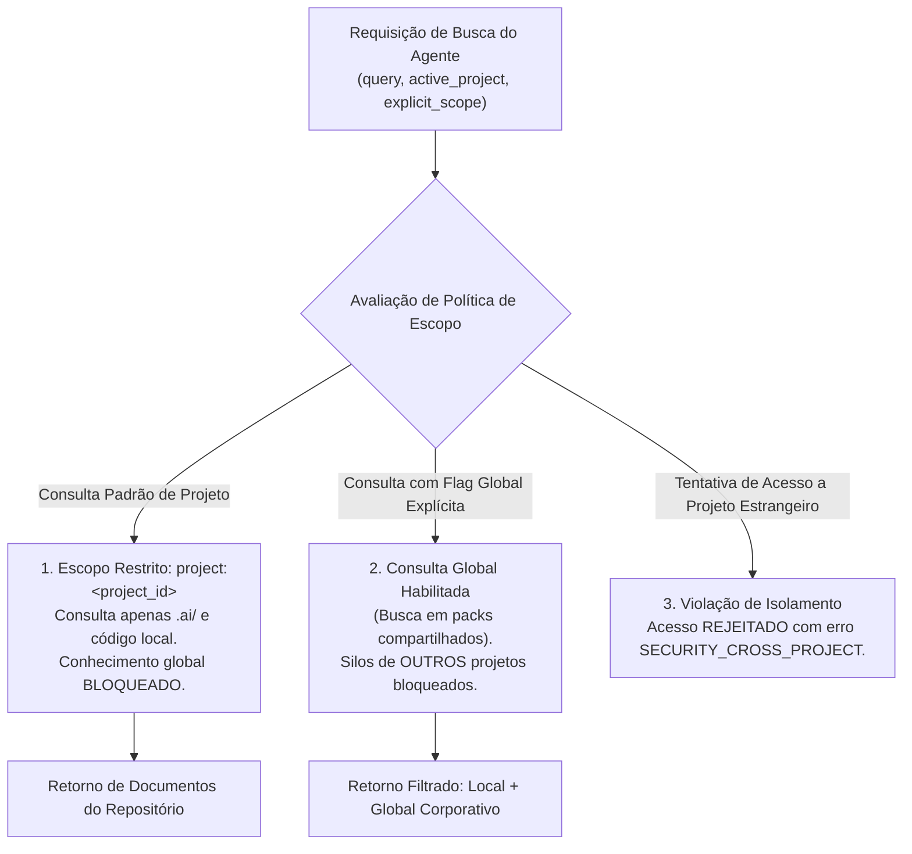
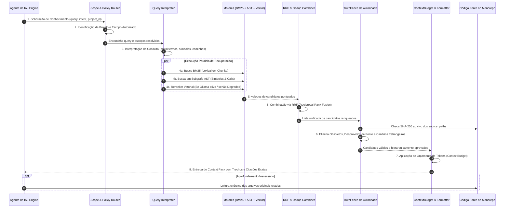

# Arquitetura Proposta: Sistema Unificado de Conhecimento do EvolveLoop

> **Status:** Proposta Arquitetural para Revisão Técnica (Fase C)  
> **Data:** 2026-10-24  
> **Escopo:** Especificação detalhada da arquitetura recomendada (Alternativa B), contratos de dados, modelo de escopos, motor de recuperação híbrido e governança de isolamento.

---

## 1. Visão Geral da Arquitetura

A arquitetura proposta consolida a fragmentação atual do EvolveLoop em um **Sistema Unificado de Conhecimento** (*Unified Knowledge System - UKS*). O sistema é regido por cinco princípios fundamentais de projeto:

1. **Local-First & Markdown como SSOT Canônico:** O conhecimento durável de domínio reside exclusivamente em documentos legíveis por humanos e versionáveis via Git. Nenhum banco de dados binário proprietário ou opaco atua como fonte primária da verdade.
2. **Índices como Artefatos Descartáveis e Reconstruíveis:** Embeddings vetoriais, manifestos de hashes, índices léxicos e grafos de código são representações derivadas. Qualquer índice corrompido ou ausente pode ser inteiramente reconstruído a partir do código e dos arquivos Markdown a qualquer momento.
3. **Escopos Rígidos e Particionamento Físico de Conhecimento:** O conhecimento de um projeto pertence ao seu repositório. O conhecimento global compartilhado reside no cofre organizacional (`$WIKI_ROOT`). O motor impõe fronteiras físicas e lógicas no momento da recuperação, não por meras instruções no prompt.
4. **Recuperação Híbrida Seletiva e Degradação Graciosa:** Combina busca lexical (BM25 rápido e determinístico), grafo topológico de dependências (AST local) e reranqueamento vetorial semântico (via Ollama local opcional). A indisponibilidade de modelos de embedding degrada automaticamente para busca léxica/AST com flag `degraded: true`, garantindo operação offline contínua (ADR-0005).
5. **Governança de Verdade Rígida (TruthFence):** Preserva e expande o princípio de autoridade: `Código Real (Tier 0) > Documentação Local do Repositório (Tier 1) > Cofre Global (Tier 2) > Inferências do Modelo (Tier 3)`.



---

## 2. Fonte Canônica de Conhecimento (6.1)

A arquitetura estabelece uma separação axiomática entre **Verdade Canônica** e **Dados Derivados**:

### 2.1. O que é Fonte Canônica (SSOT)
- **Código-Fonte:** Os arquivos de código do projeto (`.ts`, `.py`, `.go`, etc.). Constitui a realidade empírica inquestionável.
- **Notas de Projeto (`.ai/pages/*.md`):** Arquivos Markdown armazenados no controle de versão do próprio repositório. Documentam decisões arquiteturais, armadilhas conhecidas, convenções e regras de negócio específicas daquele código.
- **Notas Globais do Ecossistema (`$WIKI_ROOT/packs/*.md`):** Documentos Markdown que descrevem padrões arquiteturais reutilizáveis, contratos de bibliotecas transversais, diretrizes de segurança organizacional e lições aprendidas em múltiplos projetos.
- **Configurações e Políticas:** Arquivos YAML no repositório (`profiles/default.yaml`, manifestos de capabilities).

### 2.2. O que são Representações Derivadas (Descartáveis)
- **Índices de Chunks e Tokens BM25:** Estruturas de dados em disco geradas a partir da leitura dos arquivos Markdown.
- **Catálogos de Hashes SHA-256:** Registros gerados para verificar se os arquivos de código citados em `source_paths` sofreram alterações desde a última redação da nota.
- **Grafo Sintático AST de Código:** Arestas e nós de relacionamentos (`calls`, `imports`, `implements`) extraídos estaticamente do código-fonte.
- **Embeddings e Tabelas LanceDB:** Vetores multidimensionais gerados para permitir busca semântica por aproximação de tópicos.

> [!IMPORTANT]
> **Regra de Sobrevivência:** Se o diretório `.data/` do projeto ou o cache de vetores for apagado por completo (`rm -rf .data/`), nenhuma informação se perde. O comando de reconstrução (`rebuild`) reconstitui o estado completo em segundos a partir do código e dos arquivos Markdown.

---

## 3. Modelo de Escopos e Política de Isolamento (6.2)

O isolamento entre projetos é um dos pilares mais críticos da proposta, evitando alucinações onde decisões de um projeto A vazem e contaminem implementações no projeto B.

### 3.1. Definição Conceitual de Escopos
O sistema define dois escopos canônicos:
1. `project:<project_id>`: O escopo estrito do projeto em trabalho. Corresponde à raiz do repositório atual e sua pasta local `.ai/`. O identificador `project_id` é resolvido de forma estável (ex.: nome do pacote em `package.json`, slug do diretório Git ou campo explícito no perfil).
2. `global`: O escopo corporativo e compartilhado, apontado por `$WIKI_ROOT`. Contém documentação transversal e packs de capacidades.



### 3.2. Política de Acesso e Trade-Offs

A questão de permitir ou bloquear o acesso ao conhecimento global durante tarefas de projeto foi analisada sob três modelos:
- **Modelo 1 — Bloqueio Total:** Durante tarefas de projeto, a busca global é desligada.  
  *Trade-off:* Isolamento absoluto, mas impede o agente de consultar diretrizes organizacionais (ex.: políticas de segurança ou padrões de logging).
- **Modelo 2 — Fusão Automática Irrestrita:** As buscas consultam local e global simultaneamente.  
  *Trade-off:* Causa poluição de contexto, empurra notas corporativas irrelevantes para dentro do prompt e consome orçamento de tokens.
- **Modelo 3 (Recomendado) — Restrição Local por Padrão com Acesso Global Explícito ou Seletivo por Categoria:**
  - **Comportamento Padrão:** Toda consulta disparada por agentes em tarefas técnicas restringe-se estritamente ao escopo `project:<project_id>`.
  - **Acesso Global Condicional:** O acesso ao escopo `global` é liberado apenas em duas situações:
    1. Invocação explícita do agente solicitando escopo global (ex.: `knowledge.search(query, scope="global")`).
    2. Fallback de Grounding para Categorias Corporativas Homologadas (ex.: convenções de segurança, padrões de API e tooling compartilhado sob `$WIKI_ROOT/packs/`).
  - **Bloqueio Incondicional de Outros Projetos:** Em nenhuma hipótese uma consulta no projeto A terá acesso às pastas `projects/<outro_projeto>/` do cofre global.

---

## 4. Modelo de Documentos e Metadados de Entidades (6.3)

Para garantir integridade, auditoria e descarte cirúrgico de itens obsoletos sem sobrecarregar o formato com campos supérfluos, o sistema padroniza o esquema mínimo de metadados obrigatórios no frontmatter das notas e no catálogo de índices:

```yaml
---
# Identificador estável único (formato: <escopo>/<slug>)
id: "project:evolveloop/engine-execution"

# Escopo normativo de pertencimento
scope: "project:evolveloop"

# Título legível para humanos
title: "Ciclo de Execução e Hard-Gates do Engine"

# Tipo semântico do conteúdo (regras estritas para TruthFence)
content_type: "decision" # "decision" | "architecture" | "contract" | "pattern" | "troubleshooting"

# Nível hierárquico canônico
tier: "ai" # "ai" (local) ou "vault" (global)

# Caminho relativo canônico do arquivo no repositório
path: ".ai/pages/engine-execution.md"

# Arquivos de código fonte aos quais este conhecimento está criptograficamente atrelado
source_paths:
  - "orchestrator/src/engine/execution-engine.ts"
  - "orchestrator/src/jobs/checkpoint.ts"

# Termos-chave e conceitos para indexação lexical e semântica
keywords:
  - "execution engine"
  - "gates"
  - "checkpoint"
  - "transição de fase"

# Relações nomeadas com outras notas ou entidades
relations:
  depends_on:
    - "project:evolveloop/evidence-bus"
  implements:
    - "global:standards/hard-gate-protocol"

# Versão do esquema e carimbo temporal da última indexação
schema_version: 1
last_indexed_at: "2026-10-24T16:00:00Z"
---
```

### Justificativa dos Campos:
- `id` e `scope`: Permitem roteamento de consulta e isolamento determinístico antes de qualquer scoring.
- `content_type`: Informa ao `ContextBudget` a criticidade do trecho (ex.: `contract` e `decision` recebem prioridade máxima de retenção em relação a descrições genéricas).
- `source_paths`: Mecanismo que vincula o texto ao código-fonte. O motor verifica o SHA-256 desses caminhos; se o código mudar, a nota é instantaneamente marcada com `status: obsoleto`.
- `relations`: Permite navegação relacional leve sem necessidade de banco de grafos dedicado.

---

## 5. Pipeline de Recuperação Unificada em 8 Etapas (6.4)

O processo de recuperação substitui a execução dispersa de scripts por um fluxo coeso e rastreável de 8 etapas:



### Detalhamento das 8 Etapas:

1. **Recebimento da Solicitação:** O agente ou etapa do IR submete uma consulta declarando `query`, `intent` (ex.: "implementar checkpoint", "revisar permissão") e identificador do projeto ativo.
2. **Identificação de Projeto e Escopo Permitido:** O `ScopeManager` verifica as credenciais da tarefa. Se estiver em uma feature de projeto, restringe as fontes a `project:<id>`. Se a query declarar intenção de padrões organizacionais, autoriza a adição de `global/packs`.
3. **Interpretação e Expansão da Consulta:** A query é analisada: se contiver nomes de símbolos de código (`applyContextBudget`, `ExecutionEngine`), o sistema sinaliza prioridade para busca em AST; se contiver termos conceituais, expande sinônimos e termos-chave.
4. **Recuperação de Candidatos por Mecanismos Apropriados:**
   - **BM25 Lexical:** Executa correspondência exata de termos sobre o catálogo unificado de chunks (latência típica: 5ms a 15ms).
   - **AST Code Graph:** Extrai caminhos de código e nós de funções chamadas utilizando a árvore sintática do repositório (latência típica: 20ms a 50ms).
   - **Vector Embeddings (Opcional):** Se o daemon Ollama local estiver ativo e o modelo responder, realiza busca vetorial para encontrar paráfrases conceituais. Se indisponível, emite `degraded: true` e conclui a busca com BM25 + AST sem falhar.
5. **Combinação e Classificação (RRF):** Os candidatos dos três motores são normalizados e ranqueados utilizando *Reciprocal Rank Fusion (RRF)* com ponderação determinística:
   $$\text{Score}(d) = \sum_{m \in \{\text{BM25, AST, Vector}\}} \frac{w_m}{k + \text{rank}_m(d)}$$
6. **Eliminação de Duplicidades e Validação de Integridade (TruthFence):**
   - Compara o hash SHA-256 dos `source_paths` indexados com o hash real do código no monorepo naquele instante. Se houver divergência, a nota é rebaixada e recebe a marcação `stale: true (source_hash_mismatch)`.
   - Aplica a sobreposição de autoridade: decisões no código superam notas de documentação; notas locais superam notas globais.
   - Remove canários e caminhos que pertençam a outros projetos.
7. **Aplicação de Orçamento e Formatação:** O `ContextBudget` processa os trechos aprovados: fatias de contratos e decisões são preservadas intactas; trechos longos são recortados nos limites exatos de parágrafo/função até atingir o limite orçamentário configurado (default: 4.000 tokens para grounding).
8. **Entrega de Trechos e Handoff para Leitura Direta:** O agente recebe o *Context Pack* pronto, contendo os trechos exatos, os caminhos ranqueados e citações `arquivo:linha`. O agente só recorre à leitura direta de arquivos (`read_file`) nos arquivos especificamente apontados pela recuperação, eliminando varreduras cegas de diretório.

### Quando Usar Cada Mecanismo de Recuperação?

| Cenário de Consulta | BM25 Lexical | Grafo AST de Código | Vetores (Ollama) | Leitura Direta de Arquivo |
|---|---|---|---|---|
| **Busca de identificador/função exata** | **Primário** | **Complementar** | Desnecessário | Apenas no arquivo retornado |
| **Mapeamento de dependências entre módulos** | Secundário | **Primário** | Desnecessário | Desnecessário |
| **Consulta conceitual/arquitetural ampla** | **Primário** | Não se aplica | **Primário (se online)** | Apenas nas notas top-ranked |
| **Verificação de contrato de API/Payload** | **Primário** | Secundário | Desnecessário | Apenas no arquivo de contrato |
| **Grounding antes de `/planejar`** | **Ativo** | **Ativo** | **Ativo (opcional)** | Bloqueada até geração do pack |

### Prevenção de Falsos Negativos (Como Evitar Esconder Arquivos Críticos)
Para evitar que uma recuperação imperfeita oculte arquivos fundamentais da implementação:
- O motor sempre inclui na resposta a lista de **arquivos adjacentes de primeiro grau** (`imports` diretos e arquivos de teste correspondentes via AST).
- Se a busca léxica retornar zero hits (`empty_corpus` ou `no_hits`), o sistema emite um alerta explícito de **GAP de Documentação** e autoriza o agente a utilizar ferramentas de inspeção de arquivos do monorepo (`find_files`, `search_files`), registrando a ausência de documentação no relatório de evidência.

---

## 6. Governança e Transições de Estado

A integração com o ecossistema EvolveLoop ocorre de forma não intrusiva:
- O provedor TypeScript `knowledge.ts` permanece como interface estável para o orquestrador, consumindo internamente o motor unificado.
- O formato de entrega para o agente é o mesmo `EvidenceSet` com os campos `hits`, `degraded`, `degraded_reason` e `error_code`, mantendo compatibilidade total com os testes unitários e de integração existentes.
