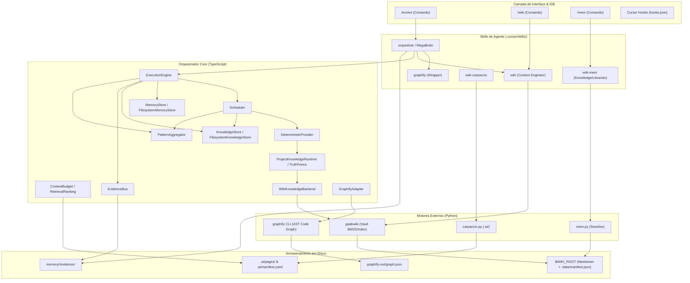

# Mapa de Dependências e Consumidores do Ecossistema

> **Objetivo:** Mapear rigorosamente a topologia de dependências de runtime, compilação, chamada e dados entre os componentes de conhecimento do EvolveLoop, discriminando explicitamente relações comprovadas no código de deduções lógicas.

---

## 1. Grafo Geral de Dependências e Chamadas

---

## 2. Matriz Detalhada de Relações

| Componente Origem | Componente Destino | Tipo de Relação | Evidência | Observações |
|---|---|---|---|---|
| `orquestrar` | `graphify` (skill) | Invocação Condicional | `VERIFIED_IN_CODE` | Executa o subset local antes do grounding; marca `blocked` se ausente. |
| `orquestrar` | `wiki` (skill) | Invocação Compulsória | `VERIFIED_IN_CODE` | Hard-gate obrigatório de grounding na Fase 0. |
| `orquestrar` | `EvidenceBus` | Leitura / Escrita em Disco | `VERIFIED_IN_CODE` | Bloqueia comando `continuar` na ausência física de `memory/<id>/evidence/*.json`. |
| `DeterministicProvider` | `knowledgeSearch` | Chamada Direta de Função | `VERIFIED_IN_CODE` | `orchestrator/src/providers/deterministic/index.ts#L103-L108`. |
| `knowledgeSearch` | `resolveKnowledgeBackend` | Resolução Dinâmica | `VERIFIED_IN_CODE` | `orchestrator/src/providers/deterministic/knowledge.ts#L47`. |
| `knowledgeSearch` | `fenceEvidenceSet` | Pipeline de Filtragem | `VERIFIED_IN_CODE` | Aplica a cerca de autoridade sobre todos os hits retornados. |
| `WikiKnowledgeBackend` | `gaabwiki` (Python) | Subprocesso (`spawn`) | `VERIFIED_IN_CODE` | Invocação CLI com timeout de 20s em `wiki-backend.ts#L41`. |
| `ExecutionEngine` | `KnowledgeStore` | Chamada de Método | `VERIFIED_IN_CODE` | Proposição de aprendizados duráveis em `execution-engine.ts#L760`. |
| `ExecutionEngine` | `MemoryStore` | Chamada de Método | `VERIFIED_IN_CODE` | Registro de aprendizados contextuais em `execution-engine.ts#L747`. |
| `ExecutionEngine` | `PatternAggregator` | Escuta de Eventos | `VERIFIED_IN_CODE` | Registra falhas de execução em `pattern-aggregator.ts`. |
| `Scheduler` | `KnowledgeStore` | Chamada de Método | `VERIFIED_IN_CODE` | Consulta `knowledgeHits` antes de agendar nós de tarefa. |
| `Scheduler` | `PatternAggregator` | Consulta de Penalidade | `VERIFIED_IN_CODE` | Aplica `providerPenalty` na pontuação de seleção de provedores. |
| `GraphifyAdapter` | `graphify` (CLI) | Subprocesso (`execFileSync`) | `VERIFIED_IN_CODE` | Invocação de `graphify query` e parsing de saídas `src=`. |
| `sync-carpaccio-to-vault.sh` | `gaabwiki` (Python) | Execução de Script | `VERIFIED_IN_CODE` | Sincroniza `.ai/pages` para o cofre e dispara `rebuild`. |
| `wiki-mem` | Cursor Hooks | Trigger via Stdin | `DOCUMENTED_ONLY` | Hooks ausentes do `.cursor/hooks.json` atual do repositório. |
| `ExecutionEngine` | `@modelcontextprotocol/server-memory` | Inexistente | `VERIFIED_IN_CODE` | Nenhuma linha de código importa ou se comunica com este MCP. |

---

## 3. Relações Inferidas vs Comprovadas

### Relações Comprovadas (`VERIFIED_IN_CODE`):
1. **O provedor determinístico de conhecimento depende exclusivamente do `WikiKnowledgeBackend` e do `ProjectKnowledgeRuntime`:** O código TypeScript isola perfeitamente a chamada ao Python e a aplicação da cerca da verdade.
2. **O avanço de fases em `orquestrar` depende fisicamente do sistema de arquivos:** O script de orquestração checa a existência física dos arquivos em `memory/<feature_id>/evidence/`.
3. **O Graphify opera como um pré-portão desacoplado:** A ausência do executável não bloqueia o fluxo de desenvolvimento; apenas registra o status `blocked` e cede a vez para o grounding da Wiki.

### Inferências Desmentidas pela Auditoria (`INFERRED → REFUTED`):
1. *Hipótese:* O `GraphStore` em `orchestrator/src/graph/` seria um grafo de conhecimento consultável.  
   **Realidade:** O `GraphStore` gerencia puramente o DAG de nós computacionais do `CapabilityIR`.
2. *Hipótese:* O diretório `memory/` conteria arquivos `preferences.yaml` e `decisions.yaml` do `FilesystemMemoryStore`.  
   **Realidade:** Os arquivos existentes em `memory/` são relatórios de planejamento, JSONs de evidência e testes forenses de tokens. O `MemoryStore` não tem dados físicos populados no checkout atual.
3. *Hipótese:* O repositório conteria uma base local em `knowledge/` com dezenas de regras de arquitetura.  
   **Realidade:** O diretório `knowledge/` não existe na raiz do repositório. Os aprendizados arquiteturais foram formalizados em `.ai/pages/` e em ADRs em `docs/adr/`.

---

## 4. Fragilidades de Integração Identificadas

1. **Acoplamento a Caminhos de Venv Não Determinísticos:**  
   A skill `graphify` aponta rigidamente para `/tmp/graphify-skill-hardgate-venv/bin/graphify`. Como `/tmp` é limpo na reinicialização do sistema operacional, o gate cai frequentemente em estado `blocked`.
2. **Sobrecarga de Spawn de Processos Python:**  
   Toda busca executada pelo `WikiKnowledgeBackend` cria um novo processo Python (`python -m gaabwiki`). Em execuções com dezenas de consultas de grounding sequenciais, isso gera overhead significativo de I/O e inicialização do interpretador.
3. **Descompasso entre as Memórias:**  
   Existem três definições paralelas de memória de sessão que não se comunicam:
   - `MemoryStore` do orquestrador (espera arquivos YAML em `memory/`).
   - `wiki-mem` (espera histórico de conversas em `$WIKI_ROOT/.ai/sessions/`).
   - `EvidenceBus` (persiste arquivos JSON de portão em `memory/<feature_id>/evidence/`).
