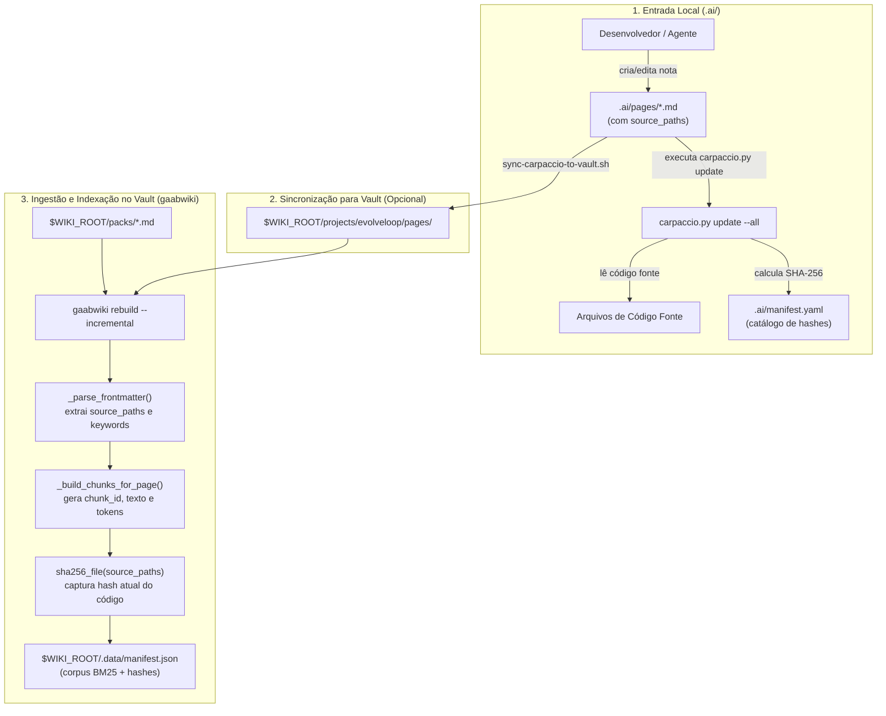
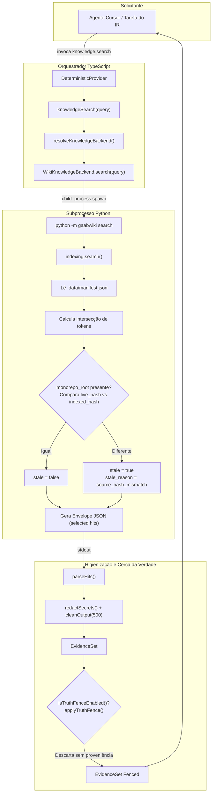
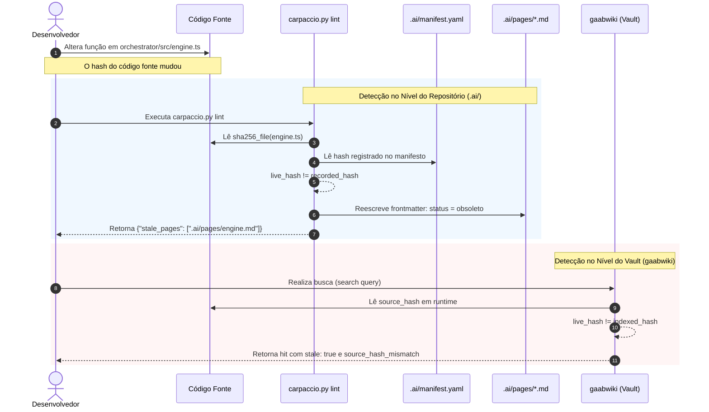
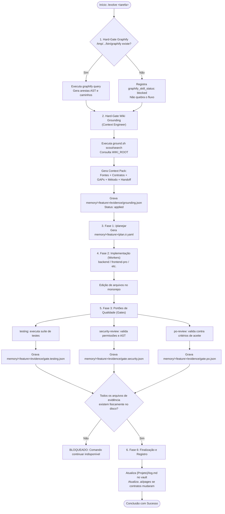

# Rastreamento dos Fluxos Completos de Conhecimento e Memória

> **Objetivo:** Documentar detalhadamente os caminhos reais de dados, controle e execução que conectam os mecanismos de conhecimento no EvolveLoop, diferenciando fluxos comprovados no código daqueles que operam manualmente ou que estão ausentes.

---

## 1. Fluxo de Entrada de Conhecimento

O conhecimento entra no ecossistema EvolveLoop por duas origens distintas:
1. **Documentação de Projeto Local (.ai/ Carpaccio):** Originada de notas redigidas por desenvolvedores ou agentes durante o trabalho no monorepo.
2. **Cofre Canônico (Wiki Vault):** Base de notas estruturada sob `$WIKI_ROOT` (`projects/` e `packs/`).

### Detalhamento das Etapas:
1. **Redação da Nota:** O autor cria uma nota Markdown em `.ai/pages/<nome>.md` incluindo frontmatter YAML com metadados obrigatórios (`title`, `keywords`, `source_paths`, `status: atual`).
2. **Registro de Hashes Locais:** Executa-se `python3 .cursor/skills/wiki-carpaccio/scripts/carpaccio.py update --all`. O script lê cada arquivo apontado em `source_paths`, calcula seu hash SHA-256 via `hashlib` e grava em `.ai/manifest.yaml` (`VERIFIED_IN_CODE`).
3. **Sincronização:** O script `docs/architecture/v2.2/scripts/sync-carpaccio-to-vault.sh` copia `.ai/pages/` para o diretório de projetos do cofre (`$VAULT/projects/evolveloop/pages/`).
4. **Indexação:** Executa-se `python -m gaabwiki rebuild --incremental`. A função `rebuild()` em `fixtures/evolveloop-wiki-vault/gaabwiki/indexing.py`:
   - Varre as pastas de projetos e packs.
   - Divide documentos em `Chunk`s com `chunk_id` determinístico (`<vault_path>#<digest>`).
   - Tokeniza o texto e palavras-chave via regex `[\w./-]+`.
   - Lê os arquivos de código correspondentes no monorepo e registra seus hashes em `source_hashes`.
   - Persiste o índice em `.data/manifest.json`.

---

## 2. Fluxo de Consulta de Conhecimento

Existem dois caminhos de consulta no ecossistema:
- **Caminho A (Agent Skill no Cursor):** O agente invoca a skill `wiki` ou executa `ground.sh` diretamente no terminal.
- **Caminho B (Runtime Determinístico do Orquestrador):** O plano de tarefas executa a capability `knowledge.search`.

### Detalhamento das Etapas:
1. **Chamada:** O chamador dispara `knowledgeSearch(query, options)` (`VERIFIED_IN_CODE`).
2. **Resolução de Backend:** `resolveKnowledgeBackend()` consulta o perfil e seleciona `WikiKnowledgeBackend` (`VERIFIED_IN_CODE`).
3. **Validação de Raiz:** Valida se `WIKI_ROOT` existe em disco. Se ausente, devolve imediatamente `error_code: "RAG_REPO_MISSING"` com hits vazios (`VERIFIED_BY_TEST`).
4. **Execução de Subprocesso:** Spawna `python -m gaabwiki search <query>` com timeout estrito de 20 segundos (`VERIFIED_IN_CODE`).
5. **Busca e Checagem de Staleness:**
   - O Python tokeniza a consulta e calcula pontuação por sobreposição de termos.
   - Para os melhores candidatos (`top_k`), lê o arquivo físico de código fonte no monorepo e calcula o SHA-256 ao vivo.
   - Se o hash mudou desde a última indexação, marca `stale: true` (`VERIFIED_BY_TEST`).
6. **Parsing e Redação:** O Node.js recebe o stdout, faz o parse de JSON, remove credenciais sensíveis (`redactSecrets`) e trunca trechos em 500 caracteres (`VERIFIED_IN_CODE`).
7. **Cerca da Verdade (Truth Fence):**
   - Descarta hits sem proveniência explícita.
   - Verifica se há sobreposição com código ativo. Se houver contradição, o código prevalece sobre a documentação (`VERIFIED_BY_TEST`).

---

## 3. Fluxo de Detecção de Mudança e Atualização (Staleness Lifecycle)

Um dos pontos mais fortes do EvolveLoop é a detecção sistemática de código que divergiu da documentação.

### Evidências:
- A marcação de `status: obsoleto` foi comprovada em código e executada em tempo real com `carpaccio.py lint` (`OBSERVED_AT_RUNTIME`).
- O retorno de `stale: true` em `gaabwiki.search` é comprovado no teste unitário `test_stale_after_source_change` em `fixtures/evolveloop-wiki-vault/tests/test_index.py` (`VERIFIED_IN_CODE`).

---

## 4. Fluxo de Exclusão e Invalidação

A auditoria identificou que **não existe um fluxo automatizado de propagação de exclusão (Delete cascade)** entre o monorepo e o cofre da Wiki.

### Comportamento Real Implementado:
1. **Exclusão de Arquivo de Código Fonte:**
   - Se um arquivo de código citado em `source_paths` for deletado do monorepo, a execução de `carpaccio.py lint` detecta que `not fp.is_file()` e marca a página como `status: obsoleto` (`VERIFIED_IN_CODE`).
   - No vault (`gaabwiki`), a função `source_hash()` retorna `None`, e a consulta subsequente marca a fonte como inconsistente.
2. **Exclusão de Página Documental em `.ai/pages/`:**
   - Se uma página `.md` for apagada em `.ai/pages/`, o arquivo de manifesto local (`manifest.yaml`) não remove a chave antiga automaticamente até que `carpaccio.py update` seja executado.
   - O cofre da Wiki **não apaga a página antiga** a menos que o script `sync-carpaccio-to-vault.sh` seja executado (ele realiza `rm -rf $DEST` e recopia tudo) seguido de `gaabwiki rebuild`.
3. **Ausência de Garbage Collection no Vault:**
   - Se o sincronizador não for rodado, chunks órfãos permanecem em `.data/manifest.json` do vault indefinidamente.

---

## 5. Fluxo de Utilização por Agentes no Ciclo `/evolve`

Este é o fluxo integrado completo que rege a jornada de desenvolvimento no EvolveLoop:

### Pontos Críticos do Fluxo de Agentes:
1. **Prioridade de Grounding:** A regra absoluta do EvolveLoop estipula que nenhum agente implementador pode alterar código sem antes ter a evidência `grounding.json` aprovada (`VERIFIED_IN_CODE`).
2. **Dependência de Arquivos Físicos:** O avanço entre as fases do ciclo de vida não aceita saída de texto puro no transcript da conversa. A função de transição verifica compulsoriamente a existência dos arquivos `.json` sob `memory/<feature_id>/evidence/` (`VERIFIED_IN_CODE`).
