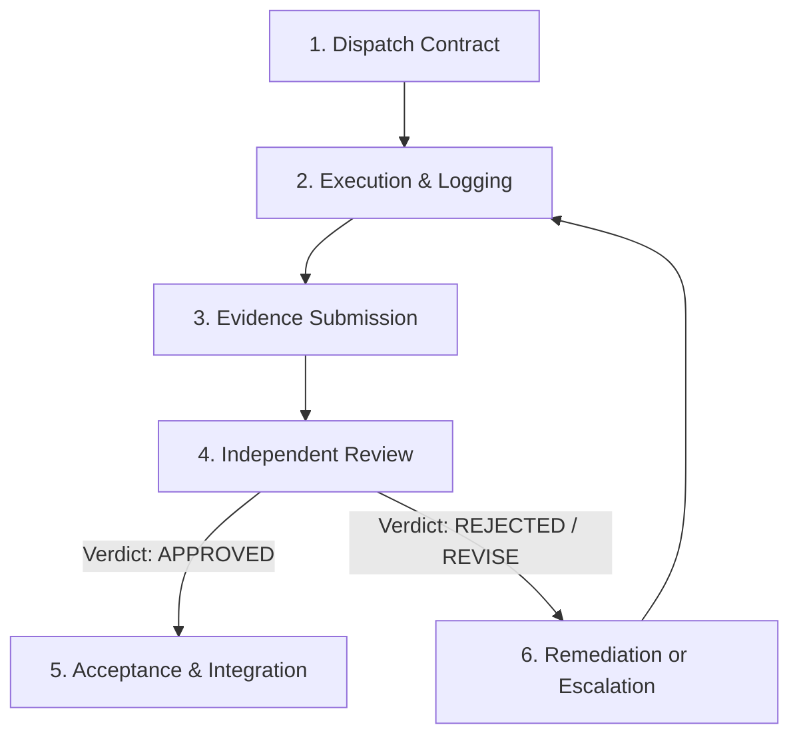

# 03 - DELEGATION PROTOCOL: EvolveLoop V2.5

| Metadata | Specification |
| :--- | :--- |
| **System** | EvolveLoop V2.5 Multiagent Operating System |
| **Document ID** | EL-V25-SETUP-03 |
| **Status** | CANONICAL PROTOCOL |
| **Scope** | Orchestrator ↔ Specialists ↔ Subagents |
| **Last Updated** | 2026-10-24 |

---

## 1. Principles of Delegation

Delegation in EvolveLoop V2.5 is not an informal prompt exchange; it is a **legally binding, programmatically verified contract** between a Delegator (e.g., Orchestrator or Implementation Coordinator) and a Delegate (Specialist or Executor Subagent).

### Axioms of the Protocol
1. **Explicit Boundaries:** Every delegation must define an exact whitelist of files and directories. Any modification outside this whitelist triggers immediate task failure.
2. **Minimal Context Injection:** Delegates are provided only with the essential context required to complete their task, preventing context window saturation and hallucinations.
3. **Evidence-Driven Completion:** A task is never complete based on claims alone; it requires physical evidence files persisted to disk.
4. **Independent Adversarial Verification:** The entity that executes a task is forbidden from performing the final acceptance of that task.

---

## 2. Delegation Hierarchy & Recursion Limits

Delegation follows a structured 3-tier hierarchy:

```
Tier 1: Master Orchestration (Orchestrator)
   │
   ├── Tier 2: Domain Specialists (Planner, Archaeologist, Impl Coordinator, Test Engineer, etc.)
   │      │
   │      └── Tier 3: Operational Executors / Focused Workers (Dedicated Executor, Test Runner)
```

- **Maximum Recursion Depth:** 3 tiers. Tier 3 workers are strictly forbidden from spawning further subagents.
- **Maximum Concurrency:** No more than 4 active agents running concurrently in the system.

---

## 3. Formal Delegation Contract Schema

Every delegation issued by an Orchestrator or Specialist MUST conform to the following structured specification (transmitted as JSON/YAML or structured markdown):

```yaml
delegation_contract:
  contract_version: "2.5.0"
  delegation_id: "del-YYYYMMDD-HHMMSS-<hash>"
  parent_task_id: "<task-id>"
  
  delegator:
    role: "orchestrator" # or implementation_coordinator
    session_id: "<session-or-conversation-id>"
    
  delegate:
    role: "implementation_coordinator" # target agent role
    assigned_model: "inherit" # inherit | flash | pro
    worktree_path: "/home/gaab/orca/workspaces/EvolveLoop/v.2.5"
    
  objective:
    title: "Atomic summary of the exact objective"
    rule_of_one: true # Certifies single atomic objective
    description: >
      Detailed description of the expected behavior, transformation,
      or forensic investigation required.
      
  scope:
    authorized_read_paths:
      - "src/core/"
      - "docs/architecture/"
    authorized_write_paths:
      - "src/core/parser.ts"
      - "tests/core/parser.test.ts"
    forbidden_paths:
      - ".git/"
      - ".env*"
      - "orchestrator/policies/"
      
  context_injection:
    relevant_files:
      - path: "src/core/types.ts"
        focus: "Interface ASTNode and ParserOptions"
    constraints:
      - "Zero runtime dependencies added"
      - "Adhere to strict TypeScript without 'any'"
      
  expected_evidence:
    evidence_dir: ".evidence/v2.5/tasks/<delegation_id>/"
    required_files:
      - file: "execution.log"
        type: "MEASURED"
        description: "Standard output and exit codes from execution"
      - file: "diff.patch"
        type: "VERIFIED_IN_CODE"
        description: "Git diff showing changes made"
      - file: "test_run.json"
        type: "MEASURED"
        description: "Test execution results"
        
  acceptance_criteria:
    - id: AC-1
      criterion: "All unit tests pass with zero failures"
      verification_method: "automated_runner"
    - id: AC-2
      criterion: "TypeScript type check passes cleanly"
      verification_method: "tsc --noEmit"
    - id: AC-3
      criterion: "Diff touches ONLY authorized_write_paths"
      verification_method: "git diff --name-only check"
      
  timeout_seconds: 600
```

---

## 4. The Closed Feedback Loop Lifecycle

The lifecycle of each delegation follows 5 rigorous phases:



### Phase 1: Dispatch Contract
- Delegator validates contract completeness against the schema.
- Delegator verifies that `authorized_write_paths` does not overlap with any concurrently running tasks.
- Delegate is invoked via `invoke_subagent` or `agent-launcher.sh`.

### Phase 2: Execution & Logging
- Delegate operates exclusively within its isolated worktree and authorized scope.
- All stdout/stderr streams are piped into `.evidence/v2.5/logs/<delegation_id>.log`.
- If an agent requires clarification, it messages the Delegator; it never guesses or expands scope.

### Phase 3: Evidence Submission
- Upon finishing, Delegate writes an `EVIDENCE.md` summary and dumps all declared `required_files` to the evidence directory.
- Delegate computes sha256 checksums of generated evidence files.
- Delegate notifies the Delegator via structured message containing the evidence bundle path.

### Phase 4: Independent Review
- The Delegator dispatches the evidence bundle and git diff to the **Independent Reviewer** (`independent_reviewer`).
- Reviewer checks:
  1. Scope compliance: Were any files modified outside `authorized_write_paths`?
  2. Acceptance criteria: Are all ACs backed by `MEASURED` or `VERIFIED_IN_CODE` evidence?
  3. Quality and safety: Are there anti-patterns, security risks, or regressions?
- Reviewer issues a structured verdict: `APPROVED`, `REVISION_REQUIRED`, or `FATAL_REJECT`.

### Phase 5: Acceptance or Rejection
- **If APPROVED:** Delegator accepts the work product, merges the worktree branch into the base branch, and marks the task as completed.
- **If REVISION_REQUIRED:** Delegator feeds the reviewer's specific defect findings back to the Delegate for a targeted remediation loop (max 2 iterations).
- **If FATAL_REJECT or iterations exceeded:** Delegator terminates the task, resets the worktree, and escalates to the Orchestrator / Human Operator.

---

## 5. Scope Violation Enforcement

Any delegate that writes to or mutates a file not explicitly listed in `authorized_write_paths` suffers:
1. Immediate task termination.
2. Complete rollback of the worktree via `git checkout -- . && git clean -fd`.
3. Logging of a `SECURITY_SCOPE_VIOLATION` incident in the evidence bus.
4. Mandatory human intervention before the task can be re-attempted.
