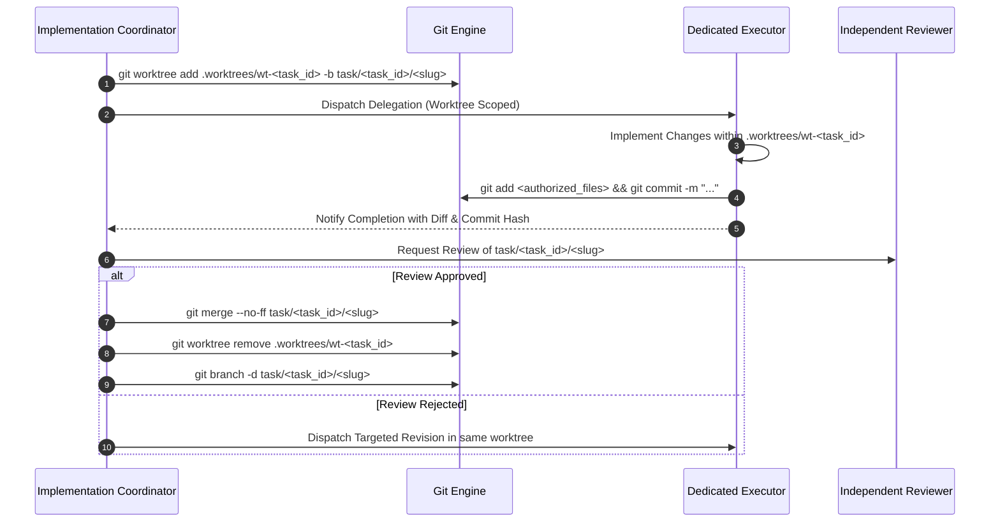

# 06 - WORKTREE POLICY: EvolveLoop V2.5

| Metadata | Specification |
| :--- | :--- |
| **System** | EvolveLoop V2.5 Multiagent Operating System |
| **Document ID** | EL-V25-SETUP-06 |
| **Base Branch** | `GaabDevWeb/v.2.5` |
| **Isolation Mechanism** | Git Worktrees (`git worktree`) |
| **Status** | CANONICAL POLICY |
| **Last Updated** | 2026-10-24 |

---

## 1. Foundational Need for Worktree Isolation

Concurrent multiagent code execution inside a single shared working directory leads inevitably to:
- Dirty working tree race conditions.
- Accidental cross-agent file overwrites.
- Untracked intermediate artifacts contaminating unrelated diffs.
- Inability to cleanly rollback a failed subagent without destroying another agent's work.

To eliminate these hazards, **EvolveLoop V2.5 mandates Git Worktree isolation** for all implementation tasks.

---

## 2. Worktree Topography & Naming Conventions

All agent-isolated worktrees are located within a designated `.worktrees/` directory under the root repository:

```
/home/gaab/orca/workspaces/EvolveLoop/v.2.5/
├── .worktrees/
│   ├── wt-task-001-archaeology/       # Worktree for Task 001
│   ├── wt-task-002-feature-parser/    # Worktree for Task 002
│   └── wt-task-003-test-suite/        # Worktree for Task 003
├── .evidence/v2.5/
├── docs/v2.5/
└── ... (primary workspace files)
```

### Branch Naming Convention:
Branches created for worktrees must follow the pattern:
```
task/<task-id>/<agent-role>/<short-slug>
```
*Example:* `task/task-20261024-001/executor/ast-parser-fixes`

---

## 3. Worktree Lifecycle Workflow



---

## 4. Total Traceability & Commit Standards

Every commit authored within a task worktree must include structured commit metadata to guarantee end-to-end auditability:

```text
feat(parser): implement AST token sanitization

Task-ID: task-20261024-001
Delegation-ID: del-20261024-001
Author-Agent: v25_executor
Coordinator: implementation_coordinator
Reviewer: independent_reviewer
Evidence-Ref: .evidence/v2.5/tasks/del-20261024-001/execution.log
Epistemic-Tier: VERIFIED_IN_CODE
```

### Prohibitions:
- **NO Anonymous Commits:** Commits lacking `Task-ID` and `Author-Agent` trailers are rejected during the review gate.
- **NO Cross-Commits:** An executor may never commit files from outside its assigned worktree directory.
- **NO Direct Merges to Base Branch:** Merges to `GaabDevWeb/v.2.5` can only be performed by the Coordinator or Orchestrator after the Independent Reviewer has published an `APPROVED` verdict.

---

## 5. Worktree Cleanup & Teardown

Transient worktrees must be pruned immediately upon task completion or termination:
```bash
# Graceful removal after merge
git worktree remove --force ".worktrees/wt-${TASK_ID}"
git branch -d "task/${TASK_ID}/${SLUG}"

# Prune dangling worktree references
git worktree prune
```

If a task is aborted due to a timeout or security violation, the worktree is forcibly removed, preserving only the `.evidence/v2.5/logs/` record for forensic analysis.
