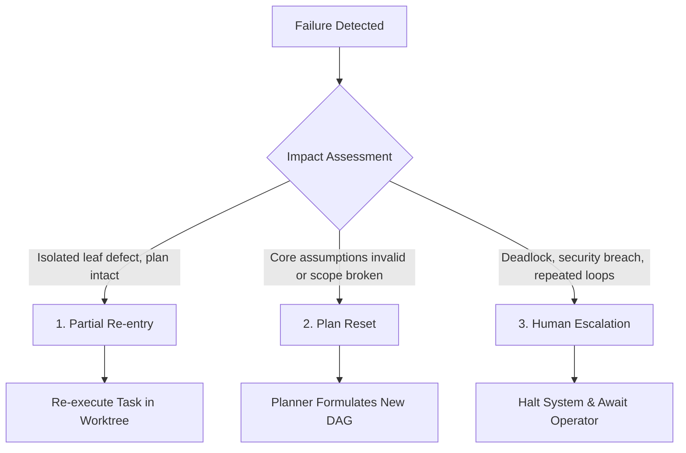

# 09 - FAILURE RECOVERY POLICY: EvolveLoop V2.5

| Metadata | Specification |
| :--- | :--- |
| **System** | EvolveLoop V2.5 Multiagent Operating System |
| **Document ID** | EL-V25-SETUP-09 |
| **Status** | CANONICAL POLICY |
| **Recovery Modes** | `partial` \| `plan_reset` \| `human_escalation` |
| **Last Updated** | 2026-10-24 |

---

## 1. Prime Directive of Fault Transparency

> **AXIOM:**  
> **Under no circumstances may a failure, timeout, broken test, or process crash be masked, ignored, or converted into an optimistic success report.**
> 
> Unhandled errors, skipped tests, or synthetic success flags constitute critical system failures. Every failure must be captured, cataloged with raw logs, and handled through deterministic recovery strategies.

---

## 2. Taxonomy of System Failures

Failures in the V2.5 multiagent system are classified into four distinct operational categories:

| Failure Type | Detection Signature | Immediate System Action |
| :--- | :--- | :--- |
| **Process Timeout** | Agent launcher exceeds deadline (exit code `124`) | Send `SIGTERM` → 5s → `SIGKILL`; mark status `TIMEOUT_EXPIRED`. |
| **Execution Crash** | Non-zero exit code (`1`, `137`, `SIGSEGV`) or uncaught exception | Capture stderr, preserve workspace state, halt step. |
| **Verification / Test Failure** | Test suite reports failures, linters report syntax/type errors | Isolate worktree diff, format defect list, trigger review reject. |
| **Scope / Policy Breach** | Agent attempts to modify files outside `authorized_write_paths` | Immediate process kill, worktree rollback, raise security alarm. |

---

## 3. Re-entry & Recovery Strategies

When a failure occurs, the Orchestrator evaluates the recovery topology and chooses one of three deterministic recovery strategies:



---

### Strategy 1: `partial` (Surgical Re-entry)
- **When Applicable:** 
  - An isolated unit test fails, a syntax error is flagged by a compiler, or an independent reviewer requests targeted fixes.
  - The overall architectural plan and preceding milestones remain completely sound.
- **Protocol:**
  1. Do **NOT** discard previously validated milestone artifacts.
  2. Preserve the active task worktree (`.worktrees/wt-<task-id>`).
  3. Compile a surgical defect list referencing the exact test failures or reviewer notes.
  4. Dispatch a remediation delegation to the executor with `max_iterations = 2`.
  5. Upon success, resume the normal pipeline at the validation gate.

---

### Strategy 2: `plan_reset` (Architectural Re-planning)
- **When Applicable:**
  - Codebase Archaeologist discovers a fundamental architectural constraint that invalidates the original design.
  - Implementation encounters an insurmountable dependency conflict.
  - A partial re-entry fails twice consecutively.
- **Protocol:**
  1. Forcibly rollback the active worktree changes (`git checkout -- . && git clean -fd`).
  2. Mark the active task as `ABORTED_INVALID_ASSUMPTION`.
  3. Package the failure logs and post-mortem findings into `.evidence/v2.5/postmortems/`.
  4. Dispatch a re-planning directive to the **Planner** (`planner`) with the failure context injected as negative constraints.
  5. Generate a new, revised `PLAN.md` for human approval before resuming execution.

---

### Strategy 3: `human_escalation` (Operator Intervention)
- **When Applicable:**
  - A Security Policy breach occurred (unauthorized path write, attempted `sudo`, secret leak).
  - An unresolvable deadlock arises between Implementation Coordinator and Independent Reviewer.
  - System resources (disk space, memory, API tokens) are exhausted.
- **Protocol:**
  1. Immediately suspend all active subagents and child tasks.
  2. Freeze the current worktree and evidence logs in their current state (no destructive cleanup).
  3. Generate a structured **Incident Report** in the terminal:
     - Incident summary and exact root cause.
     - Epistemological evidence citations (`MEASURED` log paths).
     - Recommended recovery options (Option A, Option B, Manual Override).
  4. Await explicit human command before unlocking the orchestrator.

---

## 4. Post-Mortem Logging & Audit Requirements

Every non-trivial failure that cannot be resolved in a single partial pass requires a **Post-Mortem Record** stored in `.evidence/v2.5/postmortems/<incident-id>.md`:

```markdown
# Incident Post-Mortem: [INCIDENT-ID]

- **Timestamp:** YYYY-MM-DDTHH:MM:SSZ
- **Failing Agent:** [agent_identifier]
- **Task ID:** [task-id]
- **Failure Classification:** [Process Timeout | Execution Crash | Test Failure | Policy Breach]
- **Root Cause (VERIFIED_IN_CODE / MEASURED):**
  - Citation to exact log line or source code defect.
- **Mitigation Applied:** [partial | plan_reset | human_escalation]
- **Lessons Learned & Preventative Constraints:**
  - Specific rules added to avoid repeating this failure mode.
```
