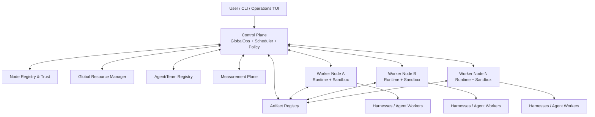

# EVOLVELOOP V3.7 — ADAPTIVE DISTRIBUTED AGENT FABRIC
## Metas, arquitetura-alvo, decisões e critérios de aceitação

**Documento:** `EVOLVELOOP_V3.7_GOALS_AND_ARCHITECTURE_v1.0.md`  
**Status:** Charter técnico proposto — requer validação na Fase 0 antes de congelar contratos  
**Escopo:** V3.7  
**Plataforma inicial:** Linux, Control Plane único ativo e Worker Nodes independentes  
**Princípio:** topologia flexível na execução; autoridade, estado e políticas consistentes no Control Plane

---

# 1. Resumo executivo

A V3.7 deve evoluir o EvolveLoop de uma plataforma single-host que administra múltiplos projetos e workflows para uma **infraestrutura distribuída de coordenação, colaboração e execução de agentes**.

O sistema deverá coordenar múltiplas máquinas Linux, cada uma oferecendo capacidades computacionais e de execução distintas. O Control Plane mantém a autoridade sobre objetivos, tarefas, políticas, budgets, scheduling e estado global. Worker Nodes autenticados oferecem ambientes locais de execução, sandboxes, harnesses, recursos computacionais e armazenamento temporário de trabalho.

A V3.7 não deve ser entendida como “mais agentes” ou “vários Coordinators”. Ela introduz uma separação explícita entre:

- **Control Plane:** autoridade e coordenação global.
- **Worker Node:** máquina física ou virtual registrada e autorizada a executar workloads.
- **Agent Worker:** instância lógica de agente/harness que realiza uma tarefa.
- **Agent Team:** conjunto de agentes organizado para um objetivo e uma topologia de colaboração.
- **Worker Pool:** agrupamento lógico de Nodes/slots que compartilham critérios de capacidade.
- **Artifact Fabric:** transferência e armazenamento verificável de artifacts, checkpoints e pacotes de workspace.

A plataforma deverá escolher não apenas *qual agente* executa uma tarefa, mas também **em qual Node, em qual pool, com qual topologia, com quais recursos, sob quais permissões e com qual estratégia de recuperação**.

O modelo distribuído inicial deve ser deliberadamente conservador: um único Control Plane ativo, múltiplos Workers, protocolo autenticado e versionado, leases e fencing autoritativos, artifacts transferidos por mecanismos verificáveis e nenhuma autoridade global autônoma em cada Worker. Multi-master, consenso distribuído geral, Kubernetes, cloud autoscaling e multi-region ficam fora do primeiro release.

A ambição da V3.7 é ampla: topologias hierárquicas, fan-out/fan-in, pipeline, execução competitiva/especulativa, pools dinâmicos, work stealing e redistribuição. Porém, essas capacidades serão subordinadas a limites de profundidade, fan-out, concorrência, orçamento, autoridade, portabilidade de tarefas e segurança.

---

# 2. Proveniência e baseline arquitetural

## 2.1 Fontes utilizadas

Este charter considera duas fontes distintas:

1. **Auditoria arquitetural fornecida na conversa**, que descreve as linhagens Git locais e os componentes existentes em branches/worktrees separados.
2. **ZIP enviado nesta conversa:** `EvolveLoop-feature-bench-obs-v1-92a8f3e-20261113-2013.zip`, correspondente ao snapshot informado como `feature/bench-obs-v1 @ 92a8f3e`.

O ZIP não contém diretório `.git`; portanto, não permite verificar branch, commit, tags ou ancestry por si só. O relatório de auditoria informa os IDs de referência. Os agentes que implementarem a V3.7 deverão revalidar esses IDs no ambiente Git real.

## 2.2 Estado observado no ZIP

O ZIP contém o Core V3 e o Measurement Plane. Entre os componentes presentes estão:

- `orchestrator/src/v3/agent-registry/`
- `orchestrator/src/v3/task-graph/`
- `orchestrator/src/v3/continuity/`
- `orchestrator/src/v3/locks/`
- `orchestrator/src/v3/recovery/`
- `orchestrator/src/v3/parallel/`
- `orchestrator/src/v3/adapters/`
- `orchestrator/src/v3/engineering/`
- `orchestrator/src/v3/model-catalog/`
- `orchestrator/src/v3/routing/`
- `orchestrator/src/v3/worktrees/`
- `orchestrator/src/telemetry/measurement-plane/`
- `orchestrator/src/events/event-bus.ts`
- `orchestrator/src/persistence/jsonl-event-persister.ts`

O ZIP **não contém**:

- `.git/`
- `docs/v3.5/`
- `docs/v3.6/`
- `orchestrator/src/v3/ops/`
- os artefatos `docs/v3.7/` informados como produzidos pela auditoria.

Assim, o ZIP não representa a árvore integrada da V3.5 + V3.6. Ele representa a linha de Measurement Plane/Core indicada no relatório.

## 2.3 Linhagens informadas pela auditoria

| Linha | Referência informada | Conteúdo |
|---|---|---|
| Base V3 | `v3-complete` → `6b69c3f` | Release V3 congelada |
| Measurement Plane | `feature/bench-obs-v1` → `92a8f3e` | Core V3 + Measurement Plane |
| Runtime | `feature/v3.5-runtime` → `0992cd2` | Sandbox, daemon, approvals e hardening |
| Multi-Workflow | `feature/v3.6-multi-workflow` → `5c1df88` | Linha que inclui V3.5 + GlobalOps V3.6 |

A auditoria recomenda preliminarmente partir da linha V3.6 e portar/integrar o Measurement Plane da branch `feature/bench-obs-v1`.

**Essa recomendação é uma hipótese de integração, não uma autorização para merge cego.** A Fase 0 da V3.7 deverá comparar árvores, commits, contratos, migrações, testes e evidências, estabelecer uma baseline canônica reproduzível e registrar a decisão em ADR.

## 2.4 Lacunas comprovadas no snapshot e limites de interpretação

O snapshot contém contratos de Agent Registry, Delegation Contract, TaskGraph, Continuity/Handoff, Model Catalog, adapters e locks. Isso oferece uma base conceitual para distribuição, mas não prova execução multi-host.

Exemplos concretos:

- `orchestrator/src/v3/agent-registry/types.ts` modela agentes, relações pai/filho, sessão, provider, lease, permissões e budget, mas não estabelece por si só identidade confiável de máquina/Worker Node.
- `orchestrator/src/v3/adapters/types.ts` descreve capacidades de adapters de harness. Adapter de harness não equivale a Worker Node.
- `orchestrator/src/v3/continuity/types.ts` define Handoff Package de tarefa/agente, mas não define transporte autenticado nem transferência distribuída de artifacts.
- `orchestrator/src/v3/task-graph/types.ts` separa o TaskGraph de engenharia do GraphStore de execução de capabilities.
- `orchestrator/src/v3/locks/types.ts` declara explicitamente best-effort mutual exclusion e não exactly-once. Não deve ser tratado como mecanismo de fencing global distribuído sem evolução.
- `orchestrator/src/v3/worktrees/manager.ts` declara que Git worktree não é sandbox OS e não impede que um host agent altere o primary checkout.
- `orchestrator/src/v3/coordinator/service.ts` no snapshot é um serviço de coordenação/persistência V3; não deve ser confundido com o daemon operacional V3.5 reportado na outra linhagem.
- `orchestrator/src/events/event-bus.ts` é um EventBus in-process; `JsonlEventPersister` persiste eventos por feature. Não são, por si só, transporte distribuído entre Nodes.
- `orchestrator/src/telemetry/measurement-plane/types.ts` já contém correlação, proveniência e `node_id` associado ao scheduler node UUID. Esse campo não deve ser reaproveitado semanticamente como identidade de Worker Node físico/remoto sem contrato versionado.

## 2.5 Implicação obrigatória

A V3.7 **não começa pela implementação do protocolo distribuído**. Começa pela convergência das linhagens.

Baseline candidata:
- V3.6 integrada, incluindo o runtime V3.5 operacional;
- Measurement Plane portado/integrado de `feature/bench-obs-v1`;
- testes e evidências reexecutados na árvore resultante.

Se a comparação do Git demonstrar que outra estratégia é mais segura, o agente deverá justificar e registrar a alternativa. Tags históricas não podem ser movidas ou reescritas.

---

# 3. Visão do produto V3.7

**EvolveLoop V3.7 — Adaptive Distributed Agent Fabric**

Uma plataforma local-first e provider-agnostic capaz de coordenar projetos, workflows, equipes dinâmicas de agentes e recursos computacionais distribuídos entre máquinas confiáveis.

O Control Plane deverá:
- manter a autoridade sobre estado global, identidade, políticas e ownership;
- admitir e priorizar workflows;
- decompor objetivos em tarefas;
- selecionar topologias de agentes;
- alocar tarefas em Worker Nodes compatíveis;
- reservar budgets e recursos;
- acompanhar sessões, processos, leases e artifacts;
- detectar falhas e redistribuir trabalho;
- validar resultados por evidências.

Cada Worker Node deverá:
- autenticar-se no Control Plane;
- anunciar capabilities e inventário de recursos;
- receber contratos de execução delimitados;
- preparar workspace e sandbox local;
- executar harnesses/agentes permitidos;
- acompanhar processos locais;
- emitir eventos e resultados;
- persistir checkpoints locais necessários;
- transferir artifacts de forma íntegra;
- respeitar leases, fencing, budgets, autoridade e políticas.

A rede de agentes deverá:
- formar equipes com topologias variáveis;
- suportar hierarquia, paralelismo, pipeline e execução competitiva;
- criar subagentes recursivamente sob limites;
- mover tarefas portáveis entre Nodes;
- usar work stealing quando o ganho esperado superar o custo;
- executar alternativas especulativas apenas em tarefas elegíveis e isoladas.

**Princípio central:** topologia flexível na execução; estado, autoridade, política e evidência governados pelo Control Plane.

---

# 4. Modelo conceitual e entidades

As entidades abaixo são distintas e não devem ser colapsadas:

| Entidade | Significado | Identidade/escopo |
|---|---|---|
| Control Plane | Autoridade global ativa | `control_plane_id`, `epoch` |
| Worker Node | Máquina/VM registrada | `worker_node_id`, identidade criptográfica |
| Agent Worker | Instância de agente executando uma tarefa | `agent_id`, `agent_attempt_id` |
| Agent Session | Sessão de harness/provider | `session_id` |
| OS Process | Processo local e sua árvore | PID/PGID/start time + Node |
| Agent Team | Agrupamento lógico de agentes | `team_id`, topologia/version |
| Worker Pool | Grupo lógico de Nodes/slots elegíveis | `pool_id`, policy/version |
| Workflow | Objetivo operacional | `workflow_id` |
| Task | Unidade de engenharia | `task_id` |
| Delegation | Transferência delimitada de responsabilidade | `delegation_id` |
| Lease | Direito temporário de executar/alterar recurso | `lease_id`, fencing epoch |
| Artifact | Resultado/checkpoint transferível | `artifact_id`, hash |
| Workspace | Clone/worktree local de projeto | `workspace_id`, `worker_node_id` |
| Experiment/Trace | Medição e correlação | IDs do Measurement Plane |

Um Worker Node pode executar vários Agent Workers se sua capacidade e policy permitirem. Uma Agent Team pode conter agentes em Nodes diferentes. Um Agent Worker pode mudar de Node somente por handoff/redistribuição explícitos, com reconciliação de ownership e artifacts.

Não confundir:
- Agent Registry com Node Registry;
- Capability Registry com inventário de recursos de Nodes;
- GraphStore com TaskGraph;
- local Coordinator com Control Plane;
- Worktree com sandbox;
- Handoff Package com transferência de workspace;
- scheduler node UUID com Worker Node identity.

---

# 5. Arquitetura-alvo

## 5.1 Control Plane

Responsabilidades:
- Node Registry e confiança.
- Global Workflow Scheduler.
- Admission e capacidade.
- Resource Manager.
- Agent Registry e Team Registry.
- Delegation Contracts.
- Leases e fencing global.
- Policy/Authority.
- Global state e event correlation.
- Approval orchestration.
- Artifact registry e catálogo de referências.
- Evaluation/evidence.
- Fleet Operations CLI/TUI.

A V3.7 começa com **um único Control Plane ativo**. Persistência durável e restart são obrigatórios; HA multi-master e consenso geral ficam fora desta versão. Se o Control Plane ficar indisponível, Nodes devem seguir política explícita de desconexão e não promover autonomamente outro Control Plane.

## 5.2 Worker Node Runtime

Responsabilidades:
- Enrollment, autenticação e health.
- Capability/resource inventory.
- Heartbeats e lease renewal.
- Receber/validar contratos.
- Local Task Executor.
- Harness Runtime local.
- Sandbox OS local.
- Process supervision.
- Workspace/Worktree local.
- Checkpoint e artifacts locais.
- Event buffer/outbox.
- Upload/transferência autenticada.
- Cancelamento e reconciliação local.

O Worker Runtime não é um segundo GlobalOpsService nem um Coordinator global autônomo. É uma camada de execução subordinada ao Control Plane.

## 5.3 Transporte e protocolo

Criar um protocolo remoto versionado e autenticado, com:
- identidade mútua;
- integridade e confidencialidade do transporte;
- mensagens correlacionáveis;
- IDs idempotentes;
- sequência/acknowledgment;
- deadlines/timeouts;
- retries limitados;
- compatibilidade de versões;
- revogação;
- auditoria;
- limites de tamanho e rate.

A tecnologia de transporte não está pré-escolhida. A Fase 0/ADR deve comparar opções compatíveis com TypeScript/Node, streaming, operações de longa duração, autenticação e operação em rede privada. Não introduzir dependência pesada sem justificativa.

## 5.4 Fluxo macro

## 5.5 Single active Control Plane

Requisitos:
- autoridade explícita e epoch de Control Plane;
- lock/lease de liderança local no início da versão;
- não promover um Worker a Control Plane durante uma partição;
- restart e recuperação a partir de estado persistente;
- Nodes rejeitam comandos assinados/emitidos por autoridade revogada ou epoch antigo;
- decisão de failover manual/operacional, não multi-master implícito.

---

# 6. Node Identity, Enrollment e Trust

## 6.1 Identidade

Cada Worker Node deverá possuir identidade estável e independente de IP, hostname ou Agent ID.

Requisitos:
- `worker_node_id` imutável durante o ciclo de vida lógico;
- credencial/certificado próprio;
- prova de posse da identidade durante conexão;
- associação a owner/fleet;
- capacidades e atributos registrados;
- estado de confiança;
- histórico de enrollment e revogação.

## 6.2 Enrollment

Definir processo seguro:
1. Node inicia em estado não confiável.
2. operador/Control Plane autoriza enrollment;
3. Node prova identidade;
4. Control Plane emite/ativa credencial de curto prazo ou certificado;
5. Node recebe policy e versão de protocolo;
6. Node só pode receber tarefas depois de passar health/capability checks.

Enrollment não deve ocorrer automaticamente apenas porque uma máquina consegue alcançar a porta de rede.

## 6.3 Revogação e rotação

Implementar:
- revogar Node;
- expirar credenciais;
- rotacionar credenciais;
- invalidar sessões;
- bloquear novos leases;
- interromper ou colocar em quarentena workloads conforme policy;
- impedir upload/commit de resultados de Node revogado;
- registrar auditoria.

## 6.4 Estados de Node

Estados mínimos:
- `PENDING_ENROLLMENT`
- `ONLINE`
- `DEGRADED`
- `DRAINING`
- `OFFLINE`
- `QUARANTINED`
- `REVOKED`

Estado do Node é distinto do estado do agente, sessão, processo e tarefa.

---

# 7. Worker Capability & Resource Inventory

Cada Node anuncia capabilities e recursos observados/declarados com proveniência.

## 7.1 Capabilities

Exemplos:
- Linux distribution/kernel/architecture;
- versão de runtime;
- sandbox backend e versão;
- harnesses instalados;
- providers acessíveis;
- modelos locais disponíveis;
- ferramentas/MCPs autorizadas;
- toolchains/compilers;
- capacidade de Git/worktree;
- suporte a GPU/CUDA/ROCm quando presente;
- classes de rede;
- regiões/localidade de dados, se aplicável.

Capabilities devem ser testadas/observadas quando possível. Um binário presente não significa que a capacidade esteja operacional.

## 7.2 Recursos

Inventário:
- CPU cores e load;
- RAM total/disponível;
- armazenamento livre e IO;
- GPU, VRAM e utilization quando disponível;
- slots de execução;
- processos concorrentes;
- largura/latência de rede;
- disponibilidade;
- budgets locais.

Separar valores:
- `OBSERVED`
- `NODE_REPORTED`
- `DECLARED`
- `ESTIMATED`
- `UNAVAILABLE`

Não inventar GPU, tokens, custos ou capacidade.

## 7.3 Freshness

Cada recurso/capability deve ter timestamp e validade. Dados stale não podem ser tratados como capacidade atual.

---

# 8. Remote Execution Protocol e Worker Runtime

## 8.1 Execution Contract

Toda tarefa remota deve receber contrato contendo:
- workflow/goal/task IDs;
- versão e hash do contrato;
- inputs e dependências;
- artifacts de entrada;
- ambiente esperado;
- capabilities obrigatórias;
- permissões e limites;
- budget e deadline;
- lease ID e fencing epoch;
- política de rede;
- workspace destination;
- acceptance criteria;
- evidence requirements;
- versão do protocolo;
- política de cancelamento e retry.

## 8.2 Worker lifecycle

Fluxo:
1. receber dispatch;
2. autenticar origem;
3. validar protocolo e contrato;
4. validar lease/epoch;
5. validar recursos/permissões;
6. reservar slot;
7. preparar workspace/artifacts;
8. iniciar sandbox;
9. iniciar harness/agent;
10. emitir eventos;
11. checkpointar;
12. entregar resultado/artifacts;
13. aguardar acknowledgment/commit;
14. encerrar e liberar recursos.

## 8.3 Worker local autonomy

O Worker pode controlar processos locais sob sua autoridade, mas não pode:
- alterar GlobalOps state diretamente;
- emitir ownership global por conta própria;
- renovar leases de outra Node;
- publicar artifact como aceito sem validação;
- elevar permissões além do Execution Contract;
- criar outro Control Plane;
- continuar mutações protegidas após lease/fencing inválido.

## 8.4 Desconexão

Política inicial conservadora:
- eventos podem ser bufferizados em outbox durável local;
- tarefas podem continuar apenas até limites de lease/policy explicitamente concedidos;
- quando lease expira, mutações globais protegidas e publicação/integração ficam bloqueadas;
- ao reconectar, Worker reconcilia sequence, lease, checkpoints e artifacts;
- execução incerta não é repetida sem reconciliação.

---

# 9. Distributed Scheduling e Worker Pools

## 9.1 Placement em duas etapas

1. **Hard constraints:** segurança, Node trust, platform, capabilities, permissões, data locality, budget, sandbox, protocolo.
2. **Soft ranking:** load, latency, disponibilidade, custo, cache locality, espera, adequação do harness/modelo.

Hard constraints nunca podem ser superadas por um score.

## 9.2 Worker Pools

Pools são agrupamentos lógicos e dinâmicos de Nodes/slots, não máquinas permanentes.

Exemplos:
- `backend-linux-pool`
- `qa-pool`
- `gpu-inference-pool`
- `build-pool`
- `security-review-pool`
- `local-private-model-pool`

Pool membership deriva de capabilities, policy e freshness.

Um Node pode pertencer a vários pools. Um agente não é pool.

## 9.3 Dynamic Worker Pools

V3.7 deverá suportar:
- criar/editar pool lógico;
- filtros de elegibilidade;
- limites de concorrência;
- reserva;
- draining;
- indisponibilidade;
- redistribuição entre Nodes;
- métricas por pool.

Auto-provisionamento de máquinas físicas/cloud não é requisito inicial. Primeiro administrar Nodes já registrados.

## 9.4 Resource Reservations

Reservations devem ter TTL/lease e owner:
- global;
- project;
- workflow;
- task;
- Node;
- agent attempt.

Evitar double booking. Reconciliação deve liberar reservas de tarefas concluídas/canceladas/expiradas, sem liberar recursos ainda usados por processos ativos.

---

# 10. Adaptive Agent Topology

## 10.1 Topologias suportadas

### Hierarchical
Master/Leader/Planner/Workers/Auxiliaries, com Delegation Contracts e budgets herdados.

### Parallel Fan-out/Fan-in
Tarefas independentes executadas em Nodes distintos e resultados agregados por evaluator/leader.

### Pipeline
Etapas especializadas ligadas por dependências e artifacts imutáveis.

### Competitive / Independent Execution
Soluções independentes comparadas por evaluator. Usar apenas quando diversidade agrega valor.

### Recursive Orchestration
Agentes autorizados podem criar subagentes/subequipes dentro de limites globais, hierárquicos e do contrato.

## 10.2 Team Registry

Adicionar modelo explícito para:
- `team_id`;
- objetivo;
- topologia;
- agentes;
- tasks;
- owners;
- limites;
- orçamento;
- estado;
- versionamento;
- evidências.

Team é projeção/agrupamento operacional; não substitui Goal Contract, TaskGraph ou Agent Registry.

## 10.3 Mudança de topologia

A topologia pode evoluir durante execução, desde que:
- mudança seja planejada e registrada;
- tarefas/owners sejam reconciliados;
- contracts sejam versionados;
- budgets sejam recalculados;
- dependências permaneçam válidas;
- leases e permissões sejam respeitados;
- não haja perda de evidência ou ownership ambíguo.

## 10.4 Limites

Configurar:
- max depth;
- fan-out;
- agents per Node;
- agents per team;
- global concurrency;
- budget;
- task deadline;
- retry count;
- speculative replicas.

Não usar limites arbitrários universais; defaults precisam ser conservadores e configuráveis.

---

# 11. Work Stealing e Dynamic Redistribution

## 11.1 Elegibilidade

Uma tarefa só pode ser roubada/redistribuída quando:
- está na fila, READY, pausada ou checkpointada;
- é declarada portável;
- dependências e inputs estão disponíveis;
- ownership anterior pode ser revogado/reconciliado;
- lease anterior expirou ou foi liberado;
- fencing epoch novo foi concedido;
- budget restante é transferível conforme política.

Uma tarefa ativa não pode ser duplicada apenas porque o Worker parece lento.

## 11.2 Procedimento

1. detectar ociosidade/desbalanceamento;
2. localizar tarefa elegível;
3. calcular benefício esperado;
4. obter checkpoint/artifacts;
5. encerrar/quiescer owner anterior quando necessário;
6. revogar lease/ownership anterior;
7. incrementar fencing epoch;
8. preparar workspace no novo Node;
9. revalidar estado;
10. iniciar substituto;
11. medir custo de transferência e resultado.

## 11.3 Métrica

Medir:
- tempo até redistribuição;
- custo de transferência;
- progresso preservado;
- retrabalho;
- custo adicional;
- redução de makespan;
- efeito sobre outros workflows.

Work stealing não deve ocorrer se custo esperado superar benefício ou se tarefa tiver side effects não reconciliados.

---

# 12. Speculative Execution

A execução especulativa será seletiva, opt-in e budgeted.

Casos elegíveis:
- pesquisa sem side effects;
- propostas arquiteturais;
- diagnóstico de bug;
- implementação em workspaces isolados e branches distintas;
- tarefas de alta incerteza/criticidade com critérios comparáveis.

Restrições:
- entradas imutáveis/versionadas;
- workspaces independentes;
- nenhum side effect externo não idempotente;
- orçamento máximo por tentativa e grupo;
- evaluator independente;
- cancelamento de alternativas perdedoras;
- artifacts não são integrados automaticamente;
- ownership/fencing por tentativa.

A V3.7 não deve duplicar tarefas rotineiras por padrão.

A capacidade pode ser lançada como experimental com feature flag, mas deve possuir contratos, limites e testes de segurança antes de ser habilitada.

---

# 13. Distributed Artifact & Workspace Fabric

## 13.1 Princípios

- Não usar filesystem compartilhado como fonte canônica entre Nodes.
- Cada execução possui workspace local isolado.
- Transferir apenas inputs/artifacts necessários.
- Integridade por hash.
- Transporte autenticado e cifrado.
- Deduplicação por conteúdo quando útil.
- Proveniência e owner.
- Retenção/cleanup explícitos.

## 13.2 Artifact model

Cada artifact deverá registrar:
- artifact_id;
- content hash;
- size;
- media/type;
- source Node;
- workflow/task/agent;
- created_at;
- provenance;
- access policy;
- schema/version;
- transfer state;
- integrity verification.

## 13.3 Workspace transfer

Avaliar Git bundle, clone/fetch incremental, patch sets ou outro mecanismo. Não escolher tecnologia antes de medir:
- tamanho do repositório;
- custo de transferência;
- preservação de branches/commits;
- secrets ignorados;
- submodules/LFS;
- worktrees ativos;
- compatibilidade de versões.

Transferência parcial só pode ser usada quando preservar o estado necessário ao contrato.

## 13.4 Integration

Apenas Control Plane/autoridade designada pode aprovar integração global. Worker produz commits/artifacts; integração requer:
- ownership válido;
- fencing atual;
- review/approval quando exigidos;
- verificação de conflitos;
- testes;
- evidência;
- rollback/reconciliation.

---

# 14. Distributed Fault Tolerance, Leases e Fencing

## 14.1 Threat/failure model

Considerar:
- crash de Worker;
- processo vivo após desconexão;
- perda de rede;
- partição;
- Coordinator restart;
- atraso/duplicação de mensagens;
- clock skew;
- lease expiry;
- replay;
- artifact parcial;
- worker comprometido;
- credencial revogada;
- resultado duplicado;
- reconnect de Node stale.

## 14.2 Leases

Leases de tarefa/recurso devem ser emitidas pelo Control Plane e incluir:
- lease ID;
- resource/task;
- owner Node/agent;
- epoch/fencing token monotônico;
- issued/expiry;
- budget;
- allowed operations;
- renewal policy.

## 14.3 Fencing

Toda mutação protegida precisa validar o fencing epoch no ponto de commit/aceitação.

Não basta validar ao iniciar a tarefa.

Um Worker antigo pode continuar executando localmente após perder conexão; porém, não pode publicar/mesclar resultados protegidos quando o epoch estiver obsoleto.

## 14.4 Reconciliação

Após reconnect:
- apresentar identidade e último sequence;
- apresentar estado de execução/processos;
- apresentar lease e epoch;
- apresentar checkpoints/artifacts pendentes;
- receber decisão do Control Plane;
- aceitar, pausar, encerrar ou reconciliar.

Timeout/heartbeat perdido não prova que o Node morreu. Estados incertos devem ser tratados conservadoramente.

## 14.5 Garantias

Não declarar exactly-once global.

Projetar:
- entrega/retry com IDs idempotentes;
- submissão idempotente de resultados;
- deduplicação de artifacts/eventos;
- fencing;
- reconciliação;
- side effects explícitos e aprovados.

Garantias precisam ser descritas por camada: transporte, dispatch, execução local, commit de artifact, integração Git e efeito externo.

---

# 15. Distributed Knowledge e Measurement Plane

## 15.1 Knowledge

Reutilizar fontes e stores existentes. Não criar outro MemoryStore/KnowledgeStore sem decisão fundamentada.

Distinguir:
- Global Knowledge autorizado;
- Project Knowledge;
- Workflow Context;
- Task Context;
- Handoff State;
- Artifact metadata.

A distribuição deve respeitar projeto, ownership e classificação de privacidade.

## 15.2 Measurement Plane

Integrar a branch `feature/bench-obs-v1` à baseline canônica por port controlado.

Não criar outro EventBus ou sistema de telemetria.

Evoluir o schema de Measurement com IDs explícitos:
- control_plane_id/epoch;
- worker_node_id;
- node_session_id;
- agent_id/attempt;
- pool_id;
- lease_id/fencing_epoch;
- artifact transfer ID;
- remote span/trace correlation.

Não reutilizar o `node_id` atual do GraphStore/scheduler como identidade física do Worker Node.

Medir:
- utilização por Node/pool;
- placement decisions;
- fila;
- transferência de artifact;
- latência de rede;
- heartbeat/lease;
- redistribuição;
- work stealing ROI;
- speculative execution overhead;
- custo e qualidade por topologia.

Usage/custos continuam com proveniência. Valores indisponíveis permanecem `UNAVAILABLE`.

---

# 16. Security Model distribuído

A V3.7 deve estender o Security Model da V3.5, não substituí-lo.

Requisitos:
- identidade de Node distinta de Agent ID;
- autenticação mútua;
- credenciais de curta duração;
- rotação e revogação;
- autorização por Node/Project/Workflow/Task;
- task-scoped execution contract;
- sandbox local obrigatório;
- rede default-deny para workload, com exceções explícitas;
- isolamento de artifacts;
- secret broker/fornecimento mínimo;
- auditoria de operações;
- revogação de Node comprometido;
- rate/size limits no protocolo;
- proteção de replay;
- versão de protocolo;
- quarantine/drain;
- nenhuma elevação de autoridade por metadata enviada pelo Worker.

Worker Node não é confiável apenas por estar na mesma LAN.

## 16.1 Segurança de transporte vs sandbox

TLS/mTLS protege transporte e identidade; não substitui sandbox.

Bubblewrap/sandbox restringe execução local; não autentica Node remoto.

Git worktree organiza alterações; não substitui isolamento OS.

As três camadas devem ser validadas separadamente.

---

# 17. Fleet Operations Center

CLI-first, com TUI operacional integrada ao estado persistente.

Visões:
- Nodes: online, degraded, draining, offline, quarantined, revoked;
- capability/resource inventory;
- Worker Pools;
- Agent Workers e Teams;
- workflows distribuídos;
- placement decisions;
- reservations/budgets;
- artifacts/transfers;
- leases/fencing;
- falhas/recovery;
- work stealing;
- speculative attempts;
- segurança/auditoria.

Comandos devem ser definidos a partir dos contratos reais e da CLI existente. Não criar superfície CLI desconectada do Core.

A UI não é owner da execução.

---

# 18. Não objetivos da V3.7

Fora do primeiro release:
- Control Plane multi-master/active-active;
- consenso distribuído geral;
- Kubernetes como requisito;
- cloud autoscaling/provisionamento automático;
- multi-region/global WAN;
- suporte oficial Windows/macOS;
- execução de código em Nodes não confiáveis sem enrollment;
- compartilhar filesystem de projetos diretamente entre Nodes;
- exactly-once global;
- autoevolução irrestrita;
- substituir harnesses/provedores existentes;
- criar um segundo EventBus/Coordinator/ApprovalBroker/Sandbox/KnowledgeStore.

Linux e rede privada são o primeiro ambiente operacional. Outros sistemas poderão ser avaliados posteriormente.

---

# 19. Roadmap proposto

| Marco | Objetivo principal | Entrega verificável |
|---|---|---|
| V3.7.0 | Canonical Lineage & Integration | Baseline V3.6 + V3.5 + Measurement Plane reconciliada e reproduzível |
| V3.7.1 | Control Plane & Node Trust | Node Registry, enrollment, identity, auth, revoke, protocol version |
| V3.7.2 | Remote Worker Runtime | Worker daemon, execution contract, remote dispatch, local sandbox, event outbox |
| V3.7.3 | Distributed Scheduler & Pools | Placement por hard constraints, resource inventory, reservations, pool lifecycle |
| V3.7.4 | Artifact & Workspace Fabric | Transferência íntegra, workspace local, Git bundle/clone strategy, artifact registry |
| V3.7.5 | Distributed Fault Tolerance | Heartbeat, leases, fencing, reconnect, reconciliation, recovery |
| V3.7.6 | Adaptive Agent Teams | Hierarchical, fan-out/fan-in, pipeline, recursive topology control |
| V3.7.7 | Work Stealing & Speculative Execution | Redistribution de tasks portáveis e speculative execution opt-in |
| V3.7.8 | Fleet Operations Center & Release | CLI/TUI, fleet observability, acceptance, release |

A ordem pode ser ajustada se uma dependência demonstrar necessidade, mas nenhum gate obrigatório pode ser descartado.

---

# 20. Gates de aceitação da V3.7

## Gate 0 — Canonical Lineage
- baseline V3.6 identificada e reproduzida;
- V3.5 runtime incluído;
- Measurement Plane integrado sem duplicação;
- ownership de estado definido;
- testes essenciais verdes ou falhas preexistentes catalogadas;
- tags históricas intactas;
- ADR de integração aceito.

## Gate I — Node Identity & Trust
- enrollment autenticado;
- Node identity;
- autenticação mútua;
- revogação;
- rotação;
- replay rejection;
- protocolo versionado;
- Node quarantine;
- isolamento de credenciais.

## Gate W — Worker Runtime
- pelo menos dois Worker Nodes independentes;
- execução remota real;
- contrato validado;
- sandbox local;
- processos rastreados;
- eventos correlacionados;
- cancelamento;
- artifacts/resultados enviados;
- nenhuma autoridade global autoconcedida.

## Gate S — Distributed Scheduling
- placement por hard constraints;
- recurso observado e freshness;
- pools;
- reservations;
- budgets globais e locais;
- concorrência;
- fila e fairness;
- nenhum overbooking indevido.

## Gate A — Artifact & Workspace Fabric
- workspace por Node;
- transferência cifrada;
- hash verificado;
- deduplicação;
- Git history preservado;
- integration governada;
- rollback/reconciliation.

## Gate F — Fault Tolerance
- Worker desconectado;
- lease expirado;
- fencing epoch incrementado;
- Worker stale impedido de publicar/mesclar;
- reconnect e reconciliação;
- handoff a outro Node;
- artifacts/checkpoints preservados;
- workflows não afetados continuam.

## Gate T — Adaptive Topology
- hierarquia;
- fan-out/fan-in;
- pipeline;
- recursão sob budget/policy;
- team registry;
- mudança de topologia persistida;
- Delegation ROI;
- nenhum spawn fora dos limites.

## Gate R — Redistribution & Speculation
- work stealing de tarefa elegível;
- benefício medido;
- ownership revogado antes da transferência;
- fencing validado;
- speculative execution isolada e opt-in;
- resultado comparado por evaluator;
- alternativa perdedora cancelada sem side effects.

## Gate O — Operations & Measurement
- CLI/TUI;
- Nodes e pools visíveis;
- trace cross-node;
- budgets e reservations;
- falhas/leases/transferências;
- auditoria;
- provenance;
- exportação reproduzível.

## Gate E2E — Distributed Engineering
O release exige um cenário real com:
- 1 Control Plane ativo;
- pelo menos 2 Worker Nodes em hosts/VMs Linux independentes;
- pelo menos 3 projetos;
- múltiplos workflows simultâneos;
- pelo menos 2 Nodes executando tarefas reais ao mesmo tempo;
- LLM/harness real em pelo menos um caminho de implementação;
- placement baseado em capabilities;
- transferência de artifact;
- uma falha de Worker/partição controlada;
- lease/fencing/recovery;
- tarefa retomada em outro Node;
- outro workflow permanecendo ativo;
- integração e testes finais;
- evidências correlacionadas.

Containers no mesmo host podem apoiar testes de integração, mas não substituem a prova de Nodes independentes para o release E2E.

## Gate Release
- todos os gates obrigatórios em PASS;
- evidências reproduzíveis;
- matriz completa;
- docs operacionais;
- limitations explícitas;
- build/typecheck/testes;
- Git/tagging conforme convenção;
- nenhuma alteração nas tags históricas;
- sem push sem solicitação explícita.

---

# 21. Métricas de sucesso

A V3.7 deve medir:
- throughput por Node/pool;
- makespan por workflow;
- queue wait;
- placement latency;
- resource utilization;
- reservation conflicts;
- task portability rate;
- artifact transfer bytes/latency/failure;
- Worker availability;
- heartbeat/lease renewal;
- recovery time;
- time to reassign;
- stale fencing rejection;
- task loss/duplicate result;
- work stealing benefit vs transfer cost;
- speculative win rate vs extra cost;
- cost per verified completion;
- quality regression;
- cross-node trace completeness.

Não otimizar apenas quantidade de Agents/Workers. A métrica principal permanece custo/tempo por conclusão verificada, com qualidade e segurança como restrições.

---

# 22. Riscos principais

| Risco | Impacto | Direção de mitigação |
|---|---|---|
| Linhagens Git divergentes | Base inconsistente | Gate 0 antes de feature |
| Node identity fraca | Worker não autorizado | Enrollment e mTLS |
| Fencing local tratado como global | Split-brain | Epoch emitido pelo Control Plane e validado no commit |
| Worker stale | Resultado obsoleto | Lease expiry + fencing + reconcile |
| Artifact leakage | Vazamento cross-project | ACL por artifact, hash, encryption |
| Shared workspace | Corrupção concorrente | Workspaces locais independentes |
| Scheduler sem dados frescos | Placement ruim | Freshness e hard constraints |
| Agent topology ilimitada | Explosão de custo | budgets/depth/fan-out/concurrency |
| Network partition | Estado incerto | Outbox/lease/reconciliation |
| Telemetria duplicada | Métricas falsas | Port Measurement Plane e dedup |
| Dependência de rede/LLM | Bloqueio operacional | Local-first e pausa persistente |

---

# 23. Decisões arquiteturais em aberto

A auditoria informada menciona decisões não resolvidas D01–D03, D06 e D10 relativas a identidade de Nodes, revogação e fencing. O texto integral dessas decisões não está presente no ZIP enviado.

**Não inventar o significado desses IDs.** Antes de congelar ADRs da V3.7:
1. localizar os documentos originais da auditoria `docs/v3.7/`;
2. recuperar o enunciado exato de D01–D03, D06 e D10;
3. mapear cada uma para ADR da V3.7;
4. registrar decisão, alternativas, risco e evidência.

Decisões a formalizar incluem:
- identidade e enrollment de Node;
- autenticação mútua e gestão de certificados;
- modelo de revogação;
- autoridade de lease/fencing;
- comportamento durante partition;
- protocolo e streaming;
- persistência/transport de artifacts;
- modelo de recursos/capabilities;
- worker pools;
- estratégia de work stealing;
- elegibilidade para speculative execution;
- política de offline/reconnect;
- segurança da conexão entre harness e sandbox.

---

# 24. Referências técnicas do snapshot auditado

Os caminhos abaixo foram encontrados no ZIP enviado; linhas exatas devem ser recalculadas no checkout integrado.

| Área | Referência |
|---|---|
| Arquitetura V3 | `docs/v3/V3_ARCHITECTURE_RECONCILIATION.md` |
| Ownership | `docs/v3/V3_COMPONENT_OWNERSHIP.md` |
| Estado V3 | `docs/v3/V3_IMPLEMENTATION_STATUS.md` |
| Release V3 | `docs/v3/V3-COMPLETE.md` |
| Agent Registry / Delegation | `orchestrator/src/v3/agent-registry/types.ts` |
| TaskGraph | `orchestrator/src/v3/task-graph/types.ts` |
| Adapter contracts | `orchestrator/src/v3/adapters/types.ts` |
| Continuity/Handoff | `orchestrator/src/v3/continuity/types.ts` |
| Locks/fencing local | `orchestrator/src/v3/locks/types.ts`, `store.ts` |
| Worktrees | `orchestrator/src/v3/worktrees/manager.ts` |
| Coordinator V3 | `orchestrator/src/v3/coordinator/service.ts` |
| Model catalog | `orchestrator/src/v3/model-catalog/types.ts` |
| Routing | `orchestrator/src/v3/routing/types.ts` |
| EventBus | `orchestrator/src/events/event-bus.ts` |
| JSONL persister | `orchestrator/src/persistence/jsonl-event-persister.ts` |
| Measurement contracts | `orchestrator/src/telemetry/measurement-plane/types.ts` |
| Measurement collector | `orchestrator/src/telemetry/measurement-plane/collector.ts` |
| Measurement trace | `orchestrator/src/telemetry/measurement-plane/trace/builder.ts` |
| Measurement Gap Analysis | `docs/bench-obs/ARCHITECTURE-GAP-ANALYSIS.md` |
| Measurement ownership ADR | `docs/bench-obs/adr/ADR-BENCH-OBS-0001-measurement-plane.md` |

Referências de V3.5 e V3.6 devem ser atualizadas a partir do checkout integrado da Fase 0; elas não estão no ZIP de `feature/bench-obs-v1` utilizado nesta análise.

---

# 25. Definição de conclusão

A V3.7 será considerada completa quando o EvolveLoop demonstrar que administra uma rede de Worker Nodes independentes, executa equipes adaptativas em diferentes máquinas, posiciona tarefas por capacidade e política, transfere artifacts com integridade, recupera falhas sem aceitar resultados de Workers obsoletos e mantém a autoridade global consistente.

**Não é suficiente conectar duas máquinas e executar comandos remotos.** A prova deve demonstrar coordenação distribuída de tarefas de engenharia com ownership, segurança, estado, artifacts, budgets, recuperação e evidências.

A V3.7 não deve ser declarada completa se:
- houver somente simulação de Nodes;
- os Workers compartilharem o mesmo host e isso for apresentado como fault tolerance multi-host;
- fencing for apenas validado no início da tarefa;
- um Worker revogado ainda puder publicar/mesclar resultados;
- artifacts não tiverem integridade/proveniência;
- o Control Plane não conseguir reconciliar estado após desconexão;
- a execução remota escapar das políticas do sandbox;
- os resultados não forem verificáveis.

---

# 26. Princípios finais

1. Reutilizar a V3.5/V3.6 e Measurement Plane; não reconstruir o produto.
2. Uma única autoridade ativa para estado global na V3.7 inicial.
3. Worker Node ≠ Agent Worker ≠ Agent Team ≠ Worker Pool.
4. Hard constraints antes de otimização de placement.
5. Lease expirado não prova processo morto.
6. Fencing deve ser validado no limite de commit/efeito.
7. Worktree não é sandbox.
8. TLS não é sandbox.
9. Worker autenticado ainda recebe apenas permissões delimitadas.
10. Não declarar exactly-once global.
11. Tasks portáveis são pré-requisito para work stealing.
12. Speculative execution é seletiva e budgeted.
13. Measurement Plane observa e mede, não se torna um segundo scheduler.
14. Métricas sem proveniência não são fatos.
15. A release exige prova multi-host real.

**Resultado pretendido:** um EvolveLoop que deixa de coordenar somente agentes em uma máquina e passa a coordenar uma rede inteira de agentes, equipes e recursos computacionais, mantendo controle centralizado de estado, segurança e qualidade.
