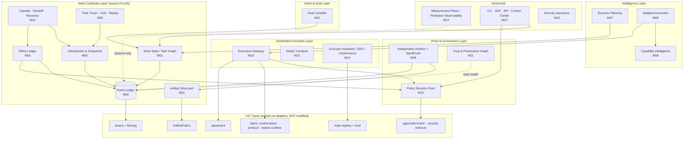

# EvolveLoop V4 — Target Architecture (M00)

| Field | Value |
|-------|-------|
| Owner | M00 — Architecture & Domain Contracts |
| Status | PROPOSED (binding after orchestrator marks M00 ACCEPTED and freezes contracts) |
| Baseline | `03937c175368715e893193fcfad09aac8474286b` — **provisional**; V3.7 global certification is **BLOCKED** on G17 |
| Normative source | `docs/v4/EvolveLoop_V4_Product_Architectural_Constitution.md` (§1, §3, §5, §6, §7, §15.2, §17) |
| Contracts | `orchestrator/src/v4/contracts/` (canonical, TypeScript) · catalog `docs/v4/contracts/CONTRACTS.md` |
| Decisions | `docs/v4/adr/README.md` (ADR-V4-0001 … 0017) |
| Companion | `DOMAIN-MODEL.md`, `OWNERSHIP-MAP.md`, `INTEGRATION-CONTRACTS.md`, `ACCEPTANCE-CRITERIA.md` |
| M18 input | sibling threat model §9 (six freeze items → ADR-V4-0003/0006/0014/0015/0016/0017) |

## 1. Purpose

Translate the constitution's thesis — *the work belongs to the system, not to the agent, model, provider or host* — into
layers, components, data ownership and contracts that M01–M20 can implement in parallel without inventing shared semantics.

This document describes structure. It does **not** implement engines (Goal Compiler, ledgers, handoff, Control Center…).
Where a technical question is still open, it points to an ADR that either fixes a justified default
(`PROPOSED-DEFAULT`) or defers with a decision gate (`DEFERRED`).

## 2. Architectural drivers

| Driver (constitution) | Architectural consequence |
|-----------------------|---------------------------|
| Work belongs to the platform (§1.2, §3) | `Work.owner` is the constant `"platform"`; all work state is a projection of a per-work append-only event stream owned by the Work Continuity layer (ADR-V4-0003). |
| Executors are substitutable (§3) | Executors only see `ExecutionCapsule`s and ports; no component may depend on executor-private memory. Context material is a non-authoritative checkpoint layer (ADR-V4-0005). |
| Explicit state beats implicit memory (§3) | Every progress item carries `ProgressStatus` (CONFIRMED / ATTEMPTED / HYPOTHESIS / UNKNOWN / UNVERIFIED). |
| Evidence beats assertion (§3, §8.3) | `TaskState.SUCCEEDED_UNVERIFIED` vs `VERIFIED`; WorkProof status is a normative derivation (`deriveFinalStatus`), self-reported evidence never qualifies (ADR-V4-0009). |
| Recovery preserves integrity (§3, §7.2) | Recovery starts from the last VERIFIED checkpoint, reconciles open effects, and appends under V3.7 fencing epochs (ADR-V4-0004/0005/0008). |
| Autonomy bounded by policy (§3, §4.10) | Deny-by-default `PolicyDecisionPort` consulted before every effect dispatch; decisions carry policy version + epoch + bounded TTL (ADR-V4-0011). |
| Optimise result, not calls (§3, §13.2) | `CostRecord` with mandatory provenance on every Execution; capability metrics include `cost_per_verified_result`. |
| Failures are first-class (§3, §4.5) | `FailureClass` taxonomy, `ExecutionState.LOST`, `EffectState.UNKNOWN/ESCALATED`, `WorkState.BLOCKED/RECOVERING`. |
| Interoperability without blind coupling (§3, §4.15) | Conformance levels C0–C3 (ADR-V4-0013); external executors integrate through ports, never by writing platform state directly. |
| Complexity must be justified (§3, §14) | One canonical contract package; no new protocol where V3.7 already provides one; deferred decisions instead of speculative machinery. |

## 3. Layers and components



### 3.1 Dependency rules (enforced by review; candidate for lint in M19)

1. **Everything depends on `orchestrator/src/v4/contracts/`; contracts depend on nothing in V4** (only type-only imports of V3.7 shapes in `adapters-v37.ts`).
2. A meta module depends on **another meta only through a port** in `contracts/ports.ts` — never on its concrete classes. Composition (wiring concrete implementations to ports) is M19's job.
3. Only the **Work Continuity layer writes authoritative state**. Every other layer emits commands/events through ports; read models (Provenance M11, Measurement M12, Control Center M15) are rebuildable and non-authoritative.
4. **V3.7 is reached only through `orchestrator/src/v4/adapters/v37/*`**, whose shapes are derived from V3.7 classes (`contracts/adapters-v37.ts`). V4 code must not import `orchestrator/src/v3/**` runtime modules elsewhere.
5. The Measurement Plane **observes**; it never changes business state and never invents values (`ProvenanceKind` reused verbatim; constitution §6.2).
6. Executors (Worker Runtime side) never write the Event Ledger directly: their outputs enter through the Execution Gateway, which validates, applies fencing and appends.

## 4. Architectural boundaries (constitution §6.2)

| Boundary | Rule | Mechanism |
|----------|------|-----------|
| Control Plane ↔ Worker Runtime | Control Plane holds authority (leases, policy, ledger); workers execute under a bounded `ExecutionContract` + capsule. | V3.7 `ExecutionContract`, `DistributedLease.fencing_epoch`; `Execution.lease`; stale epoch → `AppendOutcome.FENCED`. |
| Work state store ↔ model memory | Model/agent memory and conversation context are never authoritative. | `Checkpoint.context_hint` is optional and non-authoritative (INV-CKPT-02); capsules list `not_preserved`. |
| Event Ledger ↔ domain semantics | The ledger guarantees identity, order, dedup, immutability and **tamper-evidence**; domain meaning lives in contracts and owning metas. | `EVENT_TYPE_CATALOG`; hash chain `prev_event_digest` → `event_digest` (ADR-V4-0003, F07); state transition tables. |
| Measurement Plane ↔ business state | Observe & measure only. | `MeasurementSinkPort.emit` is fire-and-forget; no read path from MP into decisions without an explicit contract (M09 consumes CapabilityProfiles, not raw telemetry). |
| Proof/Governance ↔ executors | Executors can neither authorize themselves nor prove their own result. They do not share the Control Plane OS identity (ADR-V4-0016). | `PolicyDecisionPort` outside the executor; `isIndependent()`; `SELF_REPORTED` never qualifies; no payload-asserted trust (ADR-V4-0017). |
| Platform ↔ external services | No exactly-once; effects are tracked, reconciled, compensated or escalated. | `EffectRecord`, `decideRetry`, write-ahead DISPATCHED (ADR-V4-0008). |

## 5. Data ownership (single writer per aggregate)

| Aggregate / record | Single writer (meta) | Storage | Readers |
|--------------------|----------------------|---------|---------|
| WorkEvent stream | M02 (ledger) — producers append via `EventLedgerPort` | per-work append-only stream | all |
| GoalContract, Work, Task (projections) | M01 (M07 appends `plan.revised` / `task.*` for replanning) | projections of events | all |
| Checkpoint | M02 | checkpoint store | M04, M05, M15 |
| Artifact | M02 (`ArtifactStorePort` over V3.7 ArtifactFabric) | content-addressed | all |
| EffectRecord | M03 | projection of `effect.*` events | M04, M05, M06, M11, M15 |
| ExecutionCapsule | M04 | content-addressed artifact | executors, M05 |
| Execution | M13 (Execution Gateway); M04 appends handoff/failure classification | projection of `execution.*` events | M04, M08, M12, M15 |
| Executor | M14 (manifests); worker identities from V3.7 node registry via M13 | registry | M09, M10, M13 |
| Evidence, WorkProof | M06 | events + artifacts | M11, M15, M16, M20 |
| Policy, PolicyDecision | M10 | policy store + `policy.*` events | all enforcement points |
| CapabilityProfile | M08 | profile store | M07, M09, M15 |
| Provenance graph | M11 (derived read model) | rebuildable index | M15, M20 |
| Measurement events | M12 (V3 Measurement Plane) | MP event store | M08, M17 |

Directory ownership is in `OWNERSHIP-MAP.md`; cross-meta interactions in `INTEGRATION-CONTRACTS.md`.

## 6. Fundamental flows mapped to contracts (constitution §7)

### 6.1 Intent → proven result (§7.1)

```mermaid
sequenceDiagram
  participant U as User
  participant GC as Goal Compiler (M01)
  participant L as Event Ledger (M02)
  participant P as Planner (M01→M07)
  participant PDP as Policy (M10)
  participant GW as Execution Gateway (M13)
  participant X as Executor (Worker Runtime, V3.7)
  participant EF as Effect Ledger (M03)
  participant V as Verifier (M06)
  U->>GC: objective + context
  GC->>L: work.created, goal_contract.versioned (ambiguities/assumptions visible)
  GC-->>U: minimal questions if blocking ambiguity (INV-GC-03)
  GC->>L: goal_contract.accepted
  P->>L: task.planned (acyclic, same work: INV-TASK-02/05)
  GW->>PDP: decide(dispatch request)
  PDP-->>GW: PolicyDecision (deny-by-default, TTL-bounded)
  GW->>L: execution.scheduled (lease + fencing epoch)
  GW->>X: ExecutionContract (+ capsule)
  X->>EF: effect.planned → PDP → AUTHORIZED → DISPATCHED (write-ahead) → COMMITTED/UNKNOWN…
  X-->>GW: outputs, artifacts, result_claim (non-authoritative)
  GW->>L: execution.state_changed, artifact.registered, task.state_changed(SUCCEEDED_UNVERIFIED)
  L->>L: checkpoint.created (M02)
  V->>L: evidence.recorded (independent, current artifacts)
  V->>L: task VERIFIED; proof.issued (final_status = deriveFinalStatus)
```

Step 8 of §7.1 ("Verifier validates criteria by independent evidence") is the only path to `VERIFIED`/`PROVEN`.

### 6.2 Recovery after failure (§7.2)

| §7.2 step | Contract mechanism |
|-----------|--------------------|
| 1 Detect & classify | `Execution.failure.failure_class` (`FailureClass`), `execution.failure_classified` (M04) |
| 2 Freeze/isolate | Work → `RECOVERING`/`SUSPENDED`; V3.7 lease revoke ⇒ new fencing epoch |
| 3 Load last recoverable state, reconcile | `CheckpointStorePort.latestConsistent`; `openEffects(checkpoint)`; `EffectLedgerPort.retryDecision` |
| 4 Classify tasks | `TaskState` + `ProgressStatus` (CONFIRMED vs UNKNOWN vs OBSOLETE) |
| 5 Decide retry/handoff/replan/compensate/human | `recovery.decided` (M04) using `decideRetry`; ESCALATED for no safe path |
| 6 New capsule | `CapsuleServicePort.seal` → `ExecutionCapsule` (integrity digest, `open_effects`, `not_preserved`) |
| 7 Validate resumption, fence stale commits | `isCapsuleFormatCompatible`, signature (ADR-V4-0006); ledger `FENCED` for old epoch |
| 8 Record & update reliability | `recovery.*` events; M12 metrics; M08 `recovery_rate` |

### 6.3 Uncertain external effect (§7.3)

`DISPATCHED` is made durable **before** the request leaves the platform; a crash therefore yields `UNKNOWN`, never silence.
`decideRetry(UNKNOWN)` returns `RETRY_WITH_SAME_IDEMPOTENCY_KEY` (target dedups), `RECONCILE_FIRST` (target queryable) or `ESCALATE`
(no safe path — INV-EFF-04 forbids leaving such an effect silently UNKNOWN). Details: ADR-V4-0008.

### 6.4 Time travel & fork (§7.4)

A fork is a **new Work** (`forked_from {work_id, checkpoint_id, event_seq}`, INV-WORK-05) that references the base's immutable
events/artifacts. Inherited effects are read-only history (`fork_inherited=true` ⇒ `decideRetry` = FORBIDDEN for EXTERNAL).
Replay steps are declared `RECORDED` or `REEXECUTE`; side effects are never re-applied automatically. Details: ADR-V4-0007.

## 7. Horizontal capabilities (constitution §6.1)

| Capability | Owner | V4 contract / decision |
|------------|-------|------------------------|
| Event Ledger & versioned event contracts | M02 (M00 contracts) | `WorkEvent`, `EVENT_TYPE_CATALOG`, ADR-V4-0003 |
| Measurement Plane with provenance | M12 | reuse `telemetry/measurement-plane` envelope; `V4ProvenanceKind` ⊇ MP `ProvenanceKind` |
| Identity, authn/z, secrets | M10 (+M18 review) | `ExecutorRef`, `PolicyDecision`, grant refs only in capsules (INV-CAP-02); **capsule ≠ grant** (ADR-V4-0006); V4 executor trust domain ≠ ADR-V37-0003 (ADR-V4-0016) |
| Persistence, snapshots, retention, backup | M02 | ADR-V4-0004, ADR-V4-0005 |
| Artifact store & cryptographic integrity | M02 over V3.7 ArtifactFabric | `ContentRef.sha256`, INV-ART-01 |
| SDK, CLI, APIs, UI | M15 (M14 for executor SDK) | ports + catalog versions; API exposes contract versions |
| Audit & change governance | M10, M11, M00 | ADR process, contract stability (`PROPOSED`/`FROZEN`), RFC for frozen changes |

## 8. Relation to V3.7 (constitution §6.3)

V3.7 is treated as the **distributed base** — registry/trust, protocol, workers, placement, leases/fencing, artifacts — and is
reused through adapters only. Real status: **BLOCKED** (G17). V4 develops against the provisional tip and must re-run adapter
contract tests on the certified hash. Full boundary, reuse table, vocabulary mapping and migration plan: **ADR-V4-0002**.

Key mapping rule: V3 `TRUE_PASS`/`TRUE_FULL_PASS` do **not** map to V4 `VERIFIED`/`PROVEN` (no independence/staleness checks);
imported results land in `SUCCEEDED_UNVERIFIED`/`VERIFYING` until an M06 verifier re-derives them (`V3_*_TO_V4` constants).

## 9. Module layout (declared)

```text
orchestrator/src/v4/
  contracts/          M00  canonical contracts, normative rules, ports, V3.7 port shapes
  adapters/v37/       per-file owners (OWNERSHIP-MAP.md) — delegate to orchestrator/src/v3/**
  goal/  work/        M01
  ledger/ checkpoint/ artifacts/   M02
  effects/            M03
  continuity/         M04  (capsule, handoff, recovery)
  timetravel/         M05
  proof/              M06
  planning/           M07
  capability/         M08
  adaptive/           M09
  policy/             M10
  provenance/         M11
  observability/      M12  (wraps telemetry/measurement-plane)
  execution/ compute/ M13
  ecosystem/          M14
  api/ cli/ sdk/      M15  (control-center UI location decided by M15 RFC)
  engineering/        M16
orchestrator/tests/v4/<same module>/   same owner as source
orchestrator/tests/v4/contracts|conformance/   M00 (golden fixtures + consumer conformance suites)
```

## 10. Principles → enforcement matrix

| Principle (§3) | Where enforced | Kind |
|----------------|----------------|------|
| Work belongs to platform | INV-WORK-01, rule 3.1-3 | validator + review |
| Executors substitutable | capsule contract, C2 conformance, INV-CKPT-02 | validator + conformance |
| Explicit state | `ProgressStatus`, INV-TASK-04 | validator |
| Evidence > assertion | INV-TASK-03, INV-PROOF-01/03, `isIndependent`, INV-EVD-01 | normative function + validator |
| Recovery preserves integrity | `decideRetry`, FENCED append, INV-EFF-04, INV-CKPT-04 | normative function + port conformance |
| Autonomy bounded by policy | INV-POL-01..05, INV-EFF-02, `autonomyPermitsWrite` | validator + PDP conformance |
| Optimise result | INV-EXEC-03 (cost provenance), `cost_per_verified_result` | validator |
| Failures first-class | `FailureClass`, INV-EXEC-05, LOST/UNKNOWN/ESCALATED states | validator |
| Interop without blind coupling | conformance levels, ports, ADR-V4-0013 | conformance (M14) |
| Complexity justified | ADRs with options/trade-offs; deferred decisions | process |

## 11. Non-goals guardrails (constitution §14)

No own-LLM; no agent-count maximisation; no marketplace (M14 = conformance only); no dashboard before engine (M15 renders only
what ports expose); no proprietary protocol without reason (V3.7 protocol reused; external protocols per ADR-V4-0013);
no unrestricted autonomy (INV-POL-04/05); **no exactly-once claim** (ADR-V4-0008); **no absolute replay determinism** (ADR-V4-0007).

## 12. M18 Wave 1 freeze items (threat model §9)

| Item | ADR / invariant |
|------|-----------------|
| 1 Capsule ≠ grant (F01) | ADR-V4-0006; INV-CAP-07/08; `CapsuleServicePort.accept` |
| 2 V4 trust domain vs ADR-V37-0003 (F02) | ADR-V4-0016 |
| 3 Event identity/order/tamper-evidence (F07) | ADR-V4-0003; INV-EVT-01/02/06 |
| 4 Canonical id grammar (F08) | ADR-V4-0015; `isValidId` |
| 5 Data vs control typing (F12, F09) | ADR-V4-0017; INV-CAP-07/09, INV-EVD-04, INV-EVT-05 |
| 6 Multi-tenancy OOS V4.0–V4.2 | ADR-V4-0014; INV-TENANT-01 |

## 13. Known limitations of this architecture package

- Contracts are `PROPOSED` until orchestrator acceptance; field names may still change through the freeze review.
- Validators check structure and local invariants; cross-aggregate invariants are exposed as pure functions
  (`checkProofCoverage`, `checkCheckpointAgainst`, `validateTaskGraph`, `checkEventStream`) that implementations must call.
- Secret scanning (`scanForSecrets`) is heuristic defence-in-depth, not proof of absence (M18 owns assurance).
- Canonical JSON v1 is not RFC 8785; cross-language digest agreement requires avoiding non-integer floats (ADR-V4-0006).
- Per-event signatures deferred to M18 Phase 5 (hash chain is the V4.0 bar).
- Isolation mechanism for ADR-V4-0016 (user vs container vs host) is M13, not chosen here.
- Policy language deferred (ADR-V4-0011); capability formula deferred (ADR-V4-0010).
- Wiki grounding unavailable (`WIKI_ROOT` unset → GAP); grounding came from repo code and docs only.
- V3.7 remains BLOCKED; adapter ports are provisional on `03937c1`.
