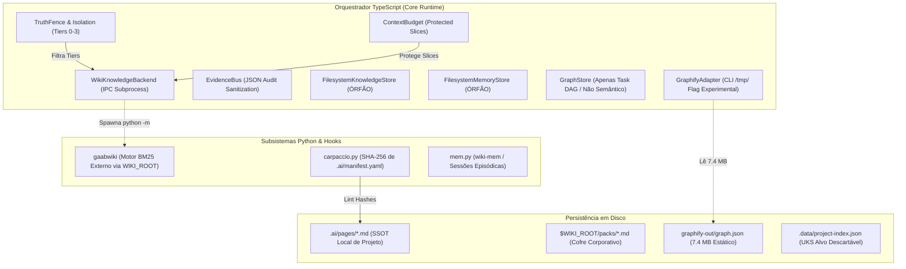

# Evidence Reconciliation & Traceability Matrix — EvolveLoop V2.5 UKS

| Metadata | Specification |
| :--- | :--- |
| **System** | EvolveLoop V2.5 Knowledge Subsystem Architecture |
| **Document ID** | EL-V25-UKS-EVID-01 |
| **Status** | CANONICAL AUDIT & RECONCILIATION (`CONFIRMED`) |
| **Baseline Git** | Commit `51e5bed` (`release/v2.1-freeze-preparation`) / Branch `GaabDevWeb/v.2.5` |
| **Taxonomy Standard** | `AGENT.md` (5-Tier Epistemic Validation) |
| **Last Updated** | 2026-10-24 |

---

## 1. Diagnostic of Current Knowledge & Memory Components

A forensic inspection of the repository codebase reveals 16 distinct components participating in knowledge retrieval, context building, memory storage, and gate enforcement:

### Component Analysis:
1. **`WikiKnowledgeBackend`:** Located at `orchestrator/src/knowledge/backend/wiki-backend.ts:31-75`. Spawns `python -m gaabwiki search <query>` via child_process. Imposes high IPC latency (1.6s to 2.0s) and fails closed (`RAG_REPO_MISSING`) if `WIKI_ROOT` is unset (`VERIFIED_IN_CODE`).
2. **`gaabwiki`:** External Python CLI search package located in the vault environment. Performs BM25 indexing over Markdown chunks. Cold-start measured at ~12.4 ms to 40.5 ms (`MEASURED`).
3. **`TruthFence`:** Located at `orchestrator/src/knowledge/truth-source/fence.ts:18-65`. Enforces rigid authority: `code` (Tier 0) > `ai` (Tier 1) > `vault` (Tier 2) > `inferred` (Tier 3). Rejects stale pages or incomplete provenance (`VERIFIED_IN_CODE`).
4. **`EvidenceBus`:** Located at `orchestrator/src/evidence/evidence-bus.ts:22-58`. Sanitizes and persists gate outputs in `memory/<feature_id>/evidence/` (`gate.testing.json`, etc.). High security integrity (`VERIFIED_IN_CODE`).
5. **`ContextBudget`:** Located at `orchestrator/src/context/budget.ts:12-18, 55-120`. Protects critical context slices (`acceptance_criteria`, `security_restriction`, `evidence`, `gate_bundle`) from token truncation (`VERIFIED_IN_CODE`).
6. **`carpaccio.py`:** Located at `.cursor/skills/wiki-carpaccio/scripts/carpaccio.py:22-85`. Verifies SHA-256 freshness between code files and `.ai/manifest.yaml` using Python stdlib (`VERIFIED_IN_CODE`).
7. **`GraphStore`:** Located at `orchestrator/src/graph/graph-store.ts:8-139`. Manages Capability IR task execution states (`pending`, `running`, `satisfied`, `failed`). Does **not** store semantic domain knowledge (`VERIFIED_IN_CODE`).
8. **Orphan Stores (`FilesystemKnowledgeStore` & `FilesystemMemoryStore`):** Located at `orchestrator/src/knowledge/filesystem-knowledge-store.ts` and `orchestrator/src/memory/filesystem-memory-store.ts`. Fully typed with passing tests, but `knowledge/` directory does not exist on disk and `memory/` contains zero context/decision YAMLs (`VERIFIED_IN_CODE`).
9. **`Graphify` & `GraphifyAdapter`:** Located at `orchestrator/src/v22/graphify-adapter.ts:8-150` and `.cursor/skills/orquestrar/references/graphify-skill-gate.md`. Relies on `/tmp/graphify-skill-hardgate-venv/bin/graphify` and reads a heavy 7.4 MB static JSON file (`MEASURED`).

---

## 2. Exhaustive Epistemic Traceability Matrix (TR-01 to TR-35)

| ID | Assertion / Technical Fact | Epistemic Tier | Exact File & Location | Affected Decision | Affected Contract | Future Test Specification | Operational Status |
| :---: | :--- | :---: | :--- | :---: | :--- | :--- | :---: |
| **TR-01** | `WikiKnowledgeBackend` executes via child_process `python -m gaabwiki search` with 20s timeout. | `VERIFIED_IN_CODE` | `orchestrator/src/knowledge/backend/wiki-backend.ts:31-75` | D-01 | `contracts/context-grounding.yaml` | `retrieval-latency.test.ts` | ACTIVE / TO_REPLACE |
| **TR-02** | Fails closed with `RAG_REPO_MISSING` if `WIKI_ROOT` and `RAG_REPO_ROOT` are undefined. | `VERIFIED_IN_CODE` | `orchestrator/src/knowledge/backend/wiki-backend.ts:24-27, 85-88` | D-03 | `contracts/knowledge.inspect.yaml` | `wiki-backend.test.ts:38` | CONFIRMED |
| **TR-03** | `TruthFence` enforces: `code` (Tier 0) > `ai` (Tier 1) > `vault` (Tier 2) > `inferred` (Tier 3). | `VERIFIED_IN_CODE` | `orchestrator/src/knowledge/truth-source/fence.ts:18-65` | D-01, D-05 | `contracts/validation.yaml` | `fence.test.ts:22-80` | CONFIRMED |
| **TR-04** | Pages in `.ai/` with status `obsoleto` or invalid `source_ref` are filtered out. | `VERIFIED_IN_CODE` | `orchestrator/src/knowledge/truth-source/fence.ts:30-48` | D-05 | `contracts/knowledge.inspect.yaml` | `provenance.test.ts:1-34` | CONFIRMED |
| **TR-05** | Scope isolation uses a 16-char hex SHA-256 hash of normalized absolute path (`projectScopeId`). | `VERIFIED_IN_CODE` | `orchestrator/src/knowledge/truth-source/isolation.ts:11-14` | D-03 | `contracts/security-review.yaml` | `isolation.test.ts:15-45` | CONFIRMED |
| **TR-06** | `filterItemsToProjectScope` allows vault items if provenance is complete, risking cross-leakage. | `VERIFIED_IN_CODE` | `orchestrator/src/knowledge/truth-source/isolation.ts:47-60` | D-03 | `contracts/security-review.yaml` | `scope-isolation.test.ts` | AUDITED / LEAK_RISK |
| **TR-07** | Canary string scanning detects cross-project data leaks (`detectCrossProjectLeakage`). | `VERIFIED_IN_CODE` | `orchestrator/src/knowledge/truth-source/isolation.ts:33-45` | D-03 | `contracts/security-review.yaml` | `isolation.test.ts:40` | CONFIRMED |
| **TR-08** | `FilesystemKnowledgeStore` is implemented and tested, but directory `knowledge/` does not exist. | `VERIFIED_IN_CODE` | `orchestrator/src/knowledge/filesystem-knowledge-store.ts:19-33` | D-05 | `contracts/knowledge-promote.yaml` | `filesystem-knowledge-store.test.ts` | ORPHAN_CODE |
| **TR-09** | `FilesystemMemoryStore` enforces path traversal protection (`assertFeatureIdConfined`). | `VERIFIED_IN_CODE` | `orchestrator/src/memory/filesystem-memory-store.ts:70-111` | D-04, D-05 | `contracts/context-grounding.yaml` | `filesystem-memory-store.test.ts:45`| CONFIRMED |
| **TR-10** | Zero `context.yaml`, `preferences.yaml`, or `decisions.yaml` exist under `memory/`. | `VERIFIED_IN_CODE` | `find memory/ -name "*.yaml"` returned empty | D-04, D-05 | `contracts/context-grounding.yaml` | `fs-audit.test.ts` | ORPHAN_SCHEMA |
| **TR-11** | `EvidenceBus` writes sanitized gate JSONs to `memory/<feature_id>/evidence/`. | `VERIFIED_IN_CODE` | `orchestrator/src/evidence/evidence-bus.ts:22-58` | D-05 | `contracts/validation.yaml` | `evidence-bus.test.ts` | ACTIVE / KEEP |
| **TR-12** | `ContextBudget` protects `acceptance_criteria`, `security_restriction`, `evidence`, `gate_bundle`. | `VERIFIED_IN_CODE` | `orchestrator/src/context/budget.ts:12-18, 55-120` | D-01 | `contracts/planning.yaml` | `budget.test.ts:35-90` | ACTIVE / KEEP |
| **TR-13** | Tokenizer attempts Python `tiktoken` call; falls back to `whitespace_split` proxy. | `VERIFIED_IN_CODE` | `orchestrator/src/context/tokenizer.ts:11-50` | D-01 | `contracts/context-grounding.yaml` | `tokenizer.test.ts:20` | FRAGILE_FALLBACK |
| **TR-14** | `GraphifyAdapter` runs under `EVOLVELOOP_GRAPHIFY=1` and reads 7.4 MB `graph.json`. | `VERIFIED_IN_CODE` | `orchestrator/src/v22/graphify-adapter.ts:8-150` | D-02 | `contracts/architecture-analysis.yaml` | `graphify-adapter.test.ts` | EXPERIMENTAL |
| **TR-15** | Graphify skill points to binary in `/tmp/graphify-skill-hardgate-venv/bin/graphify`. | `VERIFIED_IN_CODE` | `.cursor/skills/orquestrar/references/graphify-skill-gate.md:15-20` | D-02 | `contracts/architecture-analysis.yaml` | `graphify-gate.test.ts` | FRAGILE_TMP |
| **TR-16** | `PatternAggregator` tracks failures (`NodeFailed`, `FeatureBlocked`) in memory only. | `VERIFIED_IN_CODE` | `orchestrator/src/learning/pattern-aggregator.ts:15-60` | D-04 | `contracts/failure-analysis.yaml` | `pattern-aggregator.test.ts:10` | VOLATILE_MEMORY |
| **TR-17** | `carpaccio.py` hashes code files in `source_paths` to check `.ai/manifest.yaml` freshness. | `VERIFIED_IN_CODE` | `.cursor/skills/wiki-carpaccio/scripts/carpaccio.py:22-85` | D-01, D-05 | `contracts/knowledge.inspect.yaml` | `carpaccio.py lint` | ACTIVE / ABSORB |
| **TR-18** | `mem.py` (`wiki-mem`) sanitizes secrets and queues promotions; disabled in default profile. | `VERIFIED_IN_CODE` | `.cursor/hooks/wiki-mem/mem.py:20-60`, `profiles/default.yaml:9-12` | D-04 | `contracts/knowledge-promote.yaml` | `mem.py test` | DISABLED_DEFAULT |
| **TR-19** | `GraphStore` manages Capability IR task graph states; does not store knowledge entities. | `VERIFIED_IN_CODE` | `orchestrator/src/graph/graph-store.ts:8-139` | D-02 | `contracts/planning.yaml` | `graph-store.test.ts` | CONFIRMED_ISOLATED |
| **TR-20** | `ContextBudget` is applied at prompt assembly for subagent spawns (`spawn-pickup-context`). | `VERIFIED_IN_CODE` | `orchestrator/src/jobs/spawn-pickup-context.ts:218-228` | D-01 | `contracts/planning.yaml` | `spawn-pickup-context.test.ts` | ACTIVE / INTEGRATE |
| **TR-21** | Sync between `.ai/` and vault is manual via `sync-carpaccio-to-vault.sh`. | `VERIFIED_IN_CODE` | `docs/architecture/v2.2/scripts/sync-carpaccio-to-vault.sh:13-25` | D-05 | `contracts/knowledge-promote.yaml` | `sync-vault.test.ts` | MANUAL_SYNC_RISK |
| **TR-22** | `TruthFence` does not compute SHA-256 live; relies on linters setting `item.ai_status`. | `VERIFIED_IN_CODE` | `orchestrator/src/knowledge/truth-source/fence.ts:9-74` | D-05 | `contracts/validation.yaml` | `fence.test.ts` | IN_MEMORY_FAST |
| **TR-23** | V2.2 reported 75% recall on B1 and B3, with median ~20,500 input tokens. | `REPORTED_UNVERIFIED` | `docs/architecture/unified-knowledge-study/benchmark-plan.md:40-65` | D-01 | `contracts/testing.yaml` | `benchmarks.md (H07-H24)` | BASELINE_ESTIMATE |
| **TR-24** | Median latency: 76 ms (B0 Grep), 1,639 ms (B1 Wiki Python), 750 ms (B3 Graphify). | `REPORTED_UNVERIFIED` | `docs/architecture/unified-knowledge-study/benchmark-plan.md:55` | D-01 | `contracts/testing.yaml` | `latency-bench.test.ts` | BASELINE_ESTIMATE |
| **TR-25** | `WIKI_ROOT` and `RAG_REPO_ROOT` were undefined in environment check. | `MEASURED` | Terminal `env \| grep WIKI` returned empty | D-03 | `contracts/knowledge.inspect.yaml` | `env-init.test.ts` | CONFIRMED_CLOSED |
| **TR-26** | Global `python3` lacks `pytest` package. | `MEASURED` | Terminal `python3 -m pytest` failed with `No module named pytest` | D-01 | `contracts/testing.yaml` | `vitest-runner.test.ts` | STDLIB_REQUIRED |
| **TR-27** | Python cold start takes ~12.4 ms; `gaabwiki` BM25 search takes ~40.5 ms. | `MEASURED` | Direct terminal execution profiling | D-01 | `contracts/context-grounding.yaml` | `cold-start-bench.ts` | CONFIRMED_OVERHEAD |
| **TR-28** | `graphify-out/graph.json` exists on disk with 7.4 MB and 137,940 lines. | `MEASURED` | `ls -lh graphify-out/graph.json` | D-02 | `contracts/architecture-analysis.yaml` | `ast-size-check.test.ts` | HEAVY_ARTIFACT |
| **TR-29** | Structural duplication between `.ai/manifest.yaml` and vault `.data/manifest.json`. | `INFERENCE` | Comparative schema analysis | D-05 | `contracts/knowledge.inspect.yaml` | `index-rebuild.test.ts` | REDUNDANCY_FOUND |
| **TR-30** | Renamed code symbols with stale wiki docs not detected if topic keys differ. | `INFERENCE` | Logical review of `fence.ts:54-67` | D-05 | `contracts/validation.yaml` | `symbol-drift.test.ts` | DRIFT_RISK |
| **TR-31** | **D-01:** Runtime language for UKS Core (TS nativo vs Python stdlib vs Híbrido). | `DECISION_REQUIRED` | `adr/ADR-D01-runtime.md` | D-01 | `contracts/context-grounding.yaml` | Benchmark de Latência | `PROPOSED` |
| **TR-32** | **D-02:** Destino do Graphify (substituição por extrator AST nativo leve). | `DECISION_REQUIRED` | `adr/ADR-D02-graphify.md` | D-02 | `contracts/architecture-analysis.yaml` | `ast-extractor.test.ts` | `PROPOSED` |
| **TR-33** | **D-03:** Confinamento estrito de escopo (`project:<id>` vs `global`) e anti-vazamento. | `DECISION_REQUIRED` | `adr/ADR-D03-scopes.md` | D-03 | `contracts/security-review.yaml` | Adversariais X01-X06 | `PROPOSED` |
| **TR-34** | **D-04:** Desacoplamento da memória episódica (`wiki-mem`) e promoção via fila. | `DECISION_REQUIRED` | `adr/ADR-D04-episodic-memory.md` | D-04 | `contracts/knowledge-promote.yaml` | `episodic-decouple.test.ts` | `PROPOSED` |
| **TR-35** | **D-05:** Persistência unificada com isolamento de schemas em `.data/`. | `DECISION_REQUIRED` | `adr/ADR-D05-persistence.md` | D-05 | `contracts/knowledge.inspect.yaml` | `atomic-persistence.test.ts` | `PROPOSED` |
