# Plano de Migração em 10 Fases: UKS Core — EvolveLoop V2.5

| Metadata | Specification |
| :--- | :--- |
| **System** | EvolveLoop V2.5 Unified Knowledge System (UKS Core) |
| **Document ID** | EL-V25-UKS-MIGR-11 |
| **Status** | CANONICAL MIGRATION ROADMAP (`PROPOSED`) |
| **Rollback Strategy** | Deterministic Rollback via Environment Flags |
| **Last Updated** | 2026-10-24 |

---

## 1. Princípios de Migração e Garantias de Não-Regressão

A migração do ecossistema heterogêneo V2.2 para o **UKS Core V2.5** é executada de forma estritamente incremental ao longo de **10 fases sequenciais**, respeitando três garantias operacionais fundamentais:
1. **Contratos Externos Congelados:** A interface de alto nível `KnowledgeBackend.search(query)` e as convenções da IDE Cursor (`/evolve`, `/wiki`) permanecem 100% retrocompatíveis.
2. **Zero Regressão de Gates:** Nenhuma fase de migração pode enfraquecer ou desativar os portões de validação existentes (`TruthFence`, `EvidenceBus`, `ContextBudget`).
3. **Mecanismo Instantâneo de Reversão (*Feature Flag Rollback*):** O orquestrador mantém suporte ao fallback para os adaptadores legados caso qualquer anomalia seja detectada.

---

## 2. As 10 Fases do Roteiro de Migração

```mermaid
flowchart LR
    F1[Fase 1: Baseline Freeze] --> F2[Fase 2: Storage Core & .data]
    F2 --> F3[Fase 3: Native AST Extractor]
    F3 --> F4[Fase 4: Native BM25 Engine]
    F4 --> F5[Fase 5: TruthFence & Scopes]
    F5 --> F6[Fase 6: RRF Hybrid Fusion]
    F6 --> F7[Fase 7: ContextPack & Budget]
    F7 --> F8[Fase 8: 24-Task Benchmark]
    F8 --> F9[Fase 9: Shadow Mode]
    F9 --> F10[Fase 10: Cutover & Deprecation]
```



---

### Fase 1: Descoberta, Congelamento de Baseline e Ambientes
- **Objetivo:** Estabelecer a linha de base imutável e métricas de referência do V2.2.
- **Entrada:** Checkout atual no commit `51e5bed`.
- **Atividades:** Gravação do baseline de tokens, latência e acurácia nas 24 tarefas de teste.
- **Critério de Saída:** Relatório `p0-baseline-report.json` congelado em `.evidence/v2.5/benchmarks/`.

### Fase 2: Storage Core e Fundação de Persistência (`.data/`)
- **Objetivo:** Criar o módulo unificado de I/O em disco com escrita atômica e higienização.
- **Entrada:** Especificação do ADR-D05.
- **Atividades:** Implementação de `storage-core.ts` (`writeAtomicJson`, `assertPathConfined`); inicialização da pasta `.data/`.
- **Critério de Saída:** Testes unitários de concorrência e escrita atômica passando com 100% de sucesso.

### Fase 3: Absorção do Extrator Sintático de AST Nativo
- **Objetivo:** Substituir a dependência do executável volátil em `/tmp` pelo parser interno.
- **Entrada:** Especificação do ADR-D02.
- **Atividades:** Criação do analisador sintático in-process para extrair classes, interfaces e imports; gravação das arestas em `.data/project-index.json`.
- **Critério de Saída:** Extração completa do grafo de tipos do monorepo gerando arquivo $< 500$ KB em $< 2$ segundos.

### Fase 4: Porting do Motor BM25 e Indexação Incremental
- **Objetivo:** Trazer a tokenização e cálculo BM25 para TypeScript nativo sem subprocessos.
- **Entrada:** Lógica matemática de `gaabwiki`.
- **Atividades:** Implementação de tokenizador determinístico com stemmer leve e cálculo de IDF in-memory.
- **Critério de Saída:** Tempo de busca léxica inferior a 15 ms para consultas típicas.

### Fase 5: Integração do TruthFence e Confinamento de Escopos
- **Objetivo:** Unificar a filtragem por tiers e proteção contra vazamento entre projetos.
- **Entrada:** Especificação do ADR-D03 e código existente em `fence.ts` e `isolation.ts`.
- **Atividades:** Acoplamento do `TruthFence` diretamente no pipeline de ranking; ativação do isolamento padrão `project:<id>`.
- **Critério de Saída:** 100% de aprovação na suíte de testes adversariais X01 a X06 (zero vazamento de canários).

### Fase 6: Fusão Híbrida RRF e Degradação Graciosa
- **Objetivo:** Combinar hits de BM25, AST e Vetores opcionais com constante $k=60$.
- **Entrada:** Especificação da fórmula RRF do UKS Core.
- **Atividades:** Implementação do combinador de scores e do flag `degraded_mode: true` para operação sem Ollama.
- **Critério de Saída:** Testes de ordenação e fail-closed executando perfeitamente offline.

### Fase 7: Montagem de Context Pack e Integração ao ContextBudget
- **Objetivo:** Empacotar resultados em envelope cirúrgico com proteção de fatias críticas.
- **Entrada:** `ContextBudget` em `budget.ts` e Hipótese H-01.
- **Atividades:** Formatação do markdown de resposta com referências de linha (`file:line-range`); injeção no prompt de spawn.
- **Critério de Saída:** Context Pack montado com $< 2.000$ tokens contendo 100% dos símbolos solicitados.

### Fase 8: Execução do Benchmark Experimental de 24 Tarefas
- **Objetivo:** Validar os critérios inegociáveis AC-01 a AC-06 contra o dataset congelado.
- **Entrada:** Suíte de benchmark `benchmarks.md` e braços B0, B1, B3 e B_UKS.
- **Atividades:** Execução instrumentada das 24 tarefas com medição de tokens e latência.
- **Critério de Saída:** Cumprimento simultâneo de AC-01 a AC-06; geração de `uks_validation_results.json`.

### Fase 9: Modo Sombra (*Shadow Mode*) nos Ciclos `/evolve`
- **Objetivo:** Executar o UKS em paralelo com o backend legado em tarefas reais sem alterar a resposta final.
- **Entrada:** Flag `EVOLVELOOP_UKS_SHADOW=1`.
- **Atividades:** O orquestrador dispara ambos os motores, loga divergências de hits e mede a latência comparativa no tráfego real.
- **Critério de Saída:** 50 ciclos reais concluídos sem divergência de regras críticas ou aumento de latência.

### Fase 10: Cutover Definitivo e Desativação dos Silos Legados
- **Objetivo:** Promover o UKS Core para backend padrão e arquivar os componentes órfãos.
- **Entrada:** Aprovação formal do Setup Architect e relatório da Fase 9.
- **Atividades:** Alterar o provider padrão em `KnowledgeBackendFactory`; formalizar a depreciação de `FilesystemKnowledgeStore`, `FilesystemMemoryStore` e do venv `/tmp` do Graphify.
- **Critério de Saída:** Limpeza de código morto e publicação da versão V2.5.

---

## 3. Estratégia de Rollback e Gatilhos de Aborto

Se durante qualquer fase após a Fase 7 ocorrer um dos seguintes eventos:
- **Gatilho de Aborto 1:** Vazamento de escopo detectado em runtime ($\text{LeakageRate} > 0.00\%$).
- **Gatilho de Aborto 2:** Latência p95 superior a 500 ms de forma sustentada.
- **Gatilho de Aborto 3:** Aumento de erros de compilação por snippets truncados indevidamente.

### Procedimento Imediato de Reversão:
1. Exportar variável de ambiente de contingência:
   ```bash
   export EVOLVELOOP_UKS_DISABLED=1
   ```
2. O `KnowledgeBackendFactory` reverte automaticamente para o `WikiKnowledgeBackend` legado.
3. Isolar o log de falha em `.evidence/v2.5/postmortems/` para auditoria do Codebase Archaeologist.
